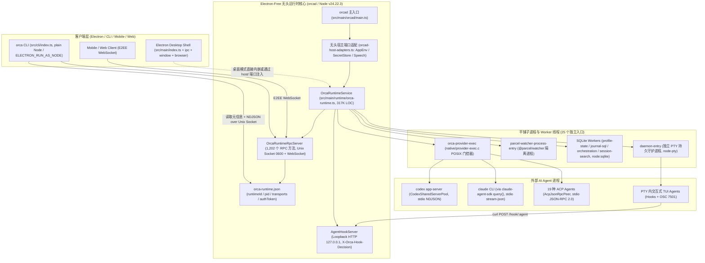
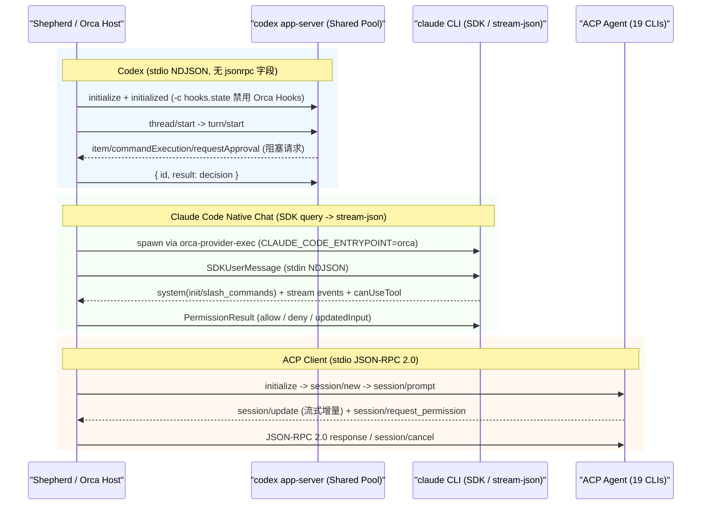

# 01 — `stablyai/orca` 上游代码审计报告

> **审计对象**：`https://github.com/stablyai/orca`（本地只读参考快照 `/tmp/shepherd-orca-ref`；该路径在临时目录，重启或清理后会丢失，复现方式见 §7.1）
> **修订状态**：评审修订版 v2（2026-11-26）。正文审计结论未变；新增 §7「评审补充查证」，并在涉及 Claude 协议参考、ACP 适配器依赖与体量估算的几处加了「更正（v2）」标注。
> **审计基线**：Commit `284bf8425a0a518225c81becdaf0023d52fa5d1e`（`package.json` 版本 `1.4.214`，锁定 `Node v24.22.3` / `Electron 45.4.1`）
> **审计目标**：为 **Shepherd**（轻量裁剪版 macOS Native 多 AI 编程代理编排应用，本期忽略 Magpie 模型网关）提供面向代码实证的合规底线、Electron 解耦评估、Agent 协议细节、Worktree/存储/Skill 实况以及模块级裁剪清点表。
> **事实分级说明**：本文严格区分 **`[已查证]`**（直接来自上游仓库源码、构建脚本或官方文档）与 **`[推断/评估]`**（基于代码事实推演出的工程工作量、合规风险或行业经验判断）。

---

## 核心执行摘要（供架构师与产品规划师直接对齐）

1. **License 与合规结论 `[已查证]`**：
   - `stablyai/orca` 主仓库为 **MIT License**（`Copyright (c) 2026 Lovecast Inc.`），允许自由商用、裁剪、闭源或改名（Shepherd）发布。
   - **最大隐藏合规红线**：Orca 的 Claude Native Chat 运行时直接依赖 **`@anthropic-ai/claude-agent-sdk`（`0.3.330`）**，该包**非开源协议**，受 **Anthropic Commercial Terms of Service** 约束（对面向第三方用户的商业软件使用消费级 OAuth vs API Key 存在条款限制）。
2. **Electron 解耦真相（重大实证发现）`[已查证]`**：
   - **上游 Orca 已经完成了后端与 Electron 的彻底解耦**！仓库内置纯 Node.js 24 无头守护进程 **`orcad`**（`src/main/orcad/main.ts`），并通过 CI 零耦合门禁 `check-runtime-electron-ratchet.mjs` 与 Rollup 插件 `plain-node-entry-guard.ts` 强制确保 `orcad`、`orca-runtime`、`daemon-entry`、CLI 以及全部结构化对话车道（`native-chat`、`codex`、`claude`、`acp`）的 **`electron` 导入基线严格为 0**。
   - **已彻底移除 `better-sqlite3`**：Orca 全量使用 **Node.js 24 内置 `node:sqlite`（`DatabaseSync`）**，无 SQLite 原生编译依赖；但仍保留 **`node-pty`**、`@parcel/watcher`、`native/provider-exec`（C）、`ripgrep` 等原生模块。
   - **但直接拿 `orcad` 做 Shepherd Sidecar 存在极高的「包体税」与「裁剪税」`[推断/评估]`**：`orcad` 单文件 JS 产物已达 ~11 MB，附带 25 个平铺子 Worker/进程入口，且必须打包锁定版 **Node v24.22.3（`darwin-arm64` 仅单个二进制即 122.59 MB）**；更关键的是 `src/main/runtime`（31.7 万行）与 `1,202` 个 RPC 方法深度交织了 Bots / Browser / Mobile Relay / Linear / Jira / Orchestration，**不裁剪则背负重型全家桶，强行裁剪的维护成本接近重写**。
3. **Agent 协议实况 `[已查证]`**：
   - **Codex**：`codex app-server` 走 stdio NDJSON（类 JSON-RPC 但不带 `"jsonrpc":"2.0"`），带共享进程池（`CodexSharedServerPool`）；Terminal 模式依赖 `~/.codex/hooks.json` + `hooks/list`/`config/batchWrite` 写入 Codex 计算的 `trusted_hash`；Native Chat 模式则用 `-c hooks.state={...enabled=false}` 显式关闭 Orca Hooks。
   - **Claude Code**：Native Chat **同时**涉及 SDK 与 `stream-json`——通过 `@anthropic-ai/claude-agent-sdk` 的 `query()` 拉起用户本机 `claude` CLI（排除 SDK 自带的 95MB 平台二进制），走 stdio `stream-json` + `canUseTool`/`onUserDialog` 控制协议，并注入 `CLAUDE_CODE_ENTRYPOINT=orca`。Terminal 模式在 **macOS 上并非二进制而是 POSIX Shell + `curl` 脚本**（`orca-agent-hook.exe` 仅限 Windows），通过 `X-Orca-Hook-Decision: claude-pre-tool-use-v1` 在 `PreToolUse` 上实现最多 8s 同步阻塞决策，辅以 **OSC 7501** 兜底。
   - **ACP Client**：`src/main/acp/*` 实现标准 **JSON-RPC 2.0 over stdio NDJSON**，已注册 **19 个 Agent**（`grok`、`opencode`、`opencode2`、`omp`、`antigravity`、`copilot`、`kimi`、`cursor`、`hermes`、`kiro`、`goose`、`auggie`、`kilo`、`mimo`、`droid`、`qwen-code`、`cline`、`devin`、`codebuddy`）。
4. **代码库体量全景 `[已查证]`**：全仓非测试源码约 **370 万行（~3.7M LOC）**，其中 `src/main` 140.6 万行、`src/renderer` 139.8 万行、`src/shared` 37.3 万行；Shepherd MVP 真正需要的核心能力仅对应其中不到 **5%** 的协议与领域逻辑。

---

## 1. License 与合规审计

### 1.1 上游主协议与版权归属 `[已查证]`

- **根目录许可证**：`LICENSE` 为标准 **MIT License**。
- **版权声明**：`Copyright (c) 2026 Lovecast Inc.`（仓库 `package.json` 作者标注 `stablyai`，主页 `https://github.com/stablyai/orca`）。
- **核心授权范围**：允许无限制复制、修改、合并、发布、再分发、再许可及商业销售（包括大幅裁剪与闭源分发），前提是在副本与实质性衍生部分中保留上述版权声明与 MIT 许可声明。

### 1.2 关键子包、原生组件与三方依赖合规矩阵 `[已查证]`

| 组件 / 依赖 | 所在路径 / 包名 | 许可协议 | 风险等级 | 对 Shepherd 的合规影响 |
| :--- | :--- | :--- | :---: | :--- |
| **Orca 主代码与原生辅助工具** | `src/*`, `native/*`（含 `provider-exec.c`, `journal-file-lock`, `*-macos/*.swift`, `windows-agent-hook`） | **MIT** (`Lovecast Inc.`) | 低 | 直接复用代码或改造子模块须保留 MIT 版权头；纯干净室重写仅参考协议则无代码版权传染 |
| **Claude Agent SDK** | `@anthropic-ai/claude-agent-sdk` (`0.3.330`) | **Anthropic Commercial Terms of Service**（非开源） | **高** | **合规红线**：不得视为 MIT 依赖；Orca 已在 `pnpm-workspace.yaml` 通过 `ignoredOptionalDependencies` 剔除其 ~95 MB/平台内置 CLI 二进制，但仍捆绑其 JS 运行时。Shepherd 若面向外部用户分发，建议避免内置该闭源 SDK，改用纯协议对接用户本机 `claude` CLI `[推断/评估]`。**更正（v2）**：ACP 适配层 `@agentclientprotocol/claude-agent-acp` 自身依赖该 SDK（见 §7.2），不能当作绕开 SDK 的替代 |
| **终端 PTY 引擎** | `node-pty` (`^1.1.0` + `config/patches/node-pty@1.1.0.patch`) | **MIT** | 低 | 仅路线 A（Node Sidecar）需要；路线 B 在 macOS 可直接调用 POSIX `openpty`/`forkpty` 或 `SwiftTerm`/`libghostty`（均为 MIT） |
| **终端渲染 / 无头缓冲** | `@xterm/xterm`, `@xterm/headless`, `@xterm/addon-*`（6 个本地补丁） | **MIT** | 低 | Shepherd 原生 macOS UI 彻底抛弃 xterm.js |
| **文件监控** | `@parcel/watcher` (`^2.5.6`) | **MIT** | 低 | 路线 B 在 macOS 直接使用系统原生 `FSEvents` / `DispatchSource`，零三方依赖 |
| **代码搜索二进制** | `@vscode/ripgrep-universal` + `resources/licenses/ripgrep/*` | **MIT / Unlicense**（静态链接依赖含 `jemalloc`、`llvm-libunwind`、`SLJIT` 及 Rust crates 声明） | 中 | 若随包分发 `rg` 二进制，必须随附 `resources/licenses/ripgrep/` 下全部声明文件 |
| **其他核心运行依赖** | `ws`, `ssh2`, `yaml`, `zod`, `jsonc-parser`, `smol-toml`, `proper-lockfile`, `tweetnacl`, `stream-json` | **MIT / ISC / Apache-2.0 / Unlicense** | 低 | 常规宽松开源协议；若裁剪 SSH/Mobile/Relay，可剔除 `ssh2`、`tweetnacl`、`agent-browser` 等 |
| **字体与前端组件** | `docs/site/THIRD_PARTY_NOTICES.md`（Geist Font）；`resources/licenses/shadcn/LICENSE-MIT` | **SIL OFL 1.1** / **MIT** | 低 | SIL OFL 1.1 禁止单独售卖字体且修改版不可沿用保留字名；Shepherd 用 macOS 原生 SF Pro / SF Mono 可彻底剔除 |
| **本地语音识别（可选）** | `transcribe-cpp` / `@transcribe-cpp/darwin-arm64-metal` | **MIT**（基于 whisper.cpp） | 低 | Shepherd MVP 裁剪语音功能，不引入 |

### 1.3 二次开发 / 裁剪 / 改名发布（品牌 Shepherd）合规清单

1. **商标与品牌隔离（必须）**：MIT 协议**不授予商标许可**。发布为 **Shepherd** 时必须全面清除：
   - 所有图标与品牌资源（`resources/app-icons`, `resources/icon*.png`, `resources/icon-source`）；
   - 运行时自报身份标识：Codex 握手 `clientInfo: { name: 'orca_desktop', title: 'Orca' }`（`src/main/codex/app-server/codex-app-server-handshake.ts`）、Claude 环境变量 `CLAUDE_CODE_ENTRYPOINT=orca`（`src/shared/agent-launch/startup/claude-chat-entrypoint.ts`）、Socket/数据目录与环境变量前缀 `ORCA_*`（仅配置文件读取层向下兼容 `orca.yaml`）；
   - macOS Bundle Identifier、App 名称、CLI 命令名（`shepherd` 而非 `orca`）及 Homebrew Cask 定义。
2. **版权与声明保留（若复用源码）**：在 Shepherd 仓库根目录及 macOS App `About -> Licenses` 中包含 `THIRD_PARTY_NOTICES.md`，列出 `Copyright (c) 2026 Lovecast Inc.` 的 MIT 原文以及实际随包分发的原生工具（如 `ripgrep`、`libghostty`/`SwiftTerm` 等）许可声明。
3. **遥测与云服务剥离（必须）**：`electron.vite.config.ts` 中通过编译期宏 `ORCA_POSTHOG_WRITE_KEY`、`ORCA_DIAGNOSTICS_TOKEN_URL`、`ORCA_BUILD_IDENTITY` 控制遥测开关（外部构建默认为 `null`），但仍应彻底移除 `posthog-node`、`connector-cloud`、`orca-account` 与 `cloud/` 目录，杜绝任何指向 Stably/Lovecast 后端的默认域名请求。
4. **SDK 条款审查（必须）**：若产品定位为公开发布的第三方商业或开源 macOS 客户端，**强烈建议不打包 `@anthropic-ai/claude-agent-sdk`**，并在文档中明确 BYOA（Bring Your Own Agent）模式仅编排用户本地合法安装并登录的 CLI 工具。

---

## 2. 核心架构与 Electron 解耦可行性

### 2.1 仓库真实目录规模 `[已查证]`

| 顶层目录 | 非测试文件数 | 非测试代码行数（LOC） | 角色说明 |
| :--- | ---: | ---: | :--- |
| `src/main` | 11,389 | **1,405,699** | 后端运行时、守护进程、Agent 协议适配、持久化、Electron 桌面外壳（共 160+ 子目录） |
| `src/renderer` | 11,387 | **1,398,401** | React 19 + Tailwind + Monaco + xterm.js + Tiptap + 嵌入式浏览器 UI |
| `src/shared` | 3,956 | **373,230** | 前后端/CLI/移动端共享契约（含 `rpc-contract`、`remote-runtime`、`native-chat`、`worktree`） |
| `src/cli` | 524 | **68,299** | `orca` CLI 入口（含 `orca serve`、`worktree`、`agent`、`orchestration` 等子命令） |
| `src/preload` | 236 | **20,083** | Electron Preload IPC 桥接 |
| `src/packages/process-host` | 29 | **2,924** | `@orca/process-host` 跨平台子进程拉起、超时取消、POSIX 进程组/Windows Job 树级清理 |
| `src/wsl-guest` | 52 | **6,834** | Windows WSL 客体中继脚本 |
| `mobile` | 3,134 | **365,199** | React Native / Expo 移动端伴侣应用 |
| `cloud` | 291 | **52,658** | 云端中继、配对与账号服务 |
| `native` | 62 | **13,671** | C / Swift / Obj-C / Rust / C++ 平台原生辅助二进制与 N-API 插件 |
| **合计** | **31,060** | **3,706,998** | **重型跨平台多端 IDE 平台** |

### 2.2 真实进程拓扑与模块架构图 `[已查证]`



### 2.3 重点核查：Orca 后端能否脱离 Electron 运行？`[已查证]`

**结论：完全可以，且上游已经用工程化的双层 CI 门禁将其固化为「零 Electron 导入」架构。**

1. **静态全图零耦合门禁（`check-runtime-electron-ratchet.mjs`）**：
   - 使用 esbuild 从 `src/main/runtime/orca-runtime.ts`、`src/main/runtime/rpc/server/runtime-rpc.ts`、`src/main/orcad/main.ts`、`src/cli/index.ts` 及 11 条结构化对话车道（`backend`、`native-chat`、`claude`、`codex`、`acp`、`provider-process`、`jsonl-rpc`、`shared`、`@orca/process-host`、`runtime/structured-*`、`pi/rpc-*`）出发做全量依赖图构建，**任何可达文件导入 `electron` 或 `electron/*` 即 CI 失败（当前基线 = 0）**。
2. **打包期与运行时冒烟双检（`plain-node-entry-guard.ts` & `build-orcad.mjs`）**：
   - `electron.vite.config.ts` 挂载 `createPlainNodeEntryGuardPlugin()`，扫描 `daemon-entry`、`backend-entry`、`parcel-watcher-process-entry`、`utility-worker-host-entry` 等全部 plain-Node / worker-thread 入口的可达产物 chunk，禁用 `require("electron")`，并在构建结束时直接用纯 `node` 执行 `daemon-entry.js` 验证无 `MODULE_NOT_FOUND`。
   - `build-orcad.mjs` 在构建独立服务端 `orcad` 时同样检查 metafile 零 `electron` 导入，并用纯 Node 运行 `--orcad-smoke-load-check`、`--orcad-structured-provider-load-check` 及各 SQLite/Watcher 子进程冒烟测试。
3. **Electron 耦合真实分布统计（全仓 `src/main` 非测试文件精确扫描）**：
   - **重度耦合（纯桌面外壳，Shepherd 全砍）**：`src/main/ipc`（261 处）、`src/main/browser`（199 处）、`src/main/window`（59 处）、`src/main/startup`（49 处）、`src/main/updater`（32 处）、`src/main/plugins`（20 处）、`src/main/host`（16 处，Electron 端口实现层，负责把 `app`、`safeStorage`、`BrowserWindow`、`Notification`、`powerMonitor`、`net`/`session` 注入核心层）。
   - **零耦合（可直接脱离 Electron 运行）**：`src/main/orcad`、`src/main/runtime`、`src/main/backend`、`src/main/native-chat`、`src/main/codex`、`src/main/claude`、`src/main/acp`、`src/main/git`、`src/main/agent-hooks`、`src/main/sqlite`、`src/shared`、`src/cli` 全部为 **0 处** `electron` 导入。
   - **极少数未触达边缘文件**：`src/main/daemon/permissions/daemon-folder-access-reset.ts`（1 处）、`src/main/workspaces/catalog/repo-maintenance-idle-gate.ts`（1 处）、`src/main/persistence/.../profile-state-startup-recovery-dialog.ts`（1 处）等，均仅被桌面端入口调用，不在 `orcad` 可达图中。
4. **`orcad` 宿主端口替换机制（`src/main/orcad/host-runtime/orcad-host-adapters.ts`）**：
   - 仅靠 68 行代码即替换了全部 Electron 运行时设施：`setAppEnvironment(createNodeAppEnvironment())`、`setSecretStore(createOrcadSecretStore())`（基于本地文件密封/密钥管理替代 Electron `safeStorage`）、`setSpeechServiceFactories(...)`。
5. **`orca serve` 与 `orca-runtime.json` 启动发现机制**：
   - `orca serve`（`src/cli/runtime/serve/startup/serve-orcad-launch.ts`）在已打包的 macOS 客户端上默认仍优先使用 Electron（原因仅在于 `orcad` 不包含应用自更新器）；但在无桌面会话（SSH）或显式指定 `ORCA_SERVE_RUNTIME=orcad` 时直接启动纯 Node 24 的 `orcad`。
   - 运行时启动后通过 `UnixSocketTransport`（NDJSON、单帧上限 1 MB、最大 32 连接、文件权限 `0600`、30s 空闲超时、10s keepalive）监听本地 Socket，并可选启动 WebSocket（默认绑定 loopback，配对外部设备后才放开监听），随后写入 `<userData>/orca-runtime.json`（含 `runtimeId`, `pid`, `transports[]`, `authToken`, `startedAt`）并轮询守护该文件所有权，自动回收崩溃残留的僵尸元数据。

### 2.4 原生模块与「解耦 vs 裁剪」的真实工程代价 `[已查证 + 推断/评估]`

虽然 `orcad` 脱离 Electron 成本为 **0**，但**作为 Shepherd 的 Sidecar 复用存在四项极现实的硬代价**：

| 维度 | 查证事实 | 对 Shepherd（路线 A Sidecar）的实际影响 `[推断/评估]` |
| :--- | :--- | :--- |
| **Node 运行时绑定** | `src/shared/node-runtime/node-runtime-pin.ts` 锁死 `Node v24.22.3`（N-API 10）；`darwin-arm64` 单个可执行文件 **122.59 MB**，`darwin-x64` **125.76 MB**（通用包双架构即 ~248 MB） | 违背“轻量 macOS 原生应用”包体目标（纯 Swift 应用通常 10-30 MB）。**口径注（v2）**：122.59 MB 是未压缩二进制；官方发行包压缩后为 tar.gz 50.6 MB / tar.xz 26.2 MB（§7.2），与压缩后的 `.dmg` 对比时应使用压缩口径 |
| **原生模块现状** | **已无 `better-sqlite3`**（改用 Node 24 内置 `node:sqlite`）；但 `orcad` 仍强依赖 `node-pty`（含 `pty.node` + `spawn-helper` + 本地补丁）、`@parcel/watcher`（`watcher.node`）、`orca-provider-exec`（C 编译）、`ripgrep` | macOS 公证（Notarization）须对 Node、`.node` 动态库、C 二进制逐一签 Hardened Runtime + Entitlements，ABI 与 Node 版本强耦合 |
| **运行时体量与多进程开销** | `orcad` 单 JS bundle 约 **11 MB**（`orcad-entry-build.mjs` 注释指出含非 ASCII 时 V8 堆直接翻倍至 ~21 MB），旁挂 **25 个独立打包的子进程/Worker 入口**（`daemon-entry`、watcher、多个 SQLite worker、session-scanner 等） | 冷启动需启动主 Node 进程 + 多个子 Node/Worker 进程，常驻空闲内存易达 **250-500 MB**，难以达到原生态轻快体感 |
| **业务逻辑高度捆绑** | `OrcaRuntimeService` 继承链 + `activateBackendRuntime`（`src/main/backend/core-runtime-activation.ts`）将 1,202 个 RPC 全部装配，其中 `bots`(143)、`browser`(127)、`orchestration`(65)、`github`(54)、`google`(44)、`linear`(43)、`jira`(28)、`plugins`(27)、`gitlab`(22)、`emulator`(21) 占绝大多数 | **「能直接跑」≠「能轻松裁剪」**。直接跑则携带 90% 冗余子系统与攻击面；若要从 `OrcaRuntimeService` 剥离上述模块，预计需拆解数万行跨模块调用与继承关系，且彻底失去同步上游更新的能力 |

### 2.5 RPC 通信协议实况 `[已查证]`

- **并非标准 JSON-RPC 2.0**：`src/main/runtime/rpc/core.ts` 定义了 Orca 自定义 NDJSON 协议：
  - 请求信封：`{ id: string, authToken: string, method: string, params?: unknown, orchestrationContractVersion?, ... }`
  - 成功响应：`{ id: string, ok: true, result: unknown, streaming?: true, _meta: { runtimeId: string } }`
  - 失败响应：`{ id: string, ok: false, error: { code: string, message: string, data?: unknown }, _meta: { runtimeId: string } }`
- **参数校验与契约规模**：全部参数由 `zod`（v4）校验，生成目录 `src/shared/rpc-contract/rpc-params-catalog.generated.ts` 共登记 **1,202 个 RPC 方法**（Top 命名空间：`bots` 143、`browser` 127、`orchestration` 65、`agentSession` 56、`github` 54、`git` 49、`terminal` 47、`accounts` 47、`google` 44、`linear` 43、`files` 42、`worktree` 28、`jira` 28、`plugins` 27、`repo` 24）。
- **流式与二进制通道**：支持 `defineStreamingMethod` 长连接流式推送；终端二进制帧仅走 E2EE WebSocket，本地 Unix Socket 走纯文本 NDJSON。

---

## 3. Agent 接入协议实况

Orca 的 Native Chat 结构化会话在运行时抽象了 **4 种统一传输通道（`handleTransport`）** `[已查证]`：
1. **Codex**：`codex`（`codex app-server` stdio NDJSON）
2. **Claude Code**：`claude`（`@anthropic-ai/claude-agent-sdk` + `claude` CLI stdio `stream-json`）
3. **ACP 通用协议**：`acp`（19 种 Agent，标准 JSON-RPC 2.0 over stdio NDJSON）
4. **Pi 专用协议**：`jsonl-rpc`（`src/main/pi/`）

### 3.1 Codex 接入实况（`src/main/codex/*`，52,089 LOC）`[已查证]`

1. **拉起、门控与共享进程池**：
   - 通过 `@orca/process-host` + `native/provider-exec/provider-exec.c`（POSIX 独立 session + fd 4/5/6/7 门控与父亡清理）拉起 `codex app-server`。
   - 引入 **`CodexSharedServerPool`**（`src/main/codex/app-server/shared-servers/codex-shared-server-pool.ts`）：按 `launch` 参数、`skillRoots`、`codexVersion` 生成共享 Key，**多个会话租用（Lease）同一个 `codex app-server` 进程**；空闲 60 秒（`IDLE_SERVER_STOP_MS = 60_000`）自动回收，内置内存上限巡检（`CodexSharedServerMemoryCeiling`）与卡死检测（`codex-shared-server-hang-watch.ts`）。
2. **通信协议与握手**：
   - 走 stdio NDJSON，帧结构为 `{ id, method, params }` / `{ method, params }` / `{ id, result }` / `{ id, error }`（**省略 `"jsonrpc": "2.0"` 字段**）。
   - 握手序列（`codex-app-server-handshake.ts`）：先发请求 `initialize`（声明 `clientInfo`、`capabilities.experimentalApi: true`、`requestAttestation: false`、`extensions: { 'openai/standard-form-input': {} }`），收到响应后发 `initialized` 通知。
3. **权限审批与交互表单**：
   - 权限策略通过启动参数 `--ask-for-approval` / `--dangerously-bypass-approvals-and-sandbox` 及线程字段 `approvalPolicy`（`on-request` | `never`）+ `approvalsReviewer`（`user` | `auto_review`）映射，审批执行权归属 Provider 侧（`approvalEnforcement: 'provider'`）。
   - `app-server` 反向发起阻塞请求时，经 `CodexPromptRegistry` 与 `disposeCodexServerRequest`（`codex-server-request-disposition.ts`）统一分流：
     - `item/commandExecution/requestApproval` → 命令执行审批卡片
     - `item/fileChange/requestApproval` → 文件改动审批卡片
     - `item/tool/requestUserInput` → 用户问答卡片
     - `mcpServer/elicitation/request` → MCP 工具审批或标准表单卡片
     - 未支持/历史请求（`item/permissions/requestApproval`、`item/tool/call`、`applyPatchApproval`、`execCommandApproval`、`account/chatgptAuthTokens/refresh`、`attestation/generate`）均安全返回拒绝或错误码，防止 `app-server` 永久挂起。
4. **Hooks（`~/.codex/hooks.json`）与 Trust Hash 机制**：
   - Codex >= 0.129 引入了 Hook 信任哈希校验。Orca 在写入托管 Hook（备份原始文件为 `hooks.json.pre-orca`）后，启动一次短命 `codex app-server` 会话（`codex-app-server-client.ts`），依次执行 `hooks/list` 读取 Codex 计算出的 `currentHash`，再调用 `config/batchWrite` 将 `{ [key]: { trusted_hash: currentHash } }` 写入 `hooks.state` 并二次核验。
   - **Native Chat 显式禁用 Orca Hooks**：`codex-structured-orca-hooks-off.ts` 在启动结构化会话时动态读取 `hooks.json` 并拼接 `-c hooks.state={"<abs hooks.json>:..."={enabled=false}}`，避免 Native Chat 每步工具调用都多余 fork Hook 脚本并防止状态双报。
5. **身份标识与防误杀**：
   - `codex-structured-owner-identity.ts` 在握手前记录 `{ hostId, pid, processStartTimeMs, spawnToken }` 以便崩溃恢复；当会话运行在 `CodexSharedServer` 上时特意将 `processStartTimeMs` 置 `null`，避免单会话故障恢复误杀共享进程。线程句柄采用 `codexProviderHandle(threadId)` + 单调 `fence` + `supersedesKey` 维护重开谱系。

### 3.2 Claude Code 接入实况（`src/main/claude/*` 27,526 LOC + `src/main/agent-hooks/*` 22,257 LOC）`[已查证]`

1. **Native Chat：SDK 包装 + 用户本机 CLI `stream-json`（并非二选一）**：
   - 核心入口 `src/main/claude/claude-stream-json-connection.ts` **动态加载 `@anthropic-ai/claude-agent-sdk` 的 `query()`**（以及会话分叉时的 `forkSession()`）。
   - **关键重写点**：Orca 通过 `pnpm-workspace.yaml` 忽略 SDK 自带的各平台 ~95 MB `claude` 二进制，调用 `query()` 时强制指定：
     - `pathToClaudeCodeExecutable`：指向用户本机安装的 `claude` CLI；
     - `spawnClaudeCodeProcess`：替换为 `@orca/process-host` + `orca-provider-exec` 托管的子进程（负责子进程树采集与彻底清理）；
     - `env`：剥离宿主继承的 `CLAUDE_CONFIG_DIR` 和被拒 API Key，并强制注入 **`CLAUDE_CODE_ENTRYPOINT=orca`**（`src/shared/agent-launch/startup/claude-chat-entrypoint.ts`）；
     - `canUseTool` 与 `onUserDialog`：由 SDK 接管底层 `stream-json` 中的 `control_request`/`control_response` 帧去重与取消语义，回调至 Orca 审批卡片；并通过 `createClaudeControlSurface(session)` 暴露 `interrupt`、`setPermissionMode`、MCP Server 状态等控制方法。
   - **`[推断/评估]` 对纯 Swift 路线的启示**：底层实质仍是 `claude` CLI 的 stdio NDJSON（`stream-json` + control protocol）。纯 Swift 若直接实现该线协议，可摆脱 Node 24 与 Anthropic 商业条款 SDK 依赖，但需自行跟踪 Claude CLI 升级带来的控制帧字段变更。
   - **更正（v2）`[已查证]`**：Orca 源码里没有这套控制协议的实现。`claude-stream-json-connection.ts` 的注释写明请求 ID、取消与去重由 SDK 处理，其余传输参数也由 SDK 提供。因此对 Claude 线协议而言，Orca 只能说明「该传哪些选项」，不构成参考实现；可读的参考是 MIT 许可的官方 Python SDK（§7.2、§7.3）。
2. **Terminal 模式：PTY + Loopback HTTP Hook + OSC 7501 双通道**：
   - **重要勘误（平台实现差异）**：原生 Rust 二进制 **`orca-agent-hook`**（`native/windows-agent-hook/Cargo.toml`，产出 `orca-agent-hook.exe`）**仅用于 Windows**；在 **macOS / POSIX** 上，Orca 安装的是轻量 **POSIX Shell 脚本**（`src/main/agent-hooks/installation/scripts/hook-post-command.ts`），内部通过 `curl --noproxy 127.0.0.1 -X POST http://127.0.0.1:${ORCA_AGENT_HOOK_PORT}/hook/claude` 上报 stdin JSON，携带认证头 `X-Orca-Agent-Hook-Token` 及缓存的 base64 元数据头 `X-Orca-Agent-Hook-Meta`（打包 `paneKey`/`tabId`/`launchToken`/`worktreeId`/`env`/`version`）。
   - **`X-Orca-Hook-Decision` 同步拦截机制（`src/main/agent-hooks/README.md`）**：
     - **全系统仅 Claude Code 的 POSIX 脚本支持同步阻塞决策**：在 `PreToolUse` 事件中附加 `-H "X-Orca-Hook-Decision: claude-pre-tool-use-v1"`，最多等待 8 秒（Orca 服务端 6 秒内响应），将响应的 `hookSpecificOutput`（`deny` 或修改后的 `updatedInput`）打印到 stdout 供 Claude 执行；超时、网络错误或 Orca 退出时输出 `{}` 直接放行（Fail-open）。
     - 其余所有 Agent（含 Codex、Windows Claude `.cmd`、Cursor 等）均丢弃响应体，仅作只读状态观测。
   - **OSC 7501（Program Status Protocol）混合兜底**：
     - Orca 在 PTY 输出流中解析 `OSC 7501` 协议并应答 `OSC 7501 ; ?` 探针（已实测支持 Claude Code ≥ 2.1.295、Codex ≥ 0.163、Grok、pi、omp、Kimi）。
     - 规则为 **Hook 优先、OSC 7501 兜底**（Hook 未安装、关闭或静默超 2 分钟时接管状态），但因 OSC 7501 缺失 prompt、工具入参、回复正文和 session ID，目前无法取代 Hook。

### 3.3 其他 Agent：ACP Client（`src/main/acp/*`，20,573 LOC）`[已查证]`

1. **协议层**：`AcpJsonRpcPeer`（`src/main/acp/transport/acp-json-rpc-peer.ts`）实现完整双向 **JSON-RPC 2.0 over stdio NDJSON**，具备增量 NDJSON 分帧、单行字节上限保护、写队列背压、请求超时自动发 `$/cancel_request`、以及对端异常关闭时的尾帧排空机制。
2. **已支持 Agent 清单（`src/main/acp/launch/acp-launch-registry.ts` 共 19 个）**：
   - `grok`（`grok agent stdio`）、`opencode` / `opencode2`（`opencode acp`）、`omp`（`omp acp`，强制 `PI_NO_PTY=1`）、`antigravity`、`copilot`、`kimi`、`cursor`、`hermes`、`kiro`、`goose`、`auggie`、`kilo`、`mimo`、`droid`、`qwen-code`、`cline`、`devin`、`codebuddy`。
3. **典型消息流与能力边界**：
   - 时序：`initialize` → （可选）`authenticate` → `session/new` 或 `session/load` → `session/prompt` → 持续流式接收 `session/update` 通知（文本/思考/工具/子代理/上下文用量）→ 响应对端发起的 `session/request_permission` / 文件 / 终端 / URL 表单请求 → 中断发 `session/cancel`。
   - 通过 `src/main/acp/acp-dialects/` 处理各厂商方言（模型发现有 `initialize`、`command`、`session` 三种模式）。
   - **能力限制**：ACP 普遍缺乏稳定的 `rewind` 与 `threadGoal` 接口，且权限强制策略需在宿主层实现（`approvalEnforcement: 'orca'`）。



---

## 4. Worktree、配置、存储与 Skill 机制

### 4.1 Git Worktree 生命周期管理 `[已查证]`

核心实现分布于 `src/main/git/worktrees/*` 与 `src/main/workspaces/*`：
- **唯一标识**：所有 Worktree 统一使用 `<repoId>::<worktreePath>` 复合 ID；同时支持非 Git 目录的 Folder Workspace（`folder:<folderId>`），避免把所有工作区硬编码假定为 Git Worktree。
- **创建管线（可回滚、防并发）**：
  1. `worktree-preparation-lock` 获取准备锁 → 刷新远端基准 ref（`worktree-base-refresh`）并检查分叉；
  2. 执行 `git worktree add`（支持全量与 sparse checkout `worktree-sparse-add`），记录进度与跳过路径；
  3. 应用目录软链（合并 `repo.symlinkPaths` 与 `orca.yaml` 的 `worktree.sharedDirectories`）；
  4. 按信任策略执行 `scripts.setup`（并依据 `setupAgentStartupPolicy` 决定 Agent 立即启动还是等待 setup 结束）；
  5. 若中途失败，通过 `worktree-preparation-discard` 清理半成品目录与锁。
- **安全移除与崩溃恢复**：
  - 删除前执行 `worktree-removal-preflight` 与 `worktree-at-risk-local-files` 扫描未提交/未跟踪风险文件，执行 `scripts.archive`（若 archive 钩子失败则阻断删除），并通过持久化队列在应用崩溃重启后继续完成中断的 Worktree 清理（`finishInterruptedWorktreeRemovals`）。

### 4.2 `orca.yaml` 配置规范与安全信任模型 `[已查证]`

- **重要勘误（`symlinkPaths` 归属位置）**：
  - `symlinkPaths` 实际上是 **Orca 的仓库级本地设置字段**（`Repo.symlinkPaths` in `src/shared/repository/repo-types.ts`），而 **`orca.yaml` 中的对应字段名为 `worktree.sharedDirectories`**（`src/shared/workspace-setup/orca-yaml-hook-types.ts`）！
  - 运行时 `getWorktreeSharedLinkPaths`（`src/main/git/worktrees/content-paths/worktree-shared-directories.ts`）将两者合并去重；且针对 `orca.yaml` 的 `sharedDirectories`，Orca 强制执行安全校验——**仅允许共享已存在且被 `.gitignore` 忽略的目录**（通过 `git check-ignore` 过滤，防止误把受版本控制的目录做成软链）。
- **`orca.yaml` 完整核心字段**：
  - `scripts.setup` / `scripts.archive`：Worktree 创建后 / 归档前脚本；
  - `setupAgentStartupPolicy`：`start-immediately` | `wait-for-setup`；
  - `worktree.sharedDirectories`：跨 Worktree 共享的大型可重建忽略目录（如 `node_modules`、`.venv`）；
  - `defaultTabs`：新建 Worktree 时自动打开的默认终端 Tab 模板；
  - `issueCommand` / `environmentRecipes`（临时 VM 生命周期配方：`create`/`suspend`/`resume`/`destroy`/`timeoutSeconds`/`passEnv`——Shepherd MVP 可直接忽略 VM 配方字段）。
- **脚本内容哈希信任门控（强烈推荐 Shepherd 复用）**：
  - 每次执行 `orca.yaml` 脚本前，对 trimmed 脚本文本计算 **SHA-256 哈希**（`src/shared/hashing/orca-hook-content-hash.ts`），用户审批后持久化至 `PersistedTrustedOrcaHooks`（同时记录 `previousContentHashes` 数组，防止开发者在多分支切换时被重复弹窗打扰）。

### 4.3 SQLite 状态持久化架构 `[已查证]`

- **底层引擎**：**彻底放弃 `better-sqlite3`**，通过 `src/main/sqlite/sync-database.ts` 动态加载 Node 24 内置 **`node:sqlite` (`DatabaseSync`)**，带预编译语句缓存和独立线程 WAL checkpoint。
- **多库分域落盘设计（避免全局写锁争用）**：

| 数据库文件名 | 所属子系统 | 存储内容 | Shepherd 建议 |
| :--- | :--- | :--- | :--- |
| `profile-state.db` | `src/main/persistence/profile-state` | Schema v3：主配置、Repo/Worktree 注册表、布局分片表（`profile_state_document_parts`），独立写/备份 Worker | **精简保留**（改用原生 Swift GRDB.swift 单库或双库即可） |
| `agent-session-journal.db` / `agent-session-domain.db` | `src/main/native-chat/agent-session-journal` | Native Chat 事件时间线日志、会话元数据、审批/回复持久化 | **核心保留** |
| `orchestration.db` | `src/main/runtime/orchestration/db` | Run / Task / Dispatch / Mail 状态机 | **裁剪 / P2 按需** |
| `agent-identities.db` / `last-status.db` | `src/main/agent-hooks` | 终端 Pane 与 Agent Session ID 及最新状态快照 | **仅当开启终端抽屉 Hook 时保留** |
| `orca-github-cache.db` | `src/main/persistence/loading-store` | GitHub PR/Issue 本地缓存 | **轻量保留** |
| `bot-work.sqlite` / `bot-items.sqlite` | `src/main/bots` | 后台 Bot 任务与待办项 | **彻底砍掉** |
| `ai-vault/session-search.sqlite` | `src/main/ai-vault-search` | 跨 Agent 全文历史索引 | **暂缓 Defer** |

### 4.4 `orca-cli` 与 `orchestration` Skill 机制及纯 Native Chat 边界限制

#### A. Skill 注入架构与两个核心 Skill 的真实作用 `[已查证]`

Orca 采用 **「轻量 Stub + 按需拉取 Guide」两级分发架构**（`skill-stubs/` → 安装到 `~/.agents/skills`、`~/.claude/skills`、`~/.codex/skills` 等根目录；Agent 触发后再通过 `orca skills get <name>` 读取 `skill-guides/*.md` 及 `references/`），避免常驻大段 Prompt 挤占上下文窗口。

- **`orca-cli`（`skill-guides/orca-cli.md`，45 KB）**：
  - 定位：**一次性交接（Full Handoff）与宿主资源操作**。
  - 核心命令：`worktree create --name ... --no-parent --agent codex --prompt "..." --json`、`agent launch`、`agent list/show/read`（按 `orca_session_id` 读取其他 Agent 历史）、`orchestration send`（一次性发信不等待）、`ports`（免 `lsof` 查工作区监听端口）、内置浏览器控制。
- **`orchestration`（`skill-guides/orchestration.md`，9.7 KB + 7 篇参考文档）**：
  - 定位：**受监督的多 Agent 编排（Coordinator-Worker + Task DAG）**。
  - 核心命令：`orchestration worker-start --worktree new-child|new-top-level`（单条 shell 并行启动最多 ~4 个 worker）、`ask` / `reply` / `worker_done` 协议、严格禁止轮询（Coordinator 结束 turn，由 Orca 邮件系统异步唤醒）、`escalation` 异常升级（区分 `exited` 确认退出与 `lost`/`unverifiable` 不可盲目重试）。

#### B. 纯 Native Chat 模式的已知边界限制

1. **原版 TUI 斜杠命令与交互界面缺失 `[已查证]`**：
   - Claude Code 在 `stream-json` 下仅通过 `system(init)`/`commands_changed` 暴露部分命令与技能（`claude-slash-command-catalog.ts`），部分 TUI 专属命令无法直接运行；Orca 甚至不得不自建模拟层（如 `native-chat-side-chat-command.ts` 通过分叉会话自行模拟 `/side` 与 `/btw`，`claude-local-command-reply.ts` 专门适配 `/recap`）。
   - ACP 下 `omp` 等 Agent 必须设置 `PI_NO_PTY=1` 关闭依赖 TUI 覆层的交互式命令，且 ACP 普遍不支持 `rewind`。
2. **终端句柄依赖与跨模式割裂 `[已查证]`**：
   - `orca-cli.md` 与 `orchestration.md` 明确记录：Native Chat 没有终端句柄（`term_...`），不可用 `terminal read/send`；反之终端 Agent 在 `/clear` 后会更换 `orca_session_id` 而 Chat 保持不变。此外，CLI 首次登录授权（如 `claude` / `codex` OAuth 登录）、手动调试脚本、交互式 `git rebase` 以及尚未支持 ACP 的长尾 CLI 仍离不开真实 TTY/PTY。
3. **Claude 订阅额度消耗与风控差异 `[已查证 + 推断/评估]`**：
   - `[已查证]` Orca 在 Native Chat 启动时显式改写环境变量 `CLAUDE_CODE_ENTRYPOINT=orca`（与默认终端 CLI 区分），并在 `claude-usage-limits.ts` 中针对 `rate_limit_event` 与多账号池 429 限流做了专门兜底；同时 `@anthropic-ai/claude-agent-sdk` 受 Anthropic 商业条款限制。
   - `[推断/评估]` 社区实测与条款实践表明，非交互 SDK/`stream-json` 入口在上下文缓存策略、5 小时/周度订阅配额消耗特征以及消费级 OAuth 政策合规上，与原生交互式 TUI 存在差异风险；为 Native Chat 配一个**默认隐藏、快捷键可呼出的极简终端抽屉**，可在额度异常、TUI 命令缺失或登录鉴权时实现零阻力兜底。
4. **多账号/环境变量注入复杂度 `[已查证]`**：
   - Orca 为在 Native Chat 中模拟用户 shell 环境与多账号切换，维护了近 **1.4 万行** 账号家目录隔离代码（`codex-accounts` 9,095 LOC + `claude-accounts` 4,876 LOC，处理 `CODEX_HOME`、`CLAUDE_CONFIG_DIR`、`ANTHROPIC_API_KEY` 清洗），而原生终端抽屉天然兼容用户 shell 配置与 CLI 原生切号。

---

## 5. 模块级「保留 / 裁剪 / 需解耦」清点表

以下清单基于 `stablyai/orca` 真实目录与精确代码量统计，为 **路线 A（复用裁剪版 `orcad` Sidecar）** 与 **路线 B（纯 Swift 原生重写核心协议）** 提供直接决策依据。

| Orca 真实模块路径 | 文件数 | 非测试 LOC | Electron 耦合 | Shepherd 处置决策 | 路线 A（Sidecar）复用难度 | 路线 B（纯 Swift）重写成本与说明 `[推断/评估]` |
| :--- | ---: | ---: | :---: | :--- | :--- | :--- |
| `src/main/codex` | 401 | 52,089 | **0** | **核心保留 / 协议参考** | 可直接跑，但强耦合 `runtime`/`native-chat` journal | **低-中（~1.5-2.5K LOC）**：stdio NDJSON + `initialize` + 4 类审批请求 + 可选连接池；砍掉 Windows Job/WSL/多账号家目录同步 |
| `src/main/claude` | 209 | 27,526 | **0** | **核心保留 / 需去闭源 SDK** | 可直接跑，但强绑定商业条款 `@anthropic-ai/claude-agent-sdk` | **中（~1.5-2K LOC）**：直连 `claude --output-format stream-json --input-format stream-json` + control_request 审批，规避闭源 SDK 合规风险。**估算待校准（v2）**：Orca 在 SDK 之上另有 `claude/structured` 约 1.3 万行（会话恢复、选项、权限、转录等边界处理），而线协议本身 Orca 并未实现（§7.3） |
| `src/main/acp` | 160 | 20,573 | **0** | **核心保留（精简方言）** | 可直接跑 | **低-中（~1.5K LOC）**：标准 JSON-RPC 2.0 over stdio NDJSON，MVP 先覆盖 2-3 个主流方言即可 |
| `src/main/git` + `source-control` | 263 | 29,769 | **0** | **核心保留（大幅精简）** | 可直接跑 | **低（~1.5-2K LOC）**：封装 `git worktree` / `status` / `diff` / `commit` / `gh pr create`，去掉 WSL/SSH 远端适配 |
| `src/main/workspaces` + `workspace-hooks` | 141 | 16,387 | 1 处（idle gate） | **核心保留（精简）** | 几乎无 Electron 耦合 | **低（~1K LOC）**：Worktree 注册表、`shepherd.yaml`/`orca.yaml` 解析、SHA-256 信任哈希、`git check-ignore` 软链校验 |
| `src/main/native-chat` | 992 | 127,958 | **0** | **仅参考事件模型，大幅裁剪** | 与 `runtime`/SQLite/Mobile 分页深度互锁，极难剥离 | **中（~2-3K LOC）**：Swift 统一事件流模型（Turn/Thinking/ToolCall/Approval/Diff/Usage）+ GRDB 持久化；砍掉多端同步与复杂历史导入 |
| `src/main/provider-process` + `native/provider-exec` + `@orca/process-host` | 73 | 7,856+ | **0** | **核心参考（保留设计思想）** | 直接复用 | **低（~0.6K LOC）**：macOS 专用 `Process` + POSIX `setpgid`/`killpg` + 优雅 `SIGTERM→SIGKILL` 进程树回收，无需兼容 Windows ConPTY/Job |
| `src/main/agent-hooks` | 175 | 22,257 | **0** | **按需保留（P1 极简版）** | 直接复用但包含 20+ Agent 与 Windows 逻辑 | **极低（~0.5K LOC）**：若配 P1 可折叠终端抽屉，仅需极简 macOS loopback HTTP + `curl` Hook 与 OSC 7501 解析 |
| `src/main/daemon` + `pty` | 445 | 50,320 | 1-2 处 | **大幅裁剪（P1 可选）** | 强依赖 `node-pty` 与独立守护进程 | **极低（复用现成库）**：macOS 直接集成 `SwiftTerm` 或 `libghostty`，彻底省去 5 万行跨平台 PTY 守护与重连代码 |
| `src/main/persistence` + `sqlite` | 454 | 59,078 | 2 处 | **核心替换** | 依赖 `node:sqlite` + 独立写/备份 Worker | **极低（~0.8K LOC）**：原生 `GRDB.swift`（WAL 模式），无需 legacy JSON 迁移与多进程锁 |
| `src/main/github` | 211 | 30,223 | **0** | **大幅裁剪** | 与 `runtime` 深度耦合 | **极低（~0.4K LOC）**：MVP 仅保留调用 `gh pr create` / `gh pr view` 创建与查看 PR 状态 |
| `src/main/runtime` + `orcad` + `backend` | 2,656 | **331,332** | **0** | **核心评估分水岭** | **0 解耦 Electron 成本，但 33 万行全家桶几乎无法干净裁剪** | **路线 B 完全免除**：用 Swift Actor（`WorkspaceManager` / `SessionCoordinator`）替代，省去 1,202 个 RPC、Unix Socket 序列化与 25 个子进程 |
| `src/main/skills` + `skill-guides` + `skill-stubs` | 128+ | 16,427+ | 1 处 | **MVP 裁剪 / P2 Opt-in** | 随 `runtime` 捆绑 | MVP 默认零注入；P2 如需自驱派活再以本地轻量 MCP Server 或 Opt-in CLI 提供 |
| `src/main/ipc` + `window` + `startup` + `menu` + `tray` + `updater` + `host` | 1,100+ | 126,000+ | **重度耦合** | **彻底砍掉** | 不在 `orcad` 中 | 全部替换为 macOS 原生 SwiftUI / AppKit / MenuBarExtra / UNUserNotificationCenter / Sparkle |
| `src/main/browser` + `browser-passwords` + `emulator` + `computer` | 835 | 102,545 | 重度耦合 | **彻底砍掉（Cut）** | `orcad` 仍残留外部 Chromium/Emulator 桥接代码 | 0 成本（不实现） |
| `src/main/bots` + `automations` + `webhooks` + `composio` + `google` + `linear` + `jira` + `gitlab` + `azure-devops` + `bitbucket` + `gitea` | 620+ | 78,000+ | 局部 | **彻底砍掉（Cut）** | 深度注册进 `OrcaRuntimeService` 与 RPC Catalog | 0 成本（不实现） |
| `src/main/ssh` + `wsl` + `managed-server` + `ephemeral-vm` + `connector-cloud` + `mobile` + `cloud` | 4,000+ | 495,000+ | 局部 | **彻底砍掉（Cut）** | 深度纠缠于 `remote-runtime` / `orcad` 路由层 | 0 成本（不实现） |
| `src/main/plugins` + `ai-vault` + `ai-vault-search` + `speech` + `mcp-servers` + `telemetry` + `rate-limits` | 730+ | 82,000+ | 局部 | **彻底砍掉 / Defer** | 部分内置于 `activateBackendRuntime` 启动链路 | 0 成本（不实现） |
| `src/renderer` + `src/preload` | 11,623 | 1,418,484 | Electron UI | **彻底砍掉（Cut）** | 不使用 | 全部替换为 SwiftUI / AppKit 原生界面 |

---

## 6. 给架构选型的硬事实裁决建议 `[推断/评估]`

基于上述源码级查证，对架构师在 **路线 A（Sidecar 复用 `orcad`）** vs **路线 B（100% 纯 Swift 原生重写）** 之间做选型提供三条硬事实约束：

1. **否定一个常见误判**：「Orca 后端耦合 Electron 所以不能做 Sidecar」——**这是错的**。上游 `orcad` 已经达到 **0 Electron 导入** 且无 `better-sqlite3`，技术上可以直接拉起并经由 `orca-runtime.json` + Unix Socket（`0600`）通信。
2. **揭示真正的致命瓶颈（路线 A 的真实成本）**：
   - **包体与运行时膨胀**：仅锁定版 Node v24.22.3（122.6 MB）+ 11 MB `orcad` bundle + 25 个子进程入口 + `node-pty`/`@parcel/watcher`/`ripgrep`，就让 Shepherd 还没写一行 UI 代码就先背上 **~150 MB 磁盘体积** 与多 Node 进程的内存常驻开销；
   - **无法轻量裁剪**：`OrcaRuntimeService`（31.7 万 LOC）与 1,202 个 RPC 深度耦合了 Bots、Browser、Mobile E2EE、Linear/Jira、Orchestration，**不裁太重，裁剪则工程量巨大且断掉上游合并路径**；
   - **合规隐患**：内置 `orcad` 会顺带引入受 Anthropic 商业条款约束的 `@anthropic-ai/claude-agent-sdk`。
3. **审计视角倾向结论**：
   - **高度利好路线 B（纯 Swift 原生核心，将 `stablyai/orca` 作为「协议规格与边界坑位活字典」）**。Shepherd MVP 真正需要的协议面极窄（总计估算仅 **~1 万行以内 Swift 后端代码**，不足 Orca `src/main` 的 1%）。**v2 注**：「活字典」对 Codex 与 ACP 成立，对 Claude 线协议不成立（见 §3.2 更正）；「~1 万行」不含 UI，且 Orca 三个协议目录合计约 10 万行，该估算偏乐观，待 M0 出口用实测校准。协议面包括：① `git worktree` + `shepherd.yaml`/`orca.yaml`（含 SHA-256 信任哈希与 `.gitignore` 软链校验）；② Codex `app-server` stdio NDJSON 客户端；③ Claude Code `stream-json` stdio 协议客户端（避开闭源 SDK）；④ 精简版 ACP JSON-RPC 2.0 客户端；⑤ 原生 GRDB SQLite + 可选 `SwiftTerm`/`libghostty` 终端抽屉。
   - 若因极短 MVP 验证周期考虑路线 A 作为短期原型，也**必须**在 Swift 侧用抽象 Protocol 彻底隔离 `orcad` 自定义 RPC 契约，且切勿对 `src/main/runtime` 做侵入式深裁剪（只做黑盒挂载），以便后续平滑切换到纯 Swift 协议层。

---

## 7. 评审补充查证（v2 · 2026-11-26）`[已查证]`

本节记录方案评审阶段新增的查证结果，均可在本机或公开来源复现。它们修正或补充了上文的若干推断，并被 `02`–`04` 与 `PROPOSAL.md` 引用。外部政策与竞品信息有时效性，引用时请带上查证日期。

### 7.1 审计快照的复现方式

本地快照放在 `/tmp`，不保证长期存在。按下面两条命令可以恢复到同一基线（commit 日期 2026-11-26，`package.json` 版本 `1.4.214`）：

```bash
git clone https://github.com/stablyai/orca /tmp/shepherd-orca-ref
git -C /tmp/shepherd-orca-ref checkout 284bf8425a0a518225c81becdaf0023d52fa5d1e
```

### 7.2 依赖、许可与体积

| 对象 | 查证结果 | 查证方式 |
| :--- | :--- | :--- |
| `@agentclientprotocol/claude-agent-acp@0.112.0` | Apache-2.0；直接依赖 `@anthropic-ai/claude-agent-sdk@0.3.331`；`engines.node >= 22` | `npm view` 元数据 |
| `@anthropic-ai/claude-agent-sdk@0.3.332` | `license` 字段为 `SEE LICENSE IN README.md`，不是开源许可 | `npm view` 元数据 |
| 官方 Python SDK `claude-agent-sdk@0.2.189` | **MIT**；源码可读，能直接看到它拼出的 CLI 参数（`--output-format`、`--input-format`、`--verbose`、`--permission-prompt-tool`、`--permission-mode`、`--include-partial-messages`）和控制子类型（`initialize`、`interrupt`、`set_model`、`set_permission_mode`、`can_use_tool`、`hook_callback`、`mcp_message`、`mcp_status`、`get_context_usage`、`stop_task`、`rewind_files` 等） | PyPI 元数据；GitHub `anthropics/claude-agent-sdk-python` 源码 |
| Node v24.22.3 `darwin-arm64` | 未压缩二进制 122.59 MB；官方发行包 tar.gz 50.6 MB、tar.xz 26.2 MB | nodejs.org 发行包 `Content-Length` |

### 7.3 Orca 接入 Claude Code 的实际分工

- **线协议全部交给 SDK**：Native Chat 通过 `query()` 以流式输入方式驱动用户本机 `claude`，Orca 自己不处理 `control_request` / `control_response` 帧。
- **Orca 接管四件事**：可执行文件路径（`pathToClaudeCodeExecutable`）、进程（`spawnClaudeCodeProcess`，换成自己的托管进程）、环境变量（清掉继承的 `CLAUDE_CONFIG_DIR` 与被拒 API Key，写入 `CLAUDE_CODE_ENTRYPOINT=orca`）、审批回调（`canUseTool` / `onUserDialog`）。
- **基础选项**：`includePartialMessages: true`、`systemPrompt` 用 `claude_code` 预设、默认 `settingSources`、额外参数 `--replay-user-messages`；环境变量 `CLAUDE_CODE_EMIT_SESSION_STATE_EVENTS=1`（没有 `result` 帧时靠它判断空闲）。
- **会话 ID 规则**：Orca 自己生成会话 ID。新会话传 `sessionId`（即 `--session-id`），磁盘上已有转录才传 `resume`。源码注释：没有转录时 `--resume` 会失败，ID 已存在时 `--session-id` 会冲突。
- **权限模式映射**：`ask → default`（显式覆盖用户设置里的 `defaultMode`）、`accept-edits → acceptEdits`、`auto → auto`、`own` 则不传（沿用用户设置）、完全放行用 `--dangerously-skip-permissions`。
- **进程清理**：停进程前先抓后代进程快照，以 pid、pgid 与启动时间做身份校验；注释写明根进程退出后被 reparent 的后代将无法再发现。
- **会写用户配置**：终端通道把托管 hooks 写进 `~/.claude/settings.json`；工作区信任以尽力而为的方式写入 `~/.claude.json` 的 `hasTrustDialogAccepted`。
- **转录回填**：`claude-transcript-catch-up.ts` 从 Claude 自己的 JSONL 转录补齐外部续聊产生的轮次。
- **代码量**：`claude/structured` 13,185 行、`sdk-transport` 659 行、`child-process` 664 行、`transcripts` 1,936 行、`hooks` 1,186 行、`claude-accounts` 4,876 行。

### 7.4 本机 CLI 与系统行为

- **`claude` 2.1.332**：
  - `--help` 写明非交互模式（`-p`，或 stdout 不是 TTY）会跳过工作区信任对话。
  - 存在 `--settings <file-or-json>`、`--plugin-dir`、`--session-id`、`--replay-user-messages`、`--setting-sources`、`--mcp-config`、`--fork-session`。
- **`codex` 0.172.0**：
  - `app-server --listen` 的默认值就是 `stdio://`。
  - 提供实验性的 `generate-json-schema` 与 `generate-ts`，可以直接生成协议类型。
  - 生成的 Schema 中 `ServerRequest` 共 10 种方法。其中 4 类需要用户参与，回包结构各不相同：命令与文件审批回 `decision`（命令审批可选 `accept` / `acceptForSession` / `acceptWithExecpolicyAmendment` / `applyNetworkPolicyAmendment` / `decline` / `cancel`；文件审批可选前两项加 `decline` / `cancel`），`item/tool/requestUserInput` 回 `answers`，`mcpServer/elicitation/request` 回 `action`（`accept` / `decline` / `cancel`）加可选 `content`。
- **进程组**：Claude Code 2.1.331 把 Bash 工具启动的 shell 放进独立进程组（实测 `claude` 进程与其子 shell 的 PGID 不同）；交互式 zsh 的前台作业同样自成进程组。只向 Agent 所在进程组发信号覆盖不到它们。
- **git 软链**：`.gitignore` 里带斜杠的目录规则（如 `node_modules/`）不匹配同名软链。在 Worktree 里建立这样的软链后，`git status` 会显示 `?? node_modules`。

### 7.5 外部政策与竞品（查证于 2026-11-26）

- **`claude -p` 用量归属**：Anthropic 于 2026 年 5 月宣布自 6 月 15 日起把 Agent SDK、`claude -p` 与第三方应用的用量移出订阅额度、改用独立额度；6 月 15 日宣布暂停。帮助中心文章 10 月 7 日的更新仍写明以订阅登录时这些用量计入订阅额度，没有给出恢复时间。来源：[Use the Claude Agent SDK with your Claude plan](https://support.claude.com/en/articles/15036540-use-the-claude-agent-sdk-with-your-claude-plan)。
- **订阅凭据的使用边界**：Claude Code 合规页写明第三方开发者不得在自己的应用里提供 Claude.ai 登录，也不得代用户经订阅凭据转发请求；基于 Agent SDK 构建产品应使用 API Key；该政策不限制用户用自己的订阅登录未修改的 Claude Code 二进制。表述以页面原文为准。来源：[Legal and compliance](https://code.claude.com/docs/en/legal-and-compliance)。
- **Claude 权限判定顺序**：Hooks → Deny 规则 → Ask 规则 → 权限模式 → Allow 规则 → `canUseTool` 回调；回调只在前面各步都没有决定时才被调用。来源：[Agent SDK permissions](https://code.claude.com/docs/en/agent-sdk/permissions)。
- **Conductor**：2026 年 11 月初被 Meta 收购，团队并入 Meta Superintelligence Labs；Conductor Cloud 当月关停，桌面端只更新到 2027 年初。来源：[The Register](https://theregister.com/ai-and-ml/2026/11/05/meta-brings-conductor-on-board-its-model-train/5307711)、[InfoWorld](https://www.infoworld.com/article/4245065/meta-acquires-conductor-as-ai-coding-shifts-toward-multi-agent-development.html)。
- **cmux**：更新日志显示已有 Diff 查看器（不晚于 2026 年 9 月的 0.64.23，后续加入已阅跟踪与文件过滤）、与 Diff 评审评论相关的 `cmux comments` 命令，以及 0.65.1 的「Agent chat panes (beta)」。更新日志未读全，逐行评论回传 Agent 的完整流程未逐项确认。来源：[cmux changelog](https://cmux.com/docs/changelog)。
- **Paradev**：即原 Superset，2026 年 10 月更名。来源：[Paradev README](https://raw.githubusercontent.com/ParadevAI/Paradev/main/README.md)。
