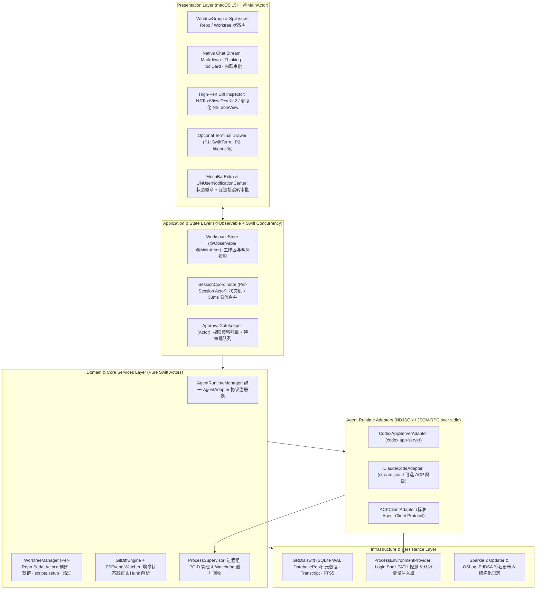
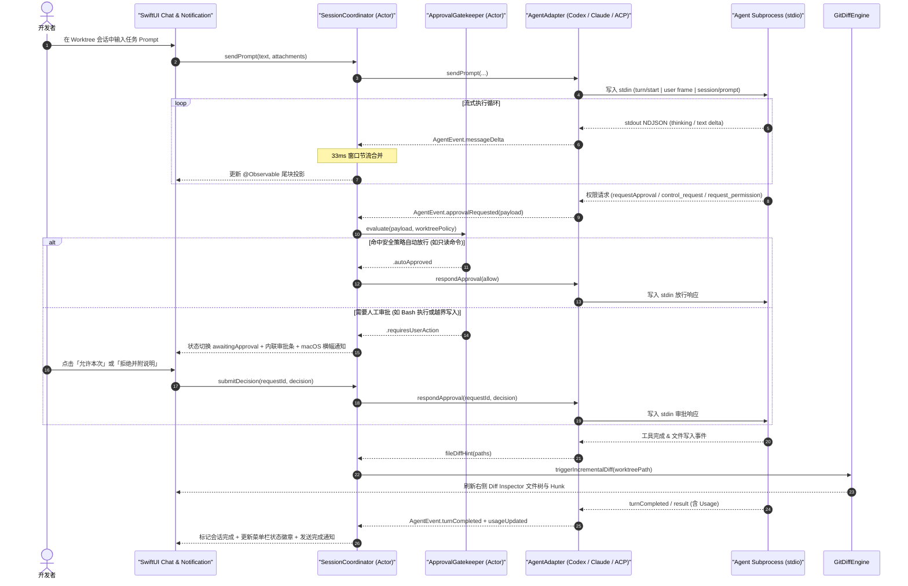
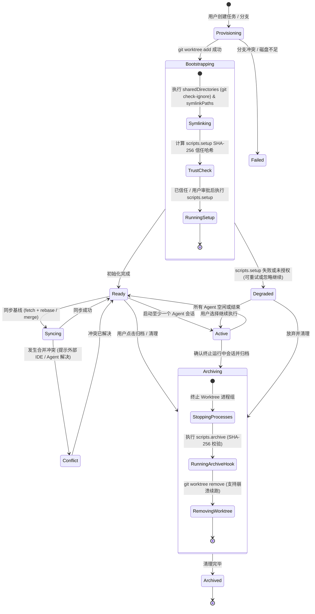
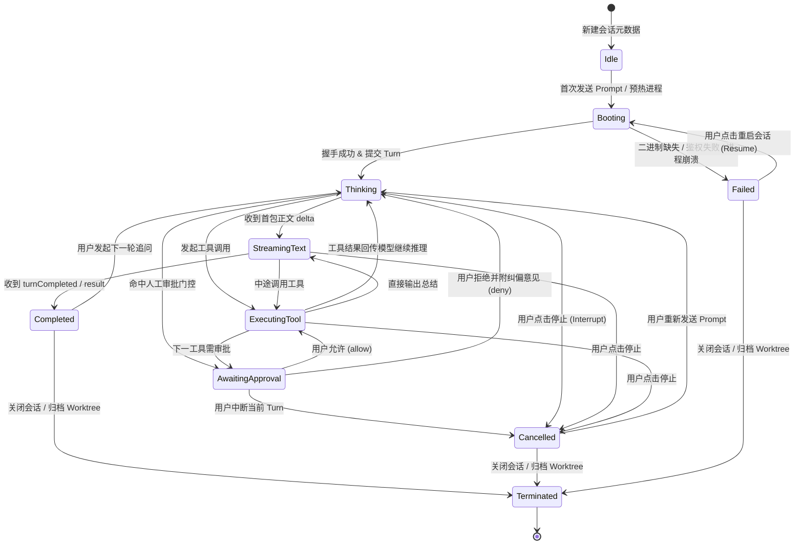

# Shepherd macOS 原生系统架构设计

> **文档角色**：Shepherd 方案计划书 — 系统架构篇（`docs/02-architecture.md`）  
> **校准状态**：已结合上游源码审计报告 [`docs/01-orca-audit.md`](./01-orca-audit.md)（基线 `stablyai/orca` Commit `284bf842` / v1.4.214）与产品规范 [`docs/03-product-and-ux.md`](./03-product-and-ux.md) 完成终版校准，**技术路线已最终锁定**。  
> **目标平台与协议**：macOS 15.0+ (Sequoia) · **仅 Apple Silicon (`arm64`，不支持 Intel Mac)** · Swift 6.0+ Strict Concurrency · **MIT License**  
> **架构愿景**：以 Conductor / cmux 级别的 macOS 原生轻快体验，承载 Orca 级别的跨厂商 BYOA（Claude Code / Codex / ACP Agent）与 Git Worktree 并发隔离编排能力。  
> **范围说明**：本期聚焦本地单机多 Agent 编排核心，**不包含**模型路由网关或协议转换代理（如 Magpie 类能力），仅在底层预留干净的子进程环境变量注入与协议扩展边界（详见第 7 节）。

---

## 1. 核心技术路线深度对比与最终选型裁决

Shepherd 的首要架构决策在于：**核心编排引擎与 Agent 协议驱动层，究竟采用 Node.js Sidecar 复用裁剪版 Orca 无头后端（`orcad`），还是 100% 用纯 Swift 原生实现？**

以下结合 `docs/01-orca-audit.md` 对 `stablyai/orca`（~370 万 LOC）的源码级审计实证，对三条候选路线进行架构拆解与 6 维度量化对比。

### 1.1 候选路线定义（已按源码审计实证校准）

#### 路线 A：Sidecar 混合模式（SwiftUI 原生壳 + 裁剪版 Orca `orcad` Headless Runtime）
- **形态**：macOS 主 App 使用 SwiftUI + AppKit 构建原生界面；App Bundle 内置锁定版 **Node.js v24.22.3** 及 Orca 的无头守护进程 **`orcad`**（`src/main/orcad/main.ts`）。
- **通信**：主 App 启动时拉起 `orcad` 子进程，读取 `orca-runtime.json` 发现本地 Unix Domain Socket（权限 `0600`），通过 Orca **自定义 NDJSON RPC 协议**（非标准 JSON-RPC 2.0，由 `zod` v4 校验、共 1,202 个方法）通信。
- **源码审计澄清（先破除一个误判）**：`docs/01-orca-audit.md` 已证实 **`orcad` 脱离 Electron 的成本实为 0**（上游已通过 `check-runtime-electron-ratchet.mjs` 实现 0 处 `electron` 导入，且已彻底移除 `better-sqlite3`，全面改用 Node 24 内置 `node:sqlite`）。
- **但实证暴露的四项致命硬代价**：
  1. **包体与运行时重税**：锁定 `Node v24.22.3` 单二进制即达 **122.59 MB**（`darwin-arm64`）或 **125.76 MB**（`darwin-x64`，Universal 双架构约 **248 MB**），叠加 ~11 MB `orcad` JS bundle、**25 个平铺子 Worker/进程入口**（`daemon-entry`、watcher、多个 SQLite worker 等）及 `node-pty` / `@parcel/watcher` / `orca-provider-exec` 原生模块，未写一行 UI 即背负 ~150 MB+ 磁盘体积与 **250–500 MB** 常驻空闲内存；
  2. **极难轻量裁剪（「能跑」≠「能裁」）**：`OrcaRuntimeService`（31.7 万 LOC）与 `1,202` 个 RPC 深度交织 Bots(143) / Browser(127) / Orchestration(65) / Mobile E2EE / Linear / Jira；黑盒挂载则背负 90% 冗余子系统与攻击面，强行剥离则需拆解数万行跨模块耦合且彻底断掉上游合并能力；
  3. **不可忽视的闭源 SDK 合规红线**：`orcad` 的 Claude Native Chat 强依赖 **`@anthropic-ai/claude-agent-sdk`（`0.3.330`）**，该包**并非 MIT 开源**，受 **Anthropic Commercial Terms of Service** 约束；
  4. **公证与跨进程排障成本**：macOS Notarization 须为 Node 24、`.node` 原生插件与 C 辅助进程逐一签 Hardened Runtime，且双进程状态同步与排障复杂度高。

#### 路线 B：100% 纯 Swift 原生重写（Single-Process Native Core）
- **形态**：全栈采用 Swift 6 + SwiftUI + AppKit，**零 Node.js / 零 Electron / 零内置浏览器 / 零闭源商业 SDK**。Swift 主进程直接通过 `posix_spawn` 驱动用户本机已安装的 CLI：
  - `git worktree` / `git status` / `git diff` / `gh`（直接调用本机 `git` 二进制，完整兼容用户 `.gitconfig` / SSH / GPG / LFS）；
  - `codex app-server`（双向 stdio NDJSON，省略 `"jsonrpc": "2.0"` 字段）；
  - `claude` CLI（直连双向 `stream-json` 控制协议 `--permission-prompt-tool stdio`，摆脱 `@anthropic-ai/claude-agent-sdk` 条款绑定）；
  - 通用 ACP Agent（标准 JSON-RPC 2.0 over stdio NDJSON）。
- **优势**：
  1. **极致轻快**：冷启动 0.2s–0.4s、空闲内存 45–75 MB、签名 `.dmg` 体积 12–22 MB，比 `orcad` Sidecar 轻量近一个数量级；
  2. **架构纯净且体量极克制**：对照 `01-orca-audit.md` 第 5 节模块清点，Shepherd MVP 所需后端核心总量仅约 **8,000–10,000 行纯 Swift 代码**（不足 Orca `src/main` 140 万行的 1%），单进程内以 Swift 6 Actor 隔离，Xcode Instruments 一站式剖析；
  3. **合规姿态干净**：零闭源商业 SDK 绑定，纯干净室协议实现，MIT 参考无污染。
- **代价**：
  1. Claude Code 的 `stream-json` 底层控制协议缺乏显式 SemVer 承诺，上游 CLI 升级时存在字段微调的追新成本；
  2. 需自行编写 Git Worktree 并发锁、脚本 SHA-256 信任门控、审批策略与异常恢复状态机（但可直接吸取 `stablyai/orca` 审计暴露的全部边界经验，避免踩坑）。

#### 路线 C：分阶段演进路线（Protocol-First 抽象边界）
路线 C 用强协议接口隔离「编排控制面」与「Agent 传输实现」，评估两个方向：
- **策略 C1（纯 Swift 内核 + 按需轻量 ACP 逃生舱 — 最终锁定方案）**：Shepherd 主进程、Worktree 管理、SQLite 持久化、Codex 驱动、ACP Client、Claude `stream-json` 驱动全部 100% Swift 原生实现；所有 Agent 均隐藏在统一的 `AgentAdapter` Swift 协议之后。当上游 Claude CLI 底层 `stream-json` 发生破坏性变更时，可在 1 天内通过 `ACPClientAdapter` 切至用户本机/按需拉起的开放适配器 `@agentclientprotocol/claude-agent-acp` 作为零侵入降级通道，无需引入整套 Orca Sidecar。
- **策略 C2（Sidecar-First 渐进替换 — 审计后已否决）**：经 `01-orca-audit.md` 查证，`orcad` 虽无 Electron 依赖，但挂接自定义 1,202 方法 RPC 契约 + 150 MB Node 24 包体 + 闭源 SDK 风险的短期收益远不如直接写 ~3,000 行 Swift 协议层，且后续迁移还要推倒重写一遍传输适配层，属于高沉没成本弯路，因此正式否决。

---

### 1.2 六维度量化与定性对比矩阵（已校准 `01-orca-audit.md` 实测数据）

| 评估维度 | 路线 A：Sidecar 混合模式（Swift + Orca `orcad`） | 路线 B：100% 纯 Swift 原生 | 路线 C1：纯 Swift 内核 + ACP 逃生舱（最终锁定） |
| :--- | :--- | :--- | :--- |
| **1. 冷启动速度**（点击图标至首屏可交互） | 1.5s – 2.8s（App 启动 + Node 24 启动 + ~11MB bundle 解析 + 多子 Worker 初始化） | **0.2s – 0.4s**（纯原生二进制直接渲染） | **0.2s – 0.4s**（逃生舱仅按需懒启动，不影响主进程） |
| **2. 内存占用**（空闲 / 5 并发会话不含外部 Agent 进程） | 空闲 **250–500 MB**（`orcad` V8 堆 + 多个常驻子 Node/Worker 进程）；5 会话 400–700 MB | **空闲 45–75 MB；5 会话 110–180 MB** | **空闲 45–75 MB；5 会话 110–180 MB**（启用外部 ACP 桥时仅单会话额外 +45 MB） |
| **3. 安装包体积**（签名压缩后 `.dmg`） | **150 – 260 MB**（仅 Node v24.22.3 `arm64` 即 122.6 MB，双架构 ~248 MB，另含 25 入口与 `.node` 模块） | **12 – 22 MB**（SwiftTerm 方案；若未来内嵌 `libghostty` 约 25–35 MB） | **12 – 22 MB**（零捆绑 Node 运行时，对齐 `03-product-and-ux.md` ≤25 MB 红线） |
| **4. MVP 研发周期**（2 名熟悉 Swift 工程师） | 4 – 6 周（虽 0 Electron 解耦，但需适配自定义 RPC + 裁剪 31.7 万行 `OrcaRuntimeService` + 解决公证签名） | 5 – 6.5 周（含 M0 协议验证 Spike + ~1 万行核心 Swift 代码 + 原生 UI/Diff） | **5 – 6.5 周**（与路线 B 持平，且大幅降低协议漂移返工风险） |
| **5. 上游协议追新与合规风险** | **合规高风险**（捆绑商业条款 `@anthropic-ai/claude-agent-sdk`）；裁剪分支无法合并上游 | **合规干净**；Codex/ACP 稳定，Claude `stream-json` 存在单点追新风险 | **合规干净且追新可控**（标准协议直连 + Claude 异常时秒切开放 `claude-agent-acp`） |
| **6. 调试与排障复杂度** | **高**（Swift + Node 24 + 25 子进程 + `.node` 原生插件，Notarization 与崩溃归因复杂） | **低**（纯 Xcode 单进程调试、单一 Crash Log、Instruments 全链路分析） | **低**（95% 路径单进程调试，逃生舱走标准 stdio NDJSON 抓包） |

---

### 1.3 最终技术路线裁决（DECISION LOCKED）

> **最终裁决**：**正式锁定路线 C1（100% 纯 Swift 6 原生内核 + Protocol-First 抽象 + 可选开放 ACP 逃生舱）**，彻底放弃复用 `orcad` Node Sidecar（路线 A / C2）。（注：开放逃生舱如 `@agentclientprotocol/claude-agent-acp` 仅作为按需调用的外部 CLI，绝不随 Shepherd 安装包捆绑。）

**四条硬事实决策依据（全部已由 `docs/01-orca-audit.md` 交叉核验）**：
1. **体量与性能红线不可妥协**：`orcad` 虽已零 Electron 依赖，但绑定 Node v24.22.3（122.6 MB）+ 25 个子进程入口导致冷启动、内存（250–500 MB）与安装包体积（150 MB+）全面击穿 `docs/03-product-and-ux.md` 确立的验收红线（TTI ≤ 400ms、空闲内存 ≤ 80 MB、`.dmg` ≤ 25 MB）。
2. **「能脱离 Electron」不等于「能轻量裁剪」**：`OrcaRuntimeService`（31.7 万 LOC）与 1,202 个自定义 RPC 深度捆绑 Bots / Browser / Mobile / Linear / Jira；而 Shepherd MVP 核心后端用纯 Swift 干净实现仅需不足 **1 万行代码**，长期维护成本反而显著更低。
3. **规避闭源 SDK 合规风险**：跳过 `orcad` 使 Shepherd 天然摆脱受 Anthropic Commercial Terms of Service 约束的 `@anthropic-ai/claude-agent-sdk`，保持纯粹的开源 BYOA（Bring Your Own Agent）中立姿态。
4. **最大化复用 Orca 的真正精华**：将 `stablyai/orca`（MIT）作为**协议规格、边界坑位与状态机设计的活字典**——完整继承其经过生产验证的边界处理（如 Codex 未支持 Server Request 显式拒绝防挂起、`orca.yaml` 的 `worktree.sharedDirectories` + `git check-ignore` 校验、脚本内容 SHA-256 信任哈希门控、POSIX 进程组清场与中断 Worktree 删除的重启续跑队列），但不背负其任何历史技术债。

---

## 2. macOS 原生客户端分层架构

Shepherd 采用清晰的 **四层单向数据流架构**，严格遵循 Swift 6 并发模型：UI 状态投影驻留在 `@MainActor`，所有协议 IO、Git 子进程与 SQLite 写入均在独立 `actor` 中异步执行，杜绝主线程阻塞。

### 2.1 整体架构图



### 2.2 UI 层：SwiftUI + AppKit 精准桥接策略

纯 SwiftUI 在普通表单与导航栏开发效率极高，但在 **macOS 高频文本流渲染、多栏精确布局与底层窗口控制** 上存在已知性能短板。Shepherd 采取「**骨架 SwiftUI + 性能热区 AppKit (`NSViewRepresentable`)**」混合策略：

| UI 模块 | 实现技术 | 关键工程考量 |
| :--- | :--- | :--- |
| **主窗口与三栏布局** | SwiftUI `WindowGroup` + `NSSplitViewController` 桥接 | 精确保存各栏宽度（`autosaveName`）、支持一键折叠左侧栏与右侧 Diff Inspector、支持原生 Unified Toolbar 与毛玻璃侧栏材质（`.sidebar`）。 |
| **Native Chat 对话流** | SwiftUI `ScrollView` + 增量块级模型；代码/长文本段使用 AppKit 文本视图 | **防抖渲染**：单条流式回复拆分为稳定历史块（Immutable）+ 当前活跃尾块（Mutable），仅活跃块响应 delta 更新，避免整条列表触发全量 Diff 重排。 |
| **高性能 Diff 查看器** | **AppKit `NSTextView`（TextKit 2）** 或 **虚拟化 `NSTableView`** | 当单次 Agent 重构涉及 50 个文件 / 8,000 行 Diff 时，SwiftUI `LazyVStack` 会出现滚动掉帧与高内存；使用基于行/Hunk 虚拟化的 `NSTableView`（配合异步语法高亮缓存，如 `swift-tree-sitter`）可稳定保持 120fps（ProMotion）。 |
| **菜单栏常驻伴侣** | SwiftUI `MenuBarExtra(.window)` | 实时展示并发 Worktree 聚合徽章（绿色空闲 / 蓝色运行 / **琥珀色待审批数字**），点击弹窗可一目了然查看所有运行中任务并一键唤起对应窗口；遵循安全原则，不在极窄 Popover 中提供高危命令盲批按钮，一律点击跳入主窗口看清上下文后再 `⌘↩` 确认。 |
| **系统级审批通知** | `UNUserNotificationCenter` + 深链接路由 | 对「待审批 / 已完成 / 报错」三类事件精准推送（当前窗口已聚焦该 Worktree 时自动抑制免打扰）；携带 `worktree_id` 与 `approval_id`，点击通知直接激活主窗口并聚焦对应内联审批条。 |

### 2.3 状态管理层：`@Observable` + Actor 隔离与背压节流

并发运行 4～8 个 AI Agent 时，典型卡顿根源是高频 `text_delta`（每秒数百条 JSON 行）直接触发 `@MainActor` 属性写入，造成 SwiftUI 视图树以 600Hz 重绘。

Shepherd 在架构层强制执行以下并发约束：
1. **Per-Session Actor 隔离**：每个活跃会话对应独立的 `actor SessionRuntime`，独占该子进程的 `stdout`/`stdin` 读写任务、协议状态机转换与内存增量拼接，彼此零共享锁竞争。
2. **33ms（30Hz）输出合并窗口（Delta Coalescer）**：`SessionRuntime` 在 Actor 内累积 `thinkingDelta`、`messageDelta`、`toolOutputDelta`，通过轻量定时刷盘器每 33ms（或遇到状态跃迁/Turn 结束立即刷新）向 `@MainActor` 的 `SessionViewModel`（`@Observable`）推送一次不可变快照增量。
3. **只读 UI 投影**：UI 视图仅观察 `@Observable final class WorkspaceStore` 与 `SessionViewModel`；所有用户意图（发送 Prompt、点击审批、中断 Turn、清理 Worktree）均通过异步 Command 投递到对应 Actor 执行，UI 仅负责呈现状态与乐观反馈。

### 2.4 可选极简终端抽屉（P1）选型对比：`libghostty` vs `SwiftTerm`

产品定位上，Shepherd 90% 场景以 Native Chat 为主交互，但在应急处理原版 TUI 斜杠命令、运行本地调试脚本或手动 `git` 排错时，提供一键呼出（`⌘J`）的当前 Worktree 极简终端抽屉。

| 对比维度 | `libghostty` (`GhosttyKit`) | `SwiftTerm` |
| :--- | :--- | :--- |
| **底层技术与渲染** | Zig 编写核心 + C API，macOS 上采用 **Metal GPU 加速渲染**（`CAMetalLayer`），吞吐与延迟为行业天花板 | 纯 Swift 编写，基于 CoreGraphics / AppKit 文本层绘制 |
| **TUI / 协议兼容** | 完美支持现代终端序列、Kitty 图形协议、连字、复杂 Emoji / CJK 宽字符、与 `~/.config/ghostty/config` 一致 | 完备的 VT100/VT220/Xterm-256color 解析，足以运行 `zsh`、`git`、`vim`、测试日志与主流 TUI，高级图形/连字弱于 Ghostty |
| **构建链与集成成本** | **高**：需要 Zig 编译器构建 `GhosttyKit.xcframework`（或引入预编译二进制），C API 仍在演进中，需处理 C 指针与 `@MainActor` 桥接 | **极低**：标准 Swift Package Manager 一行引入，零外部工具链，源码可直接单步调试 |
| **包体增量** | 约 +5 ~ 9 MB（`arm64` XCFramework） | **< 1 MB** |
| **适用定位** | 以终端为核心界面的超级终端（如 cmux） | 以 Native Chat + Diff 为核心、终端仅作应急抽屉的应用 |

#### 推荐与渐进降级策略
1. **接口先行（TerminalSurfaceProtocol）**：在独立 Package `ShepherdTerminal` 中定义统一抽屉契约 `TerminalSurfaceHosting`，将 PTY 会话句柄、环境变量注入、Resize、清屏、焦点管理与底层渲染引擎解耦。
2. **P1 / M3 首发锁定 `SwiftTerm`**：终端抽屉（`⌘J`）已锁定在 **M3** 交付（M0–M2 专注 Native Chat + 原生 Diff/PR 核心闭环），首发选用纯 Swift `SwiftTerm`，契合 Shepherd「轻快、小包体、零复杂构建链」的哲学，1–2 天即可交付稳定可用的 Worktree 绑定终端抽屉，且无需维护 Zig CI 构建管线。
3. **P2 按需无缝升级 `libghostty` (`GhosttyKit`)**：当后续真实用户场景证明「在抽屉内长期运行复杂 TUI 或百万行日志滚动」成为高频痛点时，仅需为 `ShepherdTerminal` 新增 `GhosttySurfaceView` 实现并接入预编译 `GhosttyKit.xcframework` CI 产线即可替换，上层零改动。
4. **关键 SwiftUI 生命周期陷阱规避（两者通用）**：**严禁**使用 `if isDrawerVisible { TerminalView() }` 条件渲染控制抽屉显隐——SwiftUI 的 `_ConditionalContent` 会在折叠时销毁底层 `NSView`，导致正在运行的 Shell / PTY 进程意外中断。正确做法是维护按 `worktreeID` 索引的 **持久化 `NSView` 容器池（`TerminalViewPool`）**，通过隐藏容器视图或折叠 `NSSplitViewItem` 实现毫秒级无损显隐切换。

---

## 3. 核心子系统详细设计

### 3.1 Agent Runtime Adapter 层

#### 3.1.1 统一内部事件模型与 Adapter 协议（Swift 6）

所有厂商协议在进入 Shepherd 领域层前，均被标准化为强类型的 `AgentEvent` 流。以下是可直接指导编码的核心契约定义：

```swift
public enum AgentProviderKind: String, Codable, Sendable {
    case codex
    case claudeCode
    case acpGeneric
}

public enum SessionPhase: String, Codable, Sendable {
    case idle
    case booting
    case thinking
    case streamingText
    case executingTool
    case awaitingApproval
    case completed
    case cancelled
    case failed
}

public enum ToolCategory: String, Codable, Sendable {
    case shellCommand
    case fileRead
    case fileEdit
    case fileSearch
    case mcpTool
    case webFetch
    case unknown
}

public struct ApprovalPayload: Identifiable, Codable, Sendable, Equatable {
    public let id: String               // 协议侧原始 requestId
    public let toolCategory: ToolCategory
    public let title: String            // 如 "Run Shell Command" / "Edit File"
    public let commandOrPath: String    // 具体命令或目标路径
    public let diffPreview: String?     // 可选文件修改预览
    public let workingDirectory: String
    public let riskLevel: RiskLevel     // .low / .medium / .high
    public let options: [ApprovalOption]
}

public struct UsageSnapshot: Codable, Sendable, Equatable {
    public let inputTokens: Int
    public let outputTokens: Int
    public let cacheReadTokens: Int?
    public let estimatedCostUSD: Double?
    public let contextWindowUsageRatio: Double?
}

public enum AgentEvent: Sendable, Equatable {
    case sessionReady(externalSessionId: String, capabilities: AgentCapabilities)
    case phaseChanged(SessionPhase)
    case turnStarted(turnId: String)
    case thinkingDelta(turnId: String, text: String)
    case messageDelta(turnId: String, text: String)
    case toolCallStarted(turnId: String, callId: String, category: ToolCategory, title: String, inputSummary: String)
    case toolCallOutputDelta(turnId: String, callId: String, chunk: String)
    case toolCallCompleted(turnId: String, callId: String, exitCode: Int?, outputSummary: String, isError: Bool)
    case approvalRequested(turnId: String, payload: ApprovalPayload)
    case fileDiffHint(paths: [String])  // 触发 GitDiffEngine 增量刷新
    case usageUpdated(UsageSnapshot)
    case turnCompleted(turnId: String, stopReason: String)
    case errorOccurred(code: String, message: String, isRecoverable: Bool)
    case processExited(exitCode: Int32)
}

public protocol AgentAdapter: Sendable {
    var provider: AgentProviderKind { get }
    func start(config: AgentLaunchConfig) async throws -> AsyncThrowingStream<AgentEvent, Error>
    func sendPrompt(_ prompt: UserPromptInput) async throws
    func respondApproval(requestId: String, decision: ApprovalDecision) async throws
    func interruptCurrentTurn() async throws
    func terminate() async
}
```

#### 3.1.2 三大厂商协议映射矩阵

| 内部标准模型 / 动作 | `CodexAppServerAdapter` (`codex app-server`) | `ClaudeCodeAdapter` (`claude stream-json`) | `ACPClientAdapter` (标准 ACP) |
| :--- | :--- | :--- | :--- |
| **启动命令** | `codex app-server --listen stdio://` | `claude --print --input-format stream-json --output-format stream-json --verbose --include-partial-messages --permission-prompt-tool stdio` | `<agent-bin> <acp-args>`（如 `gemini --experimental-acp` / `claude-agent-acp`） |
| **传输格式** | NDJSON 双向类 JSON-RPC（线缆层**省略 `"jsonrpc": "2.0"` 字段**） | NDJSON 双向流（直连本机 `claude` CLI，零闭源 SDK 依赖） | 标准 NDJSON JSON-RPC 2.0 |
| **握手与会话创建** | `initialize`（声明 `clientInfo: { name: "shepherd_mac", title: "Shepherd" }`，绝不沿用 `orca_desktop`）→ 收到响应后发 **`initialized` 通知** → `thread/start` / `thread/resume` | `control_request(subtype: "initialize")` → 监听 `system(subtype: "init")` 取 `session_id`（续聊加 `--resume`）；**不覆写 `CLAUDE_CODE_ENTRYPOINT=orca`** | `initialize` →（可选 `authenticate`）→ `session/new`（传 `cwd`）或 `session/load` |
| **发送 Prompt** | `turn/start` (`threadId`, `input`) | 向 `stdin` 写入 `{ "type": "user", "message": { "role": "user", "content": [...] } }` | `session/prompt` (`sessionId`, `prompt`) |
| **Thinking / 文本流** | `item/started` + `item/reasoning/*` + `item/agentMessage/delta` | `stream` 事件内的 `thinking_delta` / `text_delta` 及 `assistant` 完整块 | `session/update` (`agent_thought_chunk` / `agent_message_chunk` / `plan`) |
| **工具调用事件** | `item/started` / `item/completed`（commandExecution / fileChange / mcpToolCall） | `assistant` 块中的 `tool_use` + `user` 块中的 `tool_result` | `session/update` (`tool_call` / `tool_call_update`) |
| **权限审批与交互请求** | Server Request 统一分流：`item/commandExecution/requestApproval`、`item/fileChange/requestApproval`、`item/tool/requestUserInput`、`mcpServer/elicitation/request` | 入站 `type: "control_request"`（含 `request_id` 与嵌套 `request: { subtype: "can_use_tool", tool_name, input }`；最终线协议字段以 M0 实机 Golden-file 锁定） | Agent Request：`session/request_permission`（宿主侧执行策略门控） |
| **权限审批回复** | JSON-RPC Response（匹配 `id`）：`accept` / `decline` / `cancel`；**所有未支持/历史 Server Request 必须显式返回拒绝或错误码，防止 `app-server` 永久挂起** | 写入 `stdin` 嵌套帧：`{ "type": "control_response", "response": { "subtype": "success", "request_id": "...", "response": { "behavior": "allow" \| "deny", ... } } }`（字段以 M0 Golden-file 实测锁定） | JSON-RPC Response（匹配 `id`）：所选 `optionId` 或取消 |
| **中断当前 Turn** | `turn/interrupt` | `control_request(subtype: "interrupt")`（降级发 `SIGINT`） | `session/cancel`（请求超时发 `$/cancel_request`） |
| **用量与结束** | `turn/completed` + token usage 通知 | `result` 帧（含 `session_id`、`total_cost_usd`、token 统计；识别 `rate_limit_event` 提示限流） | `session/prompt` 返回 `stopReason` + 元数据 |
| **专属健壮性处理** | 处理 `-32001` 过载指数退避；遵循零污染原则不改写 `~/.codex/hooks.json`；MVP 一会话一进程隔离，P1 可按需引入共享进程池（空闲 60s 回收 + 内存上限巡检） | 严格解析单行 JSON 容错非 JSON 告警输出；支持一键切至开放 `claude-agent-acp` 逃生舱 | 增量分帧 + 单行上限保护 + 断连尾帧排空；方言层适配模型发现模式与环境变量（如 `PI_NO_PTY=1`） |

**Claude Code 三级兼容接入策略（零闭源 SDK + 应对协议漂移与 TUI 边界）**：
1. **默认主路径（Native Chat · 直连 `stream-json`）**：纯 Swift 直接驱动用户本机 `claude --print --input-format stream-json --output-format stream-json --verbose --include-partial-messages --permission-prompt-tool stdio`，**彻底不捆绑受 Anthropic Commercial Terms of Service 约束的 `@anthropic-ai/claude-agent-sdk`**，保留原生默认入口特征（绝不注入 `CLAUDE_CODE_ENTRYPOINT=orca`），支持双向审批与 `--resume` 断点续聊。
2. **协议降级逃生舱（开放 ACP Adapter）**：若上游 Claude CLI 破坏性修改 `stream-json` 控制帧结构，可在设置中将底层无缝切至 `ACPClientAdapter` 驱动开放的 `@agentclientprotocol/claude-agent-acp`，业务层与 UI 零感知。
3. **可选 PTY + Hook 应急路径（P1 终端抽屉联动，对齐 `01-orca-audit.md` macOS 实况）**：当开发者按 `⌘J` 在终端抽屉中手动运行原版交互式 `claude` TUI（使用 `/btw`、`/usage` 或排查订阅窗口额度消耗）时，通过会话级互斥锁防止 Native Chat 与 TUI 并发写同一会话，并采用 **macOS 轻量双通道状态同步**——无需单独编译 Rust Hook 二进制（上游 `orca-agent-hook.exe` 仅用于 Windows）：(a) 首选解析 PTY 输出流的 **`OSC 7501`（Program Status Protocol）**零侵入探测状态（支持新版 Claude Code / Codex / Grok / Kimi 等）；(b) 可选按需挂载极简 POSIX Shell + `curl --noproxy 127.0.0.1` 回调至本地 Loopback HTTP / Unix Socket（携带 256-bit Bearer Token，仅在用户显式启用时生效，默认绝不改写 `~/.claude/settings.json`，且超时 Fail-open 绝不卡死终端）。

#### 3.1.3 协议消息流与审批闭环时序图



---

### 3.2 Git Worktree 管理器设计

#### 3.2.1 磁盘目录规范与命名策略
为避免在开发者主仓库父目录四处散落文件夹，Shepherd 默认将受管 Worktree 统一隔离在应用受管工作区下（允许按仓库自定义覆盖）：

```text
~/Library/Application Support/Shepherd/
├── shepherd.sqlite                 # GRDB 元数据与会话索引
├── shepherd.sqlite-wal
├── blobs/                          # >128KB 大日志外置压缩归档（LRU 清理）
└── logs/                           # 调试日志与可选协议抓包

~/.shepherd/
├── run/                            # 权限 0700，短路径本地 Socket (shepherd.sock, 0600) 与 runtime.json（规避 macOS sun_path 104 字节上限及路径空格）
└── worktrees/                      # 默认 Worktree 根目录（可在偏好设置修改）
    └── <repo-slug>-<short-hash>/   # 例：my-saas-a1b2c3d4
        ├── feat-oauth-login/       # 独立 Worktree 1
        └── fix-diff-perf/          # 独立 Worktree 2
```

#### 3.2.2 项目配置文件规范（`shepherd.yaml` 精确兼容 `orca.yaml`）
Shepherd 原生支持仓库根目录的 `shepherd.yaml`（或 `.shepherd.yaml`），同时**精确向下兼容上游 `orca.yaml` 的真实嵌套 Schema**（依据 `docs/01-orca-audit.md` §4.2 查证：`orca.yaml` 中的真实软链字段为 `worktree.sharedDirectories`，脚本字段为 `scripts.setup` / `scripts.archive`，并支持 `setupAgentStartupPolicy`；而 `symlinkPaths` 实为仓库级本地用户设置字段）。

配置解析与合并优先级（从高到低）：
1. Shepherd 本地仓库覆盖设置（存储在 SQLite，支持本地自定义 `symlinkPaths`、脚本覆写与环境变量，不污染 Git）；
2. `<repoRoot>/shepherd.yaml`（或 `.shepherd.yaml`）；
3. `<repoRoot>/orca.yaml`（自动忽略超出范围的 `environmentRecipes` VM 配方、`defaultTabs`、`issueCommand` 字段）。

```yaml
# shepherd.yaml（直接沿用与 orca.yaml 同构的嵌套 Schema，实现零成本双向兼容）
version: 1
baseBranch: main

# 启动策略：wait-for-setup（默认，等初始化完成再发首轮 Prompt）| start-immediately
setupAgentStartupPolicy: wait-for-setup

worktree:
  # 跨 Worktree 共享的未跟踪目录/文件（必须已存在且通过 git check-ignore 校验）
  sharedDirectories:
    - node_modules
    - .venv
  # 可选（Shepherd 扩展）：需要物理拷贝而非软链的局部配置文件
  copyPaths:
    - .env.test

scripts:
  # Worktree 创建并完成软链后执行的初始化脚本（首次或内容变化须经 SHA-256 信任门控确认）
  setup: |
    pnpm install --frozen-lockfile --prefer-offline
  # Worktree 归档/删除前执行的清理钩子（默认失败时阻断删除防资源泄露）
  archive: |
    ./scripts/cleanup-worktree.sh

# 该仓库共享的非敏感环境变量（敏感凭据建议留在本地覆盖设置或 .env.local）
env:
  NODE_ENV: development
```

> **向后兼容规则**：若用户在本地仓库偏好设置中配置了 `symlinkPaths`（用于软链 `.env.local` 等未入库单文件），运行时会与配置文件中的 `worktree.sharedDirectories` 合并去重执行。

#### 3.2.3 并发安全、脚本信任门控与磁盘保护机制
1. **Per-Repo 串行写锁（`RepoLockActor`）**：Git 的 `worktree add`、`worktree remove`、`worktree prune`、`branch -D` 与 `fetch` 都会竞争主仓库 `.git/` 下的 `packed-refs` 与 `worktrees/` 管理锁。`WorktreeManager` 为每个规范化后的 `repoCommonDir` 维护独立串行队列，确保同一仓库的拓扑变更严格串行执行，彻底杜绝并发创建 3 个任务时报错 `index.lock: File exists`；而不同 Worktree 目录内部的 `git status`/`git diff` 保持全并发。
2. **双层软链安全边界（`git check-ignore` + Path Traversal Guard）**：
   - 借鉴 Orca 源码实证安全实践：对于来自仓库提交文件（`shepherd.yaml` / `orca.yaml`）的 `worktree.sharedDirectories`，软链前必须依次通过两道校验——① `standardizedFileURL.resolvingSymlinksInPath()` 路径穿越校验（源路径与目标路径严格位于主仓库与目标 Worktree 子树内，拒绝 `../` 越界）；② **`git check-ignore` 校验**（仅允许共享已存在且被 `.gitignore` 忽略的路径，彻底杜绝误将受 Git 跟踪的源码目录做成软链或覆盖代码）。
3. **脚本内容 SHA-256 信任门控（Script Trust Gate）**：
   - 借鉴 Orca 的 `orca-hook-content-hash` 安全模型：执行来自仓库文件的 `scripts.setup` 或 `scripts.archive` 前，对 trimmed 脚本文本计算 **SHA-256 哈希**，比对 SQLite `trusted_hook_hashes` 表。
   - **未命中即拦截**：首次执行或 Git pull / 切分支引入了新脚本内容时，弹窗展示完整脚本文本与变更来源，必须由开发者显式点击「信任并执行」后才可运行；同时在 `trusted_hook_hashes` 表中按 `(repo_id, script_kind, content_sha256)` 复合唯一键保留多条历史已信任记录，防止开发者在多个可信分支间频繁切换时被重复打扰。
4. **磁盘保护、未保存改动防护与中断删除续跑**：
   - 创建前通过 `URLResourceKey.volumeAvailableCapacityForImportantUsageKey` 检查剩余空间，低于可配置阈值（默认 2 GB）弹窗预警；创建中途失败自动回滚半成品目录并释放锁；
   - 归档/清理前执行预检（未提交修改 + 未跟踪风险文件 + 未 Push 本地 Commit 数），存在脏状态强制二次确认；若 `scripts.archive` 非零退出，默认阻断删除并提示重试或强制清理；
   - **崩溃续跑（Interrupted Removal Recovery）**：Worktree 进入 `Archiving` 状态即落盘 SQLite；若清理中途 App 崩溃，重启后自动扫描并续跑未完成的 `git worktree remove` 与 `git worktree prune`，同步对账 `~/.shepherd/worktrees/` 残留孤儿目录并提示一键回收。

#### 3.2.4 Worktree 与 Session 状态机图

##### Worktree 生命周期状态机



##### Session / Turn 运行状态机



---

### 3.3 进程生命周期、分发策略与安全模型

#### 3.3.1 为什么不能上架 Mac App Store（分发策略硬约束）

> **架构铁律**：Shepherd **不得**采用 Mac App Store (MAS) 分发，必须采用 **Direct Distribution（开发者官网 / GitHub Releases / Homebrew Cask 直接分发）**。

原因在于 Mac App Store 强制启用 **App Sandbox (`com.apple.security.app-sandbox = true`)**，该沙箱机制与多 AI 编程代理编排工具的核心能力存在不可调和的系统级冲突：

1. **无法执行用户本机任意开发工具链**：App Sandbox 禁止应用拉起位于 `/opt/homebrew/bin`、`~/.nvm`、`~/.cargo/bin`、`~/.local/bin` 的外部非沙箱二进制（`git`、`claude`、`codex`、`node`、`python`、`gh`、`go`、`docker` 等），且即使强行启动，子进程会强制继承沙箱限制，无法编译或运行项目代码。
2. **无法访问用户现有 CLI 登录态与 Git 凭据**：BYOA 模式的核心体验是复用用户已登录的 Claude / Codex / Gemini 凭证（`~/.claude`、`~/.codex`）、SSH 密钥（`~/.ssh`、`SSH_AUTH_SOCK`）与 macOS Git Credential Helper；App Sandbox 会严格阻断对用户家目录隐藏配置文件的访问。
3. **文件系统跨目录访问受阻**：`git worktree` 需要同时读写主仓库 `.git` 目录与目标 Worktree 目录，且测试脚本会访问全局缓存目录（如 `~/.pnpm-store`、`~/Library/Caches`、`~/.m2`），Security-Scoped Bookmarks 无法覆盖动态派生的外部构建工具访问需求。
4. **本地 IPC / Hook 受限**：无法在标准路径（如 `~/.shepherd/run/`）暴露 Unix Domain Socket 给外部终端或 Agent Hook 进程通信。

#### 3.3.2 Direct Distribution 签名、公证与更新链路
- **目标架构与开源协议（已锁定）**：仅构建并分发 **Apple Silicon (`arm64`)** 单一架构（不支持 Intel Mac、不打 Universal Binary）；项目以 **MIT License** 开源发布。
- **Bundle ID 与签名分阶段策略（已锁定）**：开发期（M0–M1）先使用临时占位 Bundle ID（如 `io.github.julytang.shepherd`）配合本地 ad-hoc 签名进行高频迭代；在首次对外公测（M4）或公证演练前最终定稿正式 Bundle ID 与 Developer ID Application 签名主体。
- **Hardened Runtime**：开启 Hardened Runtime（Apple 公证必需），遵循最小权限 Entitlements 原则：
  - `com.apple.security.app-sandbox = false`
  - `com.apple.security.network.client = true`（用于 Sparkle 更新检查、可选 GitHub PR API 调用）
  - 其余敏感项（如 `allow-jit` / `disable-library-validation`）**默认全部关闭**，保证最高系统安全基线。
- **签名与公证 CI 流水线（单一 `arm64` 产线）**：
  `xcodebuild archive`（`-arch arm64`）→ 由内向外逐组件 `codesign --options runtime --timestamp`（使用 **Developer ID Application** 证书依次签 `Sparkle.framework` 组件、`shepherd-reaper` 与 `Shepherd.app`，禁用 `--deep`）→ 临时 `ditto` 打包并 `notarytool` 公证 `Shepherd.app` → `stapler staple Shepherd.app` → 重新 `ditto` 打最终 Sparkle `.zip` → 基于已装订 `.app` 生成并签名 `.dmg` → `notarytool` 公证并 `stapler` 装订 `.dmg` → `spctl` 分别校验 `.app` 与 `.dmg`（详见 `docs/04-roadmap-and-engineering.md` §2.2）。
- **自动更新**：集成 **Sparkle 2**，使用 **EdDSA (`SUPublicEDKey`)** 校验更新包签名，托管静态 `appcast.xml`（支持 Stable / Beta 双频道）。
- **macOS GUI `PATH` 环境补全**：从 Finder / Spotlight 启动的 macOS GUI App 默认仅继承极简 `PATH=/usr/bin:/bin:/usr/sbin:/sbin`，找不到 Homebrew 与 nvm 安装的 `claude`/`codex`。Shepherd 启动时执行单次异步探测（`$SHELL -ilc 'env -0'`，3s 超时保护 + 交互式提示符抑制 + 缓存回退常见路径 `/opt/homebrew/bin`、`~/.local/bin`、`~/.npm-global/bin` 等），确保零配置开箱即用。
- **品牌隔离与开源合规基线（对齐 `docs/01-orca-audit.md` §1.3）**：以 **MIT License** 开源发布，彻底清除任何 Orca 商标/资源、`ORCA_*` 前缀、`clientInfo: "orca_desktop"` 与 `CLAUDE_CODE_ENTRYPOINT=orca`；零遥测零云端中继；全程采用系统原生 SF Pro / SF Mono（不引入 Geist SIL OFL 字体）；不捆绑闭源 `@anthropic-ai/claude-agent-sdk`；在 `THIRD_PARTY_NOTICES.md` 与 `About -> Licenses` 完整声明全部开源依赖。

#### 3.3.3 进程组回收与防孤儿进程（Orphan Prevention）

AI 编程代理在执行测试或启动开发服务器时，往往会派生多层孙进程（`shepherd` → `claude` → `bash` → `pnpm test` → `vitest`）。若仅终止直接子进程 PID，极易产生占满 CPU 或锁死端口的孤儿进程。

Shepherd 实施 **三层防孤儿保障机制**：
1. **强制独立进程组（Process Group Isolation）**：
   - 所有子进程（Agent CLI、`scripts.setup`、`scripts.archive`、终端抽屉 Shell 及按需启用的 ACP 逃生舱进程）统一通过底层 `posix_spawn` 配合 `POSIX_SPAWN_SETPGROUP`（`pgroup = 0`）启动，使其自身 PID 自动成为全新进程组 ID（`PGID == childPID`），所有后代进程默认继承同一 `PGID`。
2. **两阶段优雅终止（Graceful Escalation）**：
   - 会话关闭或 App 正常退出（`applicationWillTerminate`）时，先发送协议级退出请求（关闭 `stdin`），随即向整个进程组发送 `kill(-pgid, SIGTERM)`；
   - 等待宽限期（会话关闭 2.5s / App 退出 1.2s），通过 `waitpid` 非阻塞轮询确认进程组清空；若仍存活则执行 `kill(-pgid, SIGKILL)` 强制收割。
3. **主进程异常崩溃兜底（`shepherd-reaper` 轻量 Watchdog）**：
   - macOS 不具备 Linux 的 `prctl(PR_SET_PDEATHSIG)`，若 Shepherd 主进程遭遇 `SIGKILL` 或底层 Crash，无法执行 `applicationWillTerminate`。
   - 解决方案：随主 App 内嵌一个极简纯 C/Swift 编译的守护助手 `Contents/Helpers/shepherd-reaper`（体积 < 200 KB，空闲内存 < 2 MB）。
   - 主 App 启动后与 `shepherd-reaper` 建立一对匿名 Pipe：每当主 App 派生/回收一个 `PGID`，便向 Pipe 写入 `ADD <pgid>` / `DEL <pgid>`；`shepherd-reaper` 同时通过 `kqueue`（`EVFILT_PROC` + `NOTE_EXIT` 监听主 App PID 与 Pipe EOF）静默挂起。
   - 一旦主 App 意外崩溃或被强杀，`shepherd-reaper` 毫秒级唤醒，向所有登记在册的存活 `PGID` 发送 `SIGTERM` → 1s → `SIGKILL`，彻底清空整棵进程树后自行退出（含按需启用的 ACP 逃生舱进程，全程无遗留）。

#### 3.3.4 本地 Socket / IPC 安全与权限审批门控
- **本地 IPC 安全规范**（用于可选终端 Hook 或内部命令通道）：
  - 仅使用短路径本地 **Unix Domain Socket**（路径 `~/.shepherd/run/shepherd.sock`，规避 macOS `sockaddr_un.sun_path` 104 字节上限及 `Application Support` 路径空格），目录权限严格 `0700`，Socket 文件权限严格 `0600`，**绝不监听公网或 `0.0.0.0` TCP 端口**；
  - 服务端接受连接时通过 `getsockopt(..., SOL_LOCAL, LOCAL_PEERCRED, ...)` 校验对端 UID 必须等于当前 `getuid()`；
  - 每次 App 启动在内存生成 256-bit CSPRNG Bearer Token，写入 `0600` 权限的 `runtime.json` 供授权子进程鉴权，退出时销毁。
- **权限审批门控模型（Approval Gatekeeper）**：
  - 提供三种清晰可控的 Worktree 级安全档位：
    1. **严格模式（Ask Every Time）**：所有 Shell 命令、文件写入与外部工具均弹窗/内联审批；
    2. **均衡模式（Default — Safe Read Auto）**：只读文件读取、搜索与只读 Git 命令（`git status`/`diff`/`log`）自动放行，所有写文件、Shell 执行、MCP 写操作均需人工确认；
    3. **Worktree 自治模式（Scoped Autonomous）**：严格限定在当前 Worktree 目录内的常规编辑与测试命令自动放行，但**内置不可绕过的硬护栏（Hard Guardrails）**——任何跨目录路径访问、高危命令模式（如 `rm -rf /`、`git push --force`、修改 `~/.ssh` / `~/.zshrc`、访问钥匙串命令 `security`）仍强制拦截交由人工审批。
  - 所有审批决策均记录到 SQLite `approval_logs` 审计表（时间、Worktree、工具名、参数摘要、决策结果）。

---

### 3.4 本地持久化设计（SQLite + GRDB.swift）

#### 3.4.1 选型决策：`GRDB.swift` v7+
- **主选 `GRDB.swift`（v7+）**，而非 Apple `SwiftData` 或 Point-Free `SQLiteData`：
  - **对比 SwiftData**：SwiftData 在 macOS 后台多线程高频写入（如流式日志追加与异步 Git 扫描）下存在已知上下文同步与 Predicate 表达能力局限，且黑盒迁移调试困难；
  - **对比 SQLiteData**：`SQLiteData` 底层正是基于 `GRDB.swift`，主打 SwiftUI 宏语法与开箱即用的 CloudKit 同步。Shepherd MVP 为纯本地单机工具，无需 CloudKit 与 Point-Free 依赖链（`swift-dependencies` 等），直接使用 `GRDB.swift` v7 可获得**最原生的 Swift 6 Strict Concurrency 支持、最透明的 SQL 性能掌控力、零额外宏编译耗时**；若未来需要跨 Mac 同步，平滑迁移至 `SQLiteData` 成本也极低。
- **并发与性能配置**：
  - 使用 `DatabasePool` 并开启 **WAL（Write-Ahead Logging）模式**，实现「多线程并发读（UI 查询 + 全文检索）不阻塞单线程串行写（Agent 事件落盘）」；
  - 对高频流式 delta 采用 **Turn 级增量批量事务**（每 500ms 或节点完成时合并写库），杜绝逐 Token 写盘引发的 SSD 写放大。

#### 3.4.2 核心数据表结构（Schema 概览）

| 表名 | 核心字段 | 用途与索引策略 |
| :--- | :--- | :--- |
| `repositories` | `id`, `name`, `root_path` (UNIQUE), `default_branch`, `config_override_json`, `last_opened_at` | 注册的本地 Git 仓库及本地配置覆盖 |
| `worktrees` | `id`, `repo_id` (FK), `slug`, `branch_name`, `base_ref`, `path` (UNIQUE), `status`, `created_at`, `archived_at` | Worktree 生命周期与物理路径对账索引 |
| `sessions` | `id`, `worktree_id` (FK), `provider`, `external_session_id`, `title`, `approval_policy`, `phase`, `total_input_tokens`, `total_output_tokens`, `total_cost_usd`, `updated_at` | 每个 Worktree 下可挂接一个或多个 Agent 会话，支持跨重启 `--resume` |
| `turns` | `id`, `session_id` (FK), `sequence`, `user_prompt`, `assistant_summary`, `stop_reason`, `started_at`, `completed_at` | 轮次级摘要，用于快速加载会话列表与回溯 |
| `transcript_items` | `id`, `turn_id` (FK), `kind` (`thinking` / `text` / `tool_call` / `system`), `payload_json`, `created_at` | 结构化渲染块缓存；附带 **`transcript_fts` (FTS5 虚拟表)** 支持毫秒级全历史搜索 |
| `approval_logs` | `id`, `session_id` (FK), `turn_id`, `tool_category`, `target_summary`, `risk_level`, `decision`, `decided_at` | 安全操作审计轨迹 |
| `trusted_hook_hashes` | `id`, `repo_id` (FK), `script_kind` (`setup` / `archive`), `content_sha256`, `approved_at` | `shepherd.yaml` / `orca.yaml` 脚本内容 SHA-256 信任门控历史（支持多分支历史哈希免重复弹窗） |

> **大对象外置策略**：超过 128 KB 的超长终端日志或原始 Diff 快照不直接存入 SQLite Blob，而是以只读压缩文件存放在 `~/Library/Application Support/Shepherd/blobs/<session_id>/`，数据库仅存路径与字节大小，配合 7 天 / 500 MB LRU 自动清理。

---

## 4. 工程目录与模块化规划（SwiftPM）

推荐采用「**轻量 Xcode App Target + 本地多模块 Swift Packages**」的组织方式，保证核心逻辑（协议、Git、存储）可在命令行 `swift test` 中独立跑通单元测试，无需拉起 GUI（完整构建、CI/CD 与里程碑见 [`docs/04-roadmap-and-engineering.md`](./04-roadmap-and-engineering.md)）：

```text
Shepherd/
├── Shepherd.xcodeproj                # macOS App Target (Signing, Entitlements, Info.plist)
├── App/                              # 极薄入口层（AppDelegate, WindowGroup, MenuBarExtra, DeepLink）
├── Helpers/
│   └── ShepherdReaper/               # 极简 Watchdog 孤儿进程回收助手 (编译打入 Contents/Helpers/)
└── Packages/
    ├── ShepherdCore/                 # 领域模型、SessionCoordinator、ApprovalGatekeeper、EnvProvider
    ├── ShepherdAgents/               # AgentAdapter 协议、CodexAppServer / ClaudeCode / ACPClient、NDJSON 传输层
    ├── ShepherdGit/                  # WorktreeManager、RepoLockActor、YAML 解析 & SHA-256 门控、GitDiffEngine
    ├── ShepherdStorage/              # GRDB.swift DatabasePool、Migrations、Repositories、FTS5 全文检索
    ├── ShepherdTerminal/             # P1 极简终端抽屉抽象（首发 SwiftTerm + OSC 7501，预留 GhosttyKit 槽位）
    └── ShepherdUI/                   # SwiftUI 视图 + AppKit 桥接（Diff NSTableView/NSTextView、SplitView）
```

---

## 5. 关键性能与可靠性工程护栏

为确保架构落地后真正达到 macOS 原生标杆体验，设定以下硬性工程护栏：

1. **首屏冷启动 < 400ms**：启动主线程仅初始化 `GRDB` 只读连接与首屏侧栏元数据；Shell `PATH` 探测、全仓库 `git status` 刷新、孤儿 Worktree 对账与 Sparkle 更新检查**全部延后至首帧渲染后在后台低优先级 Task 中并发执行**。
2. **文件监听防风暴（FSEvents Debounce）**：Agent 执行 `npm install` 或构建产物写入时可能产生上万次文件变更事件。`GitDiffEngine` 必须在 FSEvents 回调层直接忽略 `.git/`、`node_modules/`、`.build/`、`target/` 等目录，并施加 **300ms 滑动防抖窗口** 后再执行单次 `git status --porcelain=v2 -z`。
3. **优雅降级与容错诊断**：
   - 检测不到本机 `claude` 或 `codex` CLI 时，提供清晰的诊断向导（展示当前探测到的 `PATH` 与一键自定义二进制绝对路径）；
   - 所有 Adapter 支持按会话开关 **Protocol Inspector（原始 JSON 帧环形缓冲区，仅驻留内存最近 500 帧）**，开发者遇到上游 CLI 升级兼容问题时可一键导出脱敏协议日志。

---

## 6. 风险清单与缓解措施

| 风险项 | 影响等级 | 缓解措施 |
| :--- | :---: | :--- |
| **Claude Code `stream-json` 控制协议非公开稳定契约变动** | 高 | 1) 解析器采用宽容解码（忽略未知字段，保留原始 JSON 兜底显示）；2) 预置 `ACPClientAdapter` 接入开放 `@agentclientprotocol/claude-agent-acp`（按需外部 CLI、绝不随包捆绑）作为零侵入降级开关；3) 建立基于真实抓包回放的协议契约回归测试集。 |
| **macOS GUI 环境缺少用户 Shell `PATH` / 环境变量** | 高 | 启动异步探测用户 Login Shell 环境并持久化缓存，同时支持在设置页查看/手动覆写 `git`、`claude`、`codex` 路径。 |
| **多 Worktree 并发操作触发 `.git/index.lock` 冲突** | 中 | `WorktreeManager` 强制按 `repoCommonDir` 串行队列执行写拓扑操作，并在遇到临时锁时执行带抖动的有限次数重试。 |
| **App 崩溃遗留高负载子进程（孤儿 `vitest`/`cargo`）** | 中 | 全量独立进程组（`POSIX_SPAWN_SETPGROUP`）+ 内嵌 `shepherd-reaper`（`kqueue` 监控主进程退出即时清场）。 |
| **超大 Diff（> 5,000 行）导致 UI 卡顿** | 中 | 放弃纯 SwiftUI 列表，采用虚拟化 AppKit `NSTableView` + 按可见区域按需语法高亮 + 单文件超大 Diff 自动折叠阈值（默认 > 1,500 行需点击展开）。 |

---

## 7. 预留扩展边界（非本期范围）

Shepherd 在底层严格保持「机制与策略分离」，通过两个零侵入扩展点为未来演进留出空间，**本期不做任何具体业务实现**：

1. **子进程环境变量注入管道（`ProcessEnvironmentProvider`）**：所有 Agent 子进程启动前统一经过分层环境合成管线（`LoginShellEnv → RepoConfigEnv → ProfileEnv → ExtensionHook`），并内置敏感 Key 日志脱敏。未来无需修改核心编排架构，即可通过注入标准端点与鉴权变量（如 `ANTHROPIC_BASE_URL` / `OPENAI_BASE_URL` 等）低成本挂载本地模型路由与额度容灾代理网关。
2. **外挂工具与协议扩展槽（`AgentAdapter` & Local Hook）**：基于统一的 `AgentAdapter` 协议与本地 `0600` Unix Socket 通道，未来可平滑接入外部自动化 Code Review CLI、轻量本地 MCP Server 或社区新兴 ACP Agent，而不影响主客户端的轻量化内核。
