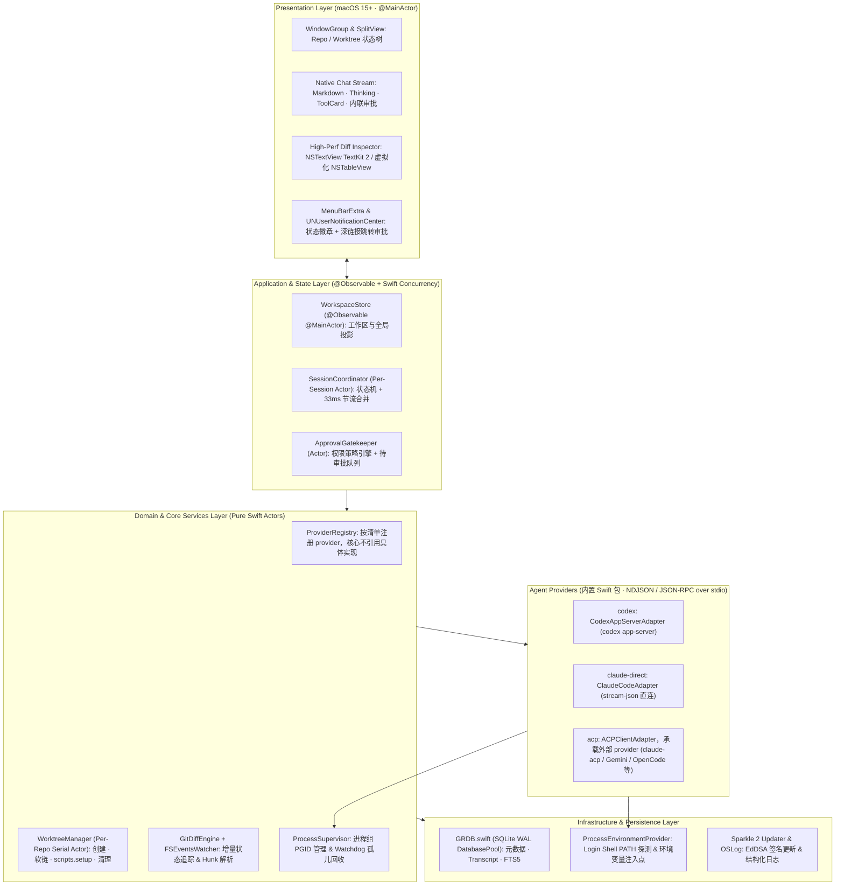
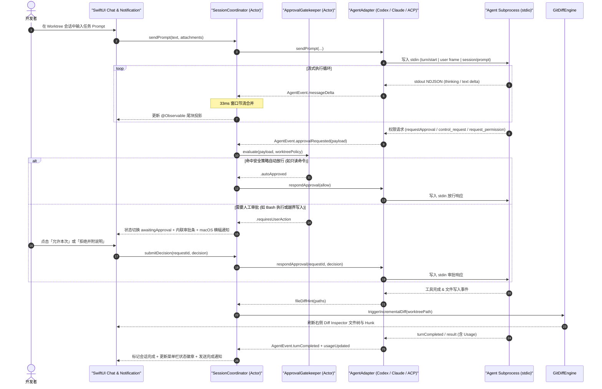
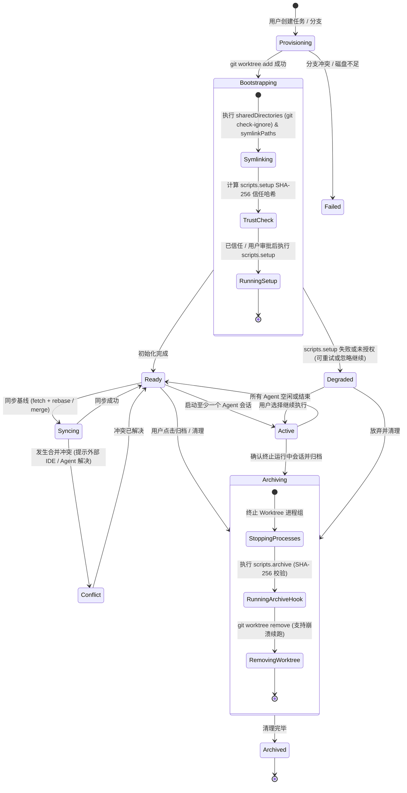
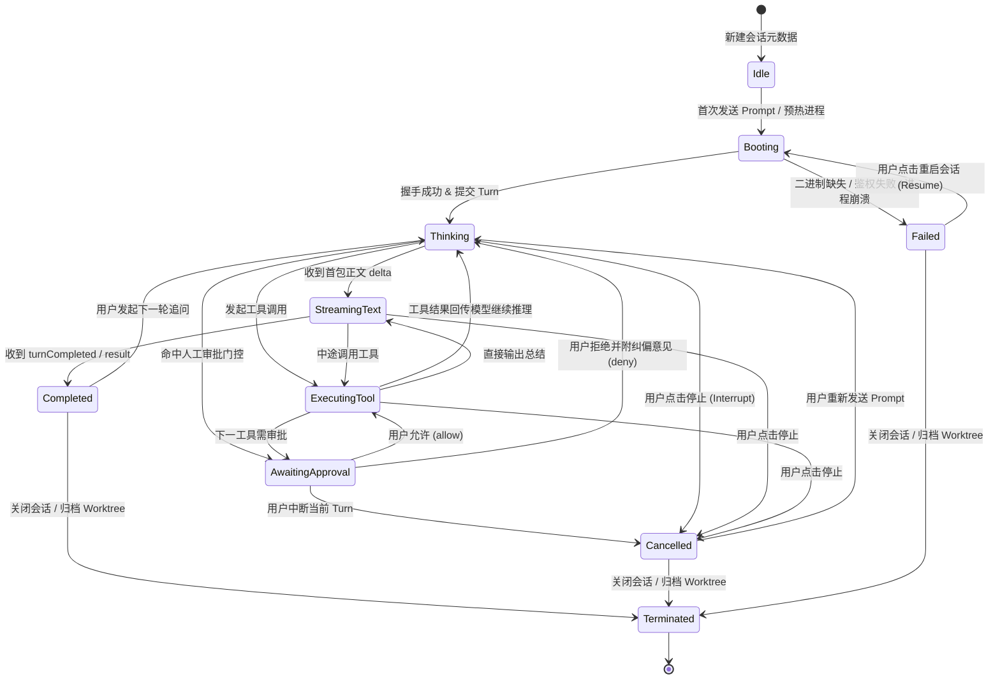

# Shepherd macOS 原生系统架构设计

> **文档角色**：Shepherd 方案计划书 — 系统架构篇（`docs/02-architecture.md`）  
> **校准状态**：已结合上游源码审计报告 [`docs/01-orca-audit.md`](./01-orca-audit.md)（基线 `stablyai/orca` Commit `284bf842` / v1.4.214）与产品规范 [`docs/03-product-and-ux.md`](./03-product-and-ux.md) 完成校准，**路线 C1 保留**。修订版 v3（2026-11-26）：性能数字均为未实测目标；审批模型、进程清理、Worktree 安全与 Chat 渲染四处设计已按评审修正（v2）；**Claude Code 接入已对齐（§3.1.4），Agent 接入改为 provider 分层（§3.1.5），终端抽屉移出规划（v3）**。v4（2026-11-27）：崩溃兜底改为每个 Agent 一个看守进程加进程树标记，借鉴 Orca 的 `orca-provider-exec`（§3.3.3）。  
> **目标平台与协议**：macOS 15.0+ (Sequoia) · **仅 Apple Silicon (`arm64`，不支持 Intel Mac)** · Swift 6.0+ Strict Concurrency · **MIT License**  
> **架构愿景**：以 Conductor / cmux 级别的 macOS 原生轻快体验，承载 Orca 级别的跨厂商 BYOA（Claude Code / Codex / ACP Agent）与 Git Worktree 并发隔离编排能力。  
> **范围说明**：本期聚焦本地单机多 Agent 编排核心，**不包含**模型路由网关或协议转换代理（如 Magpie 类能力），仅在底层预留干净的子进程环境变量注入与协议扩展边界（详见第 7 节）。

---

## 1. 核心技术路线深度对比与最终选型裁决

Shepherd 的首要架构决策在于：**核心编排引擎与 Agent 协议驱动层，究竟采用 Node.js Sidecar 复用裁剪版 Orca 无头后端（`orcad`），还是 100% 用纯 Swift 原生实现？**

以下结合 `docs/01-orca-audit.md` 对 `stablyai/orca`（~370 万 LOC）的源码级审计实证，对三条候选路线进行架构拆解与 5 维度量化对比。

### 1.1 候选路线定义（已按源码审计实证校准）

#### 路线 A：Sidecar 混合模式（SwiftUI 原生壳 + 裁剪版 Orca `orcad` Headless Runtime）
- **形态**：macOS 主 App 使用 SwiftUI + AppKit 构建原生界面；App Bundle 内置锁定版 **Node.js v24.22.3** 及 Orca 的无头守护进程 **`orcad`**（`src/main/orcad/main.ts`）。
- **通信**：主 App 启动时拉起 `orcad` 子进程，读取 `orca-runtime.json` 发现本地 Unix Domain Socket（权限 `0600`），通过 Orca **自定义 NDJSON RPC 协议**（非标准 JSON-RPC 2.0，由 `zod` v4 校验、共 1,202 个方法）通信。
- **源码审计澄清（先破除一个误判）**：`docs/01-orca-audit.md` 已证实 **`orcad` 脱离 Electron 的成本实为 0**（上游已通过 `check-runtime-electron-ratchet.mjs` 实现 0 处 `electron` 导入，且已彻底移除 `better-sqlite3`，全面改用 Node 24 内置 `node:sqlite`）。
- **但实证暴露的四项致命硬代价**：
  1. **包体与运行时重税**：锁定 `Node v24.22.3` 单二进制即达 **122.59 MB**（`darwin-arm64`）或 **125.76 MB**（`darwin-x64`，Universal 双架构约 **248 MB**），叠加 ~11 MB `orcad` JS bundle、**25 个平铺子 Worker/进程入口**（`daemon-entry`、watcher、多个 SQLite worker 等）及 `node-pty` / `@parcel/watcher` / `orca-provider-exec` 原生模块，未写一行 UI 即背负 ~150 MB+ 磁盘体积（未压缩口径）与 **250–500 MB** 常驻空闲内存（估算，未实测）；
  2. **极难轻量裁剪（「能跑」≠「能裁」）**：`OrcaRuntimeService`（31.7 万 LOC）与 `1,202` 个 RPC 深度交织 Bots(143) / Browser(127) / Orchestration(65) / Mobile E2EE / Linear / Jira；黑盒挂载则背负 90% 冗余子系统与攻击面，强行剥离则需拆解数万行跨模块耦合且彻底断掉上游合并能力；
  3. **不可忽视的闭源 SDK 合规红线**：`orcad` 的 Claude Native Chat 强依赖 **`@anthropic-ai/claude-agent-sdk`（`0.3.330`）**，该包**并非 MIT 开源**，受 **Anthropic Commercial Terms of Service** 约束；
  4. **公证与跨进程排障成本**：macOS Notarization 须为 Node 24、`.node` 原生插件与 C 辅助进程逐一签 Hardened Runtime，且双进程状态同步与排障复杂度高。

#### 路线 B：100% 纯 Swift 原生重写（Single-Process Native Core）
- **形态**：全栈采用 Swift 6 + SwiftUI + AppKit，**零 Node.js / 零 Electron / 零内置浏览器 / 零闭源商业 SDK**。Swift 主进程直接通过 `posix_spawn` 驱动用户本机已安装的 CLI：
  - `git worktree` / `git status` / `git diff` / `gh`（直接调用本机 `git` 二进制，完整兼容用户 `.gitconfig` / SSH / GPG / LFS）；
  - `codex app-server`（双向 stdio NDJSON，省略 `"jsonrpc": "2.0"` 字段）；
  - `claude` CLI（直连双向 `stream-json` 控制协议 `--permission-prompt-tool stdio`，摆脱 `@anthropic-ai/claude-agent-sdk` 条款绑定）；
  - 通用 ACP Agent（标准 JSON-RPC 2.0 over stdio NDJSON）。
- **优势**：
  1. **预期轻快**：冷启动 0.2s–0.4s、空闲内存 45–75 MB、签名 `.dmg` 体积 12–22 MB（均为设计目标，尚未实测），预期明显轻于 `orcad` Sidecar；
  2. **架构纯净且体量极克制**：对照 `01-orca-audit.md` 第 5 节模块清点，Shepherd MVP 所需后端核心总量仅约 **8,000–10,000 行纯 Swift 代码**（不足 Orca `src/main` 140 万行的 1%；该估算不含 UI 且偏乐观，见 `01-orca-audit.md` §6 的 v2 注），单进程内以 Swift 6 Actor 隔离，Xcode Instruments 一站式剖析；
  3. **合规姿态干净**：零闭源商业 SDK 绑定，纯干净室协议实现，MIT 参考无污染。
- **代价**：
  1. Claude Code 的 `stream-json` 底层控制协议缺乏显式 SemVer 承诺，上游 CLI 升级时存在字段微调的追新成本；
  2. 需自行编写 Git Worktree 并发锁、脚本 SHA-256 信任门控、审批策略与异常恢复状态机（但可直接吸取 `stablyai/orca` 审计暴露的全部边界经验，避免踩坑）；
  3. Claude 线协议在 Orca 中没有参考实现（Orca 把它交给 SDK），需要以官方 Python SDK（MIT）与实机 Golden-file 为依据（见 `01-orca-audit.md` §7.3）。

#### 路线 C：分阶段演进路线（Protocol-First 抽象边界）
路线 C 用强协议接口隔离「编排控制面」与「Agent 传输实现」，评估两个方向：
- **策略 C1（纯 Swift 内核 + 按需轻量 ACP 逃生舱 — 最终锁定方案）**：Shepherd 主进程、Worktree 管理、SQLite 持久化、Codex 驱动、ACP Client、Claude `stream-json` 驱动全部 100% Swift 原生实现；所有 Agent 均隐藏在统一的 `AgentAdapter` Swift 协议之后。当上游 Claude CLI 底层 `stream-json` 发生破坏性变更时，可通过 `ACPClientAdapter` 切至用户自行安装的适配器 `@agentclientprotocol/claude-agent-acp` 作为备用通道，无需引入整套 Orca Sidecar。**v2 更正**：该适配器直接依赖 `@anthropic-ai/claude-agent-sdk` 并要求 Node ≥ 22（`01-orca-audit.md` §7.2），启用它等于在用户机器上重新引入这两项运行时依赖；切换耗时、会话能否续用、审批行为是否一致均未实测，原「1 天内」「零侵入」的说法撤回。**v3 定稿**：该适配器定位为外部 provider `claude-acp`，是 Claude 在 Native Chat 下唯一的备用路径，由用户自行安装，切换后只能新开会话（§3.1.4、§3.1.5）。
- **策略 C2（Sidecar-First 渐进替换 — 审计后已否决）**：经 `01-orca-audit.md` 查证，`orcad` 虽无 Electron 依赖，但挂接自定义 1,202 方法 RPC 契约 + 150 MB Node 24 包体 + 闭源 SDK 风险的短期收益远不如直接写 ~3,000 行 Swift 协议层，且后续迁移还要推倒重写一遍传输适配层，属于高沉没成本弯路，因此正式否决。

---

### 1.2 五维度量化与定性对比矩阵

> **口径说明（v2）**：路线 A 的体积与结构数据来自 `01-orca-audit.md` 的源码审计；三条路线的启动时间、内存与包体数字都是估算，尚未实测，不应当作已验证的对比结果引用。

| 评估维度 | 路线 A：Sidecar 混合模式（Swift + Orca `orcad`） | 路线 B：100% 纯 Swift 原生 | 路线 C1：纯 Swift 内核 + ACP 逃生舱（最终锁定） |
| :--- | :--- | :--- | :--- |
| **1. 冷启动速度**（点击图标至首屏可交互） | 1.5s – 2.8s（App 启动 + Node 24 启动 + ~11MB bundle 解析 + 多子 Worker 初始化） | **0.2s – 0.4s**（纯原生二进制直接渲染） | **0.2s – 0.4s**（逃生舱仅按需懒启动，不影响主进程） |
| **2. 内存占用**（空闲 / 5 并发会话不含外部 Agent 进程） | 空闲 **250–500 MB**（`orcad` V8 堆 + 多个常驻子 Node/Worker 进程）；5 会话 400–700 MB | **空闲 45–75 MB；5 会话 110–180 MB** | **空闲 45–75 MB；5 会话 110–180 MB**（启用外部 ACP 桥时仅单会话额外 +45 MB） |
| **3. 安装包体积**（签名压缩后 `.dmg`） | **150 – 260 MB**（仅 Node v24.22.3 `arm64` 即 122.6 MB，双架构 ~248 MB，另含 25 入口与 `.node` 模块；**口径注**：这些是未压缩体积，Node 官方发行包压缩后约 26–51 MB，压缩后的 `.dmg` 会明显小于此值（未实测），路线结论不依赖该数字） | **12 – 22 MB**（不内嵌终端） | **12 – 22 MB**（零捆绑 Node 运行时，对齐 `03-product-and-ux.md` ≤25 MB 红线） |
| **4. 上游协议追新与合规风险** | **合规高风险**（捆绑商业条款 `@anthropic-ai/claude-agent-sdk`）；裁剪分支无法合并上游 | **合规干净**；Codex/ACP 稳定，Claude `stream-json` 存在单点追新风险 | **直连路径合规姿态较稳，追新靠 Golden-file 与备用通道**（备用的 `claude-agent-acp` 依赖 SDK 与 Node，订阅登录下的合规性需公测前确认，见 §3.1.4） |
| **5. 调试与排障复杂度** | **高**（Swift + Node 24 + 25 子进程 + `.node` 原生插件，Notarization 与崩溃归因复杂） | **低**（纯 Xcode 单进程调试、单一 Crash Log、Instruments 全链路分析） | **低**（95% 路径单进程调试，逃生舱走标准 stdio NDJSON 抓包） |

---

### 1.3 最终技术路线裁决（DECISION LOCKED）

> **最终裁决**：**正式锁定路线 C1（100% 纯 Swift 6 原生内核 + Protocol-First 抽象 + 可选 ACP 逃生舱）**，彻底放弃复用 `orcad` Node Sidecar（路线 A / C2）。（注：`@agentclientprotocol/claude-agent-acp` 这类适配器只作为用户自行安装的外部 CLI，不随 Shepherd 安装包捆绑；它自身依赖 Claude Agent SDK 与 Node，定位见 §3.1.4 与 §3.1.5。）

**四条硬事实决策依据（全部已由 `docs/01-orca-audit.md` 交叉核验）**：
1. **体量与性能红线不可妥协**：`orcad` 虽已零 Electron 依赖，但绑定 Node v24.22.3（122.6 MB）+ 25 个子进程入口导致冷启动、内存（250–500 MB）与安装包体积（150 MB+）全面击穿 `docs/03-product-and-ux.md` 确立的验收红线（TTI ≤ 400ms、空闲内存 ≤ 80 MB、`.dmg` ≤ 25 MB）。
2. **「能脱离 Electron」不等于「能轻量裁剪」**：`OrcaRuntimeService`（31.7 万 LOC）与 1,202 个自定义 RPC 深度捆绑 Bots / Browser / Mobile / Linear / Jira；而 Shepherd MVP 核心后端用纯 Swift 干净实现仅需不足 **1 万行代码**，长期维护成本反而显著更低。
3. **规避闭源 SDK 合规风险**：跳过 `orcad` 使 Shepherd 天然摆脱受 Anthropic Commercial Terms of Service 约束的 `@anthropic-ai/claude-agent-sdk`，保持纯粹的开源 BYOA（Bring Your Own Agent）中立姿态。
4. **最大化复用 Orca 的真正精华**：将 `stablyai/orca`（MIT）作为**协议规格、边界坑位与状态机设计的活字典**——完整继承其经过生产验证的边界处理（如 Codex 未支持 Server Request 显式拒绝防挂起、`orca.yaml` 的 `worktree.sharedDirectories` + `git check-ignore` 校验、脚本内容 SHA-256 信任哈希门控、POSIX 进程组清场与中断 Worktree 删除的重启续跑队列），但不背负其任何历史技术债。

> **v2 评审说明**：路线选择不依赖上面的估算数字。即使去掉「内存与包体领先一个数量级」和「不足 1 万行」这两个未实测的说法，C1 仍然成立：Shepherd 只需要 Orca 的一小部分能力，直接驱动本机 CLI 与产品边界吻合，并且不必把 Node 与 SDK 放进安装包。需要保留意见的只有一点：Orca 对 Claude 线协议不构成参考实现（`01-orca-audit.md` §7.3），这部分的依据要换成官方 Python SDK 与实机样本。

---

## 2. macOS 原生客户端分层架构

Shepherd 采用清晰的 **四层单向数据流架构**，严格遵循 Swift 6 并发模型：UI 状态投影驻留在 `@MainActor`，所有协议 IO、Git 子进程与 SQLite 写入均在独立 `actor` 中异步执行，杜绝主线程阻塞。

### 2.1 整体架构图



### 2.2 UI 层：SwiftUI + AppKit 精准桥接策略

纯 SwiftUI 在普通表单与导航栏开发效率极高，但在 **macOS 高频文本流渲染、多栏精确布局与底层窗口控制** 上存在已知性能短板。Shepherd 采取「**骨架 SwiftUI + 性能热区 AppKit (`NSViewRepresentable`)**」混合策略：

| UI 模块 | 实现技术 | 关键工程考量 |
| :--- | :--- | :--- |
| **主窗口与三栏布局** | SwiftUI `WindowGroup` + `NSSplitViewController` 桥接 | 精确保存各栏宽度（`autosaveName`）、支持一键折叠左侧栏与右侧 Diff Inspector、支持原生 Unified Toolbar 与毛玻璃侧栏材质（`.sidebar`）。 |
| **Native Chat 对话流** | **待 M0 Chat 渲染 Spike 选型**：候选一为 SwiftUI `ScrollView` + 增量块级模型（代码/长文本段用 AppKit 文本视图），候选二为与 Diff 相同的 AppKit 虚拟化列表（`NSTableView` / TextKit 2） | **防抖渲染**：单条流式回复拆分为稳定历史块（Immutable）+ 当前活跃尾块（Mutable），仅活跃块响应 delta 更新，避免整条列表触发全量 Diff 重排。**v2 补充**：Chat 是唯一的对话界面，长转录（200+ 条消息）下 SwiftUI 懒加载列表的滚动定位、跨块文本选择与流式 Markdown 增量解析都是已知难点，不应只给 Diff 做虚拟化；Markdown 引擎尚未选型（见 `04-roadmap-and-engineering.md` §1.3）。 |
| **高性能 Diff 查看器** | **AppKit `NSTextView`（TextKit 2）** 或 **虚拟化 `NSTableView`** | 当单次 Agent 重构涉及 50 个文件 / 8,000 行 Diff 时，SwiftUI `LazyVStack` 会出现滚动掉帧与高内存；使用基于行/Hunk 虚拟化的 `NSTableView`（配合异步语法高亮缓存，如 `swift-tree-sitter`）可稳定保持 120fps（ProMotion）。 |
| **菜单栏常驻伴侣** | SwiftUI `MenuBarExtra(.window)` | 实时展示并发 Worktree 聚合徽章（绿色空闲 / 蓝色运行 / **琥珀色待审批数字**），点击弹窗可一目了然查看所有运行中任务并一键唤起对应窗口；遵循安全原则，不在极窄 Popover 中提供高危命令盲批按钮，一律点击跳入主窗口看清上下文后再 `⌘↩` 确认。 |
| **系统级审批通知** | `UNUserNotificationCenter` + 深链接路由 | 对「待审批 / 已完成 / 报错」三类事件精准推送（当前窗口已聚焦该 Worktree 时自动抑制免打扰）；携带 `worktree_id` 与 `approval_id`，点击通知直接激活主窗口并聚焦对应内联审批条。 |

### 2.3 状态管理层：`@Observable` + Actor 隔离与背压节流

并发运行 4～8 个 AI Agent 时，典型卡顿根源是高频 `text_delta`（每秒数百条 JSON 行）直接触发 `@MainActor` 属性写入，造成 SwiftUI 视图树以 600Hz 重绘。

Shepherd 在架构层强制执行以下并发约束：
1. **Per-Session Actor 隔离**：每个活跃会话对应独立的 `actor SessionRuntime`，独占该子进程的 `stdout`/`stdin` 读写任务、协议状态机转换与内存增量拼接，彼此零共享锁竞争。
2. **33ms（30Hz）输出合并窗口（Delta Coalescer）**：`SessionRuntime` 在 Actor 内累积 `thinkingDelta`、`messageDelta`、`toolOutputDelta`，通过轻量定时刷盘器每 33ms（或遇到状态跃迁/Turn 结束立即刷新）向 `@MainActor` 的 `SessionViewModel`（`@Observable`）推送一次不可变快照增量。
3. **只读 UI 投影**：UI 视图仅观察 `@Observable final class WorkspaceStore` 与 `SessionViewModel`；所有用户意图（发送 Prompt、点击审批、中断 Turn、清理 Worktree）均通过异步 Command 投递到对应 Actor 执行，UI 仅负责呈现状态与乐观反馈。

### 2.4 不内嵌终端（v3 决定）

原方案在 P1 提供 `⌘J` 内嵌终端抽屉（`SwiftTerm`），并用它承担 Claude 的「Resume in Terminal」备用路径。v3 把它整体移出规划：

- **对话只有 Native Chat 一种形态**。Claude 的备用路径改为同一契约下的另一个 provider（§3.1.4），不再经过终端。
- **需要 shell 时跳系统终端**。`⌘⇧T` 在用户的默认终端里打开当前 Worktree 目录，Shepherd 不管理这个终端里的进程。
- **随之取消的部分**：`ShepherdTerminal` 包与 `SwiftTerm` 依赖、PTY 容器池、`OSC 7501` 状态解析、终端 Hook、Native Chat 与 TUI 之间的会话互斥锁、终端轮次的转录回填。
- **原先靠终端解决的事**（登录、用量查看、TUI 专属斜杠命令）的去处见 §3.1.4。

---

## 3. 核心子系统详细设计

### 3.1 Agent Runtime Adapter 层

> **v3**：Agent 接入按 provider 组织。每个 provider 是一个独立的包，内含一个 `AgentAdapter` 实现；核心只依赖契约，不引用具体 provider。分层与独立维护的规则见 §3.1.5。

#### 3.1.1 统一内部事件模型与 Adapter 协议（Swift 6）

所有厂商协议在进入 Shepherd 领域层前，均被标准化为强类型的 `AgentEvent` 流。以下是可直接指导编码的核心契约定义：

```swift
public enum AgentProviderKind: String, Codable, Sendable {
    case codex
    case claudeCode
    case acpGeneric
}

public enum SessionPhase: String, Codable, Sendable {
    case idle
    case booting
    case thinking
    case streamingText
    case executingTool
    case awaitingApproval
    case completed
    case cancelled
    case failed
}

public enum ToolCategory: String, Codable, Sendable {
    case shellCommand
    case fileRead
    case fileEdit
    case fileSearch
    case mcpTool
    case webFetch
    case unknown
}

public struct ApprovalPayload: Identifiable, Codable, Sendable, Equatable {
    public let id: String               // 协议侧原始 requestId
    public let toolCategory: ToolCategory
    public let title: String            // 如 "Run Shell Command" / "Edit File"
    public let commandOrPath: String    // 具体命令或目标路径
    public let diffPreview: String?     // 可选文件修改预览
    public let workingDirectory: String
    public let riskLevel: RiskLevel     // .low / .medium / .high
    public let options: [ApprovalOption]
}

public struct UsageSnapshot: Codable, Sendable, Equatable {
    public let inputTokens: Int
    public let outputTokens: Int
    public let cacheReadTokens: Int?
    public let estimatedCostUSD: Double?
    public let contextWindowUsageRatio: Double?
}

public enum AgentEvent: Sendable, Equatable {
    case sessionReady(externalSessionId: String, capabilities: AgentCapabilities)
    case phaseChanged(SessionPhase)
    case turnStarted(turnId: String)
    case thinkingDelta(turnId: String, text: String)
    case messageDelta(turnId: String, text: String)
    case toolCallStarted(turnId: String, callId: String, category: ToolCategory, title: String, inputSummary: String)
    case toolCallOutputDelta(turnId: String, callId: String, chunk: String)
    case toolCallCompleted(turnId: String, callId: String, exitCode: Int?, outputSummary: String, isError: Bool)
    case approvalRequested(turnId: String, payload: ApprovalPayload)   // v2：只覆盖「权限确认」，问题作答与表单填写需另行建模，见下方说明
    case fileDiffHint(paths: [String])  // 触发 GitDiffEngine 增量刷新
    case usageUpdated(UsageSnapshot)
    case turnCompleted(turnId: String, stopReason: String)
    case errorOccurred(code: String, message: String, isRecoverable: Bool)
    case processExited(exitCode: Int32)
}

public protocol AgentAdapter: Sendable {
    var provider: AgentProviderKind { get }
    func start(config: AgentLaunchConfig) async throws -> AsyncThrowingStream<AgentEvent, Error>
    func sendPrompt(_ prompt: UserPromptInput) async throws
    func respondApproval(requestId: String, decision: ApprovalDecision) async throws   // v2：单一 decision 装不下 answers 与表单 content，见下方说明
    func interruptCurrentTurn() async throws
    func terminate() async
}
```

> **v2 契约修订（草案待改，本轮只改文档、不改接口代码）**：上面的草案把所有需要用户参与的请求都当成「审批」，并用一个 `decision` 回复。用本机 `codex` 0.172.0 生成的协议 Schema 核对后，这个抽象装不下 Codex 的四类反向请求（`01-orca-audit.md` §7.4）：Agent 问「选哪种迁移策略」时，一个「允许」按钮传不回用户的答案。接口需要按下表拆成三类交互。它们进入同一个「待处理」列表，但各自保留原始语义与回包结构。

| 交互类型 | 用户看到的界面 | Codex 来源与回包 | Claude / ACP 对应 |
| :--- | :--- | :--- | :--- |
| **权限确认** | 内联审批条（允许一次 / 本会话允许 / 拒绝 / 取消） | `item/commandExecution/requestApproval`、`item/fileChange/requestApproval` → 回 `decision`（命令审批另有两种策略修订选项） | Claude `can_use_tool`（含退出计划模式的确认）；ACP `session/request_permission` |
| **问题作答** | 问答卡（选项或自由文本） | `item/tool/requestUserInput` → 回 `answers` | Claude 的提问同样以 `can_use_tool` 到达（工具名 `AskUserQuestion`），答案随回包带回，字段以 M0 Golden-file 为准；ACP 视方言而定 |
| **表单填写** | 表单卡（按请求给出的 Schema 渲染字段） | `mcpServer/elicitation/request` → 回 `action` 加可选 `content` | MCP elicitation，各 Agent 的支持程度待 M0 验证 |

> **v3 契约补充（同样只改文档、不改接口代码）**：
>
> - 草案里的 `AgentProviderKind` 是封闭枚举。provider 分层后，provider 标识改为清单里的字符串 ID（如 `codex`、`claude-direct`、`claude-acp`），新增 provider 不需要改契约。
> - `AgentCapabilities` 承担能力声明：是否支持权限模式切换、模型切换、会话续聊、问题作答、表单填写、用量上报。界面按声明隐藏 provider 做不到的功能。
> - 上述类型与 `AgentAdapter` 一起移入契约包 `ShepherdProviderKit`（§3.1.5）。

#### 3.1.2 三大厂商协议映射矩阵

| 内部标准模型 / 动作 | `CodexAppServerAdapter` (`codex app-server`) | `ClaudeCodeAdapter`（provider `claude-direct`） | `ACPClientAdapter` (标准 ACP) |
| :--- | :--- | :--- | :--- |
| **启动命令** | `codex app-server --listen stdio://` | `claude --print --input-format stream-json --output-format stream-json --verbose --include-partial-messages --permission-prompt-tool stdio --replay-user-messages`，另按情况追加 `--session-id <uuid>` 或 `--resume <id>`、`--permission-mode <mode>`（细目见 §3.1.4） | `<agent-bin> <acp-args>`（如 `gemini --experimental-acp` / `claude-agent-acp`） |
| **传输格式** | NDJSON 双向类 JSON-RPC（线缆层**省略 `"jsonrpc": "2.0"` 字段**） | NDJSON 双向流（直连本机 `claude` CLI，零闭源 SDK 依赖） | 标准 NDJSON JSON-RPC 2.0 |
| **握手与会话创建** | `initialize`（声明 `clientInfo: { name: "shepherd_mac", title: "Shepherd" }`，绝不沿用 `orca_desktop`）→ 收到响应后发 **`initialized` 通知** → `thread/start` / `thread/resume` | 先发 `control_request(subtype: "initialize")`，收到应答后再发第一条用户消息；以 `system(subtype: "init")` 帧的 `session_id` 为准；`CLAUDE_CODE_ENTRYPOINT` 既不设置也不继承 | `initialize` →（可选 `authenticate`）→ `session/new`（传 `cwd`）或 `session/load` |
| **发送 Prompt** | `turn/start` (`threadId`, `input`) | 向 `stdin` 写入 `{ "type": "user", "message": { "role": "user", "content": [...] } }` | `session/prompt` (`sessionId`, `prompt`) |
| **Thinking / 文本流** | `item/started` + `item/reasoning/*` + `item/agentMessage/delta` | `stream` 事件内的 `thinking_delta` / `text_delta` 及 `assistant` 完整块 | `session/update` (`agent_thought_chunk` / `agent_message_chunk` / `plan`) |
| **工具调用事件** | `item/started` / `item/completed`（commandExecution / fileChange / mcpToolCall） | `assistant` 块中的 `tool_use` + `user` 块中的 `tool_result` | `session/update` (`tool_call` / `tool_call_update`) |
| **权限审批与交互请求** | Server Request 统一分流：`item/commandExecution/requestApproval`、`item/fileChange/requestApproval`、`item/tool/requestUserInput`、`mcpServer/elicitation/request` | 入站 `type: "control_request"`（含 `request_id` 与嵌套 `request: { subtype: "can_use_tool", tool_name, input }`；最终线协议字段以 M0 实机 Golden-file 锁定） | Agent Request：`session/request_permission`（宿主侧执行策略门控） |
| **权限审批回复** | JSON-RPC Response（匹配 `id`），**回包结构随请求类型不同**：命令与文件审批回 `decision`（`accept` / `acceptForSession` / `decline` / `cancel`，命令审批另有 `acceptWithExecpolicyAmendment` / `applyNetworkPolicyAmendment`），用户问答回 `answers`，MCP 表单回 `action` 加可选 `content`；**所有未支持/历史 Server Request 必须显式返回拒绝或错误码，防止 `app-server` 永久挂起** | 写入 `stdin` 嵌套帧：`{ "type": "control_response", "response": { "subtype": "success", "request_id": "...", "response": { "behavior": "allow" \| "deny", ... } } }`（字段以 M0 Golden-file 实测锁定） | JSON-RPC Response（匹配 `id`）：所选 `optionId` 或取消 |
| **中断当前 Turn** | `turn/interrupt` | `control_request(subtype: "interrupt")`（降级发 `SIGINT`） | `session/cancel`（请求超时发 `$/cancel_request`） |
| **用量与结束** | `turn/completed` + token usage 通知 | `result` 帧（含 `session_id`、`total_cost_usd`、token 统计；识别 `rate_limit_event` 提示限流） | `session/prompt` 返回 `stopReason` + 元数据 |
| **专属健壮性处理** | 处理 `-32001` 过载指数退避；遵循零污染原则不改写 `~/.codex/hooks.json`；MVP 一会话一进程隔离，P1 可按需引入共享进程池（空闲 60s 回收 + 内存上限巡检）；协议类型优先由 `codex app-server generate-json-schema`（实验性命令）生成，并在 CI 中比对 Schema 漂移 | 严格解析单行 JSON 容错非 JSON 告警输出；备用路径是外部 provider `claude-acp`（§3.1.4） | 增量分帧 + 单行上限保护 + 断连尾帧排空；方言层适配模型发现模式与环境变量（如 `PI_NO_PTY=1`） |

> **v3 说明**：上表 Claude 一列已按 §3.1.4 的对齐结论更新。原「三级兼容接入策略」里的第三级（终端 PTY 加 Hook）随终端抽屉一起取消。

**Claude Code 接入策略（纯 Native Chat，同一契约下两个 provider）**：
1. **默认：内置 provider `claude-direct`**。纯 Swift 直接驱动用户本机已登录的 `claude`，自己实现双向 `stream-json` 控制协议；不捆绑受 Anthropic Commercial Terms of Service 约束的 `@anthropic-ai/claude-agent-sdk`，不冒用其他入口标识。
2. **备用：外部 provider `claude-acp`**。经内置的 ACP 客户端驱动用户自行安装的 `@agentclientprotocol/claude-agent-acp`，界面仍是 Native Chat。它依赖 Claude Agent SDK 与 Node ≥ 22，包的是同一个 CLI：上游协议变动时要等适配器更新，用量政策变动时同样受影响。从 `claude-direct` 切过去只能新开会话，能否续用原会话未实测，不作承诺。
3. **没有第三条路径**。终端不再承担接入或备用职责（§2.4）。直连驱动跟不上上游变动时，应对手段是尽快发版修复，以及让用户临时改用 `claude-acp`。

#### 3.1.3 协议消息流与审批闭环时序图



#### 3.1.4 Claude Code 接入对齐结论（v3 · 2026-11-26）

v2 列出的 11 项待定事项已逐项对齐，结论如下。「留给 M0 确认」一列的内容来自文档记忆或 Orca 源码，尚未在本机实测；事实依据见 `01-orca-audit.md` §7.2–§7.6。

| # | 事项 | 结论 | 留给 M0 确认 |
| :---: | :--- | :--- | :--- |
| 1 | **默认驱动与备用路径** | 默认 `claude-direct`（直连 CLI）；备用是外部 provider `claude-acp`；终端不是接入路径 | 切到 `claude-acp` 后的审批与交互行为是否符合预期 |
| 2 | **启动契约** | 见下方「启动契约」 | `CLAUDE_CODE_EMIT_SESSION_STATE_EVENTS=1` 在本机版本是否生效 |
| 3 | **会话 ID 与续聊** | Shepherd 生成 UUID；新会话传 `--session-id`，续聊传 `--resume`；细则见下方「会话规则」 | `--resume` 后会话 ID 是否保持不变；转录文件的路径规则 |
| 4 | **权限档位** | 与 Claude 原生模式一一对应，默认「沿用我的 Claude 设置」；见下方「权限档位」 | `init` 帧能否读到生效的权限模式；`auto` 的可用条件 |
| 5 | **「每次询问」** | 首版不提供。「询问」档的含义是 Claude 按自己的规则来问，界面如实标注 | `hook_callback` 能否在允许规则之前拦到每次工具调用，结果决定 P1 是否加「严格模式」 |
| 6 | **工作区信任** | Shepherd 设自己的仓库信任门；不限制 `--setting-sources`；见下方「仓库信任门」 | 无头模式下项目级 hooks 与 MCP 的实际加载行为；`--setting-sources user` 能否挡住它们 |
| 7 | **线协议参考来源** | 实现依据是官方 Python SDK（MIT）源码，回归依据是实机 Golden-file；记录已测试的 `claude` 版本范围，超出时提示但不阻止 | — |
| 8 | **终端转录对账** | 取消。不内嵌终端，也就没有终端里产生的轮次（§2.4） | — |
| 9 | **环境变量** | 与用户终端里的环境一致，只去掉宿主带进来的，另加一个进程树标记（v4，§3.3.3）；见下方「环境变量」 | 需要清掉的变量完整名单；环境里有 `ANTHROPIC_API_KEY` 时无头模式的计费行为 |
| 10 | **用量政策预案** | 接受该风险，产品内不设对冲；出路在 Shepherd 之外：API Key，或经外部网关换模型与账号（§7） | 同一任务在 Native Chat 路径下的额度消耗 |
| 11 | **代码体量** | 原估 1.5–2 千行作废；粗估 6–9 千行 Swift（不含测试与 UI），见下方「代码体量」 | 用实测替换粗估 |

**启动契约**

- **进程**：一个会话对应一个常驻的 `claude` 子进程，工作目录是 Worktree，使用用户本机已登录的 CLI。
- **固定参数**：`--print --input-format stream-json --output-format stream-json --verbose --include-partial-messages --permission-prompt-tool stdio --replay-user-messages`。
- **按情况追加**：`--session-id <uuid>` 或 `--resume <id>`；`--permission-mode <mode>`（「沿用我的 Claude 设置」档不传）；`--model`。
- **不传**：`--system-prompt`、`--setting-sources`、`--settings`、`--plugin-dir`。目的是让会话与用户在终端里直接运行 `claude` 时的行为一致。
- **`--replay-user-messages` 的用途**：Shepherd 能确认每条用户消息已被 CLI 接收，排队消息依赖它。
- **`CLAUDE_CODE_EMIT_SESSION_STATE_EVENTS=1`**：有条件采用。它没有公开文档，仅见于 Orca 源码；M0 确认生效后启用，解码按「没有这类事件也能工作」来写。
- **握手顺序**：先发 `control_request(initialize)`，收到应答后再发第一条用户消息。
- **控制请求**：中断、切换权限模式（`set_permission_mode`）、切换模型（`set_model`）都在同一进程内完成，不重启。

**会话规则**

- 以 `system(init)` 帧里的 `session_id` 为准，与请求的不一致时更新数据库。
- 续聊前先只读地检查 Claude 的会话文件是否存在；`--resume` 启动失败时退回新建会话，并告知用户上下文没有接上。路径规则没有文档，所以两步都要有。
- 会话绑定 Worktree 路径：Claude 按目录存放转录，Worktree 换了路径就无法续聊。
- 分叉（`--fork-session`）列为 P1。

**权限档位**

| 界面档位 | 传给 Claude |
| :--- | :--- |
| 沿用我的 Claude 设置（默认） | 不传 `--permission-mode` |
| 询问 | `default` |
| 自动接受编辑 | `acceptEdits` |
| 计划模式 | `plan` |
| 完全放行 | `bypassPermissions`，每个会话单独确认 |

- `auto` 只在本机 CLI 列出且账号可用时显示。
- 会话头部始终显示实际生效的模式，避免用户设置里的 `defaultMode` 在不知情的情况下生效。
- 「询问」档下，已有允许规则命中的操作与只读工具不会经过 Shepherd，档位说明里写明这一点（§3.3.4）。

**仓库信任门**

- 仓库第一次加入 Shepherd 时确认一次，说明该仓库的项目级 hooks 与 MCP 配置会在会话启动时直接生效，Claude 自己不会再问。
- 按仓库记录，对它的所有 Worktree 生效；记在 Shepherd 的数据库里，不写 `~/.claude.json`。
- 与脚本信任门（§3.2.3）共用一个弹窗、分开记录：脚本信任随内容哈希失效，仓库信任不随提交变化。
- 已知缺口：Agent 可以在 Worktree 里修改项目级 hooks，下次会话生效。这与在终端里使用 Claude 的风险相同。
- 「不信任时以受限方式打开」暂不提供，要等 M0 确认 `--setting-sources user` 确实能挡住项目级 hooks 与 MCP。
- Codex 是否需要同样的门，由 M0 的无头模式信任验证决定。

**环境变量**

- **基线**：登录 shell 的环境（`ProcessEnvironmentProvider`）。
- **清掉**：`CLAUDECODE`、`CLAUDE_CODE_ENTRYPOINT` 这类因为 Shepherd 从另一个 Claude 会话或 IDE 终端启动才继承到的变量。`CLAUDE_CODE_ENTRYPOINT` 既不设置也不继承。
- **不清**：`CLAUDE_CONFIG_DIR`、`ANTHROPIC_API_KEY`、`ANTHROPIC_BASE_URL` 与云厂商相关变量。Orca 清它们是因为自带账号管理；Shepherd 没有账号管理，清掉会在用户不知情时改变账号与计费方式。
- **改为显示**：会话头部写明生效的登录方式；环境里有 `ANTHROPIC_API_KEY` 时提示一次。

**终端能力在 Native Chat 中的去处**

| 原先靠终端做的事 | 现在的处理 |
| :--- | :--- |
| 登录 | 用户事先在自己的终端里登录一次；Shepherd 检测到未登录时给出提示，不代为登录 |
| 查看用量与限流 | 从每轮的 `result` 帧与 `rate_limit_event` 读取并显示 |
| 斜杠命令 | 只支持无头模式下可用的部分，清单由 M0 列出；其余在界面上不出现 |
| 需要真实终端的交互式命令 | `⌘⇧T` 跳系统终端，Shepherd 不跟踪其中的进程 |

**代码体量（粗估，未验证）**

| 部分 | 粗估行数 |
| :--- | :--- |
| 传输与控制协议 | 1.5–2.5 千 |
| 消息解码与事件映射 | 2–3 千 |
| 启动、会话与环境 | 1–1.5 千 |
| 权限与三类交互 | 1–1.5 千 |

依据是对官方 Python SDK 协议核心规模的印象（约 3 千行），以及 Orca 在 SDK 之上仍有约 1.3 万行结构化对话代码这一事实。M0 出口用实测替换。

#### 3.1.5 Provider 分层与独立维护（v3 新增）

目标是让每个 Agent 的接入实现可以独立维护，核心不随某个 Agent 的协议变动而改动。做法参照 Magpie（`yetone/magpie`，MIT）的两层插件结构，事实依据见 `01-orca-audit.md` §7.6。

```text
ShepherdProviderKit（契约包，独立版本号）      ← 核心与 provider 之间唯一的共享面
├─ 内置 provider：独立 Swift 包，编进 App
│    ├─ codex            CodexAppServerAdapter
│    ├─ claude-direct    ClaudeCodeAdapter
│    └─ acp              ACPClientAdapter（同时是外部 provider 的宿主）
└─ 外部 provider：独立进程，清单文件 + 说 ACP 的可执行文件
     ├─ claude-acp       @agentclientprotocol/claude-agent-acp
     └─ Gemini / OpenCode / 其他 ACP Agent
```

**第一层：内置 provider**

- 每个 provider 是一个独立的 Swift 包，可以放进独立仓库，有自己的测试与 Golden-file。
- provider 只依赖契约包 `ShepherdProviderKit`。契约包的内容是 `AgentAdapter`、`AgentEvent`、三类交互、能力声明与启动规格。
- 核心（`ShepherdCore`、`ShepherdUI`）只依赖契约包，不引用任何具体 provider。只有 App 入口引用各 provider 包并完成注册。
- 每个 provider 带一份清单：ID、名称、兼容的契约版本范围、能力声明。契约版本不兼容的 provider 不注册，并在诊断页给出原因。
- 用一个边界测试守住依赖方向：核心不得引用 provider 包，provider 包之间不得互相引用。
- 这一层解决的是独立维护，不是独立发版：内置 provider 的更新仍随 App 发版，由 Sparkle 推送。

**第二层：外部 provider**

- 外部 provider 是独立进程，协议直接用 ACP，不另造私有协议。ACP 正好定义在宿主与 Agent 之间，并且已有现成生态。
- 一个外部 provider 由两部分组成：一份清单（启动命令、能力声明、方言差异），和一个说 ACP 的可执行文件。原方案里的 `DialectsRegistry` 即这份清单的注册表。
- 外部 provider 各自独立发版，Shepherd 不捆绑、不代为安装。
- 首版只支持用户手动添加，并在添加时确认一次；不做自动安装，也不做插件市场。外部 provider 是以用户权限运行的任意代码。

**与 Magpie 的差别**

- **契约更宽**。Magpie 的 provider 插件只做登录、列模型、发请求，基本无状态。Shepherd 的 provider 是长连接会话，带流式输出、三类交互、权限模式、续聊与进程树。
- **默认路径不依赖脚本运行时**。Magpie 的社区插件跑在首次使用时才下载的 Bun 上。Shepherd 的默认 provider 必须是原生 Swift：每个会话多一个 Node 或 Bun 进程会多占内存（§1.2 的估算是每会话约 45 MB，未实测），与内存目标冲突。因此外部 provider 只能是可选项。
- **进程树多一层**。外部 provider 使进程树变成 Shepherd、provider、CLI、工具四层，清理与后代进程跟踪要覆盖到（§3.3.3）。

**契约定版条件**

`ShepherdProviderKit` 在 M0 先以草案存在。至少经 `claude-direct`、`codex` 与一个 ACP Agent 三种实现验证后再定为 1.0，之前允许不兼容修改。

---

### 3.2 Git Worktree 管理器设计

#### 3.2.1 磁盘目录规范与命名策略
为避免在开发者主仓库父目录四处散落文件夹，Shepherd 默认将受管 Worktree 统一隔离在应用受管工作区下（允许按仓库自定义覆盖）：

```text
~/Library/Application Support/Shepherd/
├── shepherd.sqlite                 # GRDB 元数据与会话索引
├── shepherd.sqlite-wal
├── blobs/                          # >128KB 大日志外置压缩归档（LRU 清理）
└── logs/                           # 调试日志与可选协议抓包

~/.shepherd/
├── run/                            # 权限 0700，短路径本地 Socket (shepherd.sock, 0600) 与 runtime.json（规避 macOS sun_path 104 字节上限及路径空格）
└── worktrees/                      # 默认 Worktree 根目录（可在偏好设置修改）
    └── <repo-slug>-<short-hash>/   # 例：my-saas-a1b2c3d4
        ├── feat-oauth-login/       # 独立 Worktree 1
        └── fix-diff-perf/          # 独立 Worktree 2
```

#### 3.2.2 项目配置文件规范（`shepherd.yaml` 精确兼容 `orca.yaml`）
Shepherd 原生支持仓库根目录的 `shepherd.yaml`（或 `.shepherd.yaml`），同时**精确向下兼容上游 `orca.yaml` 的真实嵌套 Schema**（依据 `docs/01-orca-audit.md` §4.2 查证：`orca.yaml` 中的真实软链字段为 `worktree.sharedDirectories`，脚本字段为 `scripts.setup` / `scripts.archive`，并支持 `setupAgentStartupPolicy`；而 `symlinkPaths` 实为仓库级本地用户设置字段）。

配置解析与合并优先级（从高到低）：
1. Shepherd 本地仓库覆盖设置（存储在 SQLite，支持本地自定义 `symlinkPaths`、脚本覆写与环境变量，不污染 Git）；
2. `<repoRoot>/shepherd.yaml`（或 `.shepherd.yaml`）；
3. `<repoRoot>/orca.yaml`（自动忽略超出范围的 `environmentRecipes` VM 配方、`defaultTabs`、`issueCommand` 字段）。

```yaml
# shepherd.yaml（直接沿用与 orca.yaml 同构的嵌套 Schema，实现零成本双向兼容）
version: 1
baseBranch: main

# 启动策略：wait-for-setup（默认，等初始化完成再发首轮 Prompt）| start-immediately
setupAgentStartupPolicy: wait-for-setup

worktree:
  # 跨 Worktree 共享的未跟踪目录/文件（必须已存在且通过 git check-ignore 校验）。
  # 共享目录在所有 Worktree 间是同一份物理目录：只共享只读、或内容与分支无关的大型缓存，
  # 不要共享会被 setup 脚本或不同分支改写的目录（例如各分支 lockfile 不同的 node_modules）。
  sharedDirectories:
    - .cache/datasets
    - third_party/prebuilt
  # 可选（Shepherd 扩展）：需要物理拷贝而非软链的局部配置文件
  copyPaths:
    - .env.test

scripts:
  # Worktree 创建并完成软链后执行的初始化脚本（首次出现或命令文本变化时须经信任门控确认）
  setup: |
    pnpm install --frozen-lockfile --prefer-offline
  # Worktree 归档/删除前执行的清理钩子（默认失败时阻断删除防资源泄露）
  # 注意：信任门控只对这里的命令文本算哈希，被调用脚本文件的内容变化不会触发重新确认（见 3.2.3）
  archive: |
    ./scripts/cleanup-worktree.sh

# 该仓库共享的非敏感环境变量（敏感凭据建议留在本地覆盖设置或 .env.local）
env:
  NODE_ENV: development
```

> **向后兼容规则**：若用户在本地仓库偏好设置中配置了 `symlinkPaths`（用于软链 `.env.local` 等未入库单文件），运行时会与配置文件中的 `worktree.sharedDirectories` 合并去重执行。
>
> **v2 示例修正**：修订前的示例同时共享 `node_modules` 并在 `scripts.setup` 里执行 `pnpm install`，并发 Worktree 会互相改写同一个目录。示例已改为只共享与分支无关的缓存。现有 `orca.yaml` 若这样配置，Shepherd 仍兼容读取，但应在创建 Worktree 时给出提示。

#### 3.2.3 并发安全、脚本信任门控与磁盘保护机制
1. **Per-Repo 串行写锁（`RepoLockActor`）**：Git 的 `worktree add`、`worktree remove`、`worktree prune`、`branch -D` 与 `fetch` 都会竞争主仓库 `.git/` 下的 `packed-refs` 与 `worktrees/` 管理锁。`WorktreeManager` 为每个规范化后的 `repoCommonDir` 维护独立串行队列，确保同一仓库的拓扑变更严格串行执行，避免并发创建多个任务时出现锁冲突；而不同 Worktree 目录内部的 `git status`/`git diff` 保持全并发。
   - **v2 实现约束**：Swift actor 在 `await` 处可重入，等待 git 子进程期间同一个 actor 会接受下一个调用，仅靠 actor 隔离不能保证串行。这里必须实现显式的异步串行队列（或异步互斥），并用并发测试验证。
   - **v2 范围说明**：该锁只约束 Shepherd 自己发起的操作。Agent 与外部 IDE 在各自 Worktree 里执行的 git 命令不受它控制，所以仍要保留有限次数的抖动重试。
2. **双层软链安全边界（`git check-ignore` + Path Traversal Guard）**：
   - 借鉴 Orca 源码实证安全实践：对于来自仓库提交文件（`shepherd.yaml` / `orca.yaml`）的 `worktree.sharedDirectories`，软链前必须依次通过两道校验——① `standardizedFileURL.resolvingSymlinksInPath()` 路径穿越校验（源路径与目标路径严格位于主仓库与目标 Worktree 子树内，拒绝 `../` 越界）；② **`git check-ignore` 校验**（仅允许共享已存在且被 `.gitignore` 忽略的路径，防止误将受 Git 跟踪的源码目录做成软链或覆盖代码）。
   - **v2 补充（实测）**：`.gitignore` 里带斜杠的目录规则（如 `node_modules/`）不匹配同名软链。建好软链后，Worktree 的 `git status` 会出现 `?? node_modules`，Agent 可能把它提交进去（`01-orca-audit.md` §7.4）。软链完成后需要把这些路径写入 `$GIT_COMMON_DIR/info/exclude`。这是一次对 `.git` 内部的写入（不进版本库），必须列入「零污染」承诺的已声明写入清单，并纳入 M0 Git Spike 验证。
3. **脚本入口信任门控（Script Trust Gate，SHA-256）**：
   - 借鉴 Orca 的 `orca-hook-content-hash` 安全模型：执行来自仓库文件的 `scripts.setup` 或 `scripts.archive` 前，对 trimmed 脚本文本计算 **SHA-256 哈希**，比对 SQLite `trusted_hook_hashes` 表。
   - **未命中即拦截**：首次执行或 Git pull / 切分支引入了新脚本内容时，弹窗展示完整脚本文本与变更来源，必须由开发者显式点击「信任并执行」后才可运行；同时在 `trusted_hook_hashes` 表中按 `(repo_id, script_kind, content_sha256)` 复合唯一键保留多条历史已信任记录，防止开发者在多个可信分支间频繁切换时被重复打扰。
   - **v2 边界声明**：哈希只覆盖 YAML 里的命令文本。如果命令调用的是仓库内脚本（如 `./scripts/cleanup-worktree.sh`），或会触发包管理器钩子（如 `pnpm install` 的 `postinstall`），被调用内容变化时命令文本不变，不会重新弹窗。因此这道门控的语义是对「此仓库执行此入口」的首次确认，防不住拉取陌生分支后被调用内容发生的变化。弹窗文案相应改为「信任此仓库执行此入口」。可选增强是把命令直接引用的仓库内脚本文件一并纳入哈希，是否采用在 M0 评估。
   - **v2 已知缺口**：这道门控也不覆盖 Agent 自己加载的项目级配置。Claude 无头模式跳过工作区信任对话，仓库内的 hooks 等配置会直接生效（§3.1.4 第 6 项）。
4. **磁盘保护、未保存改动防护与中断删除续跑**：
   - 创建前通过 `URLResourceKey.volumeAvailableCapacityForImportantUsageKey` 检查剩余空间，低于可配置阈值（默认 2 GB）弹窗预警；创建中途失败自动回滚半成品目录并释放锁；
   - 归档/清理前执行预检（未提交修改 + 未跟踪风险文件 + 未 Push 本地 Commit 数），存在脏状态强制二次确认；若 `scripts.archive` 非零退出，默认阻断删除并提示重试或强制清理；
   - **崩溃续跑（Interrupted Removal Recovery）**：Worktree 进入 `Archiving` 状态即落盘 SQLite；若清理中途 App 崩溃，重启后自动扫描并续跑未完成的 `git worktree remove` 与 `git worktree prune`，同步对账 `~/.shepherd/worktrees/` 残留孤儿目录并提示一键回收。

#### 3.2.4 Worktree 与 Session 状态机图

##### Worktree 生命周期状态机



##### Session / Turn 运行状态机



---

### 3.3 进程生命周期、分发策略与安全模型

#### 3.3.1 为什么不能上架 Mac App Store（分发策略硬约束）

> **架构铁律**：Shepherd **不得**采用 Mac App Store (MAS) 分发，必须采用 **Direct Distribution（开发者官网 / GitHub Releases / Homebrew Cask 直接分发）**。

原因在于 Mac App Store 强制启用 **App Sandbox (`com.apple.security.app-sandbox = true`)**，该沙箱机制与多 AI 编程代理编排工具的核心能力存在不可调和的系统级冲突：

1. **无法执行用户本机任意开发工具链**：App Sandbox 禁止应用拉起位于 `/opt/homebrew/bin`、`~/.nvm`、`~/.cargo/bin`、`~/.local/bin` 的外部非沙箱二进制（`git`、`claude`、`codex`、`node`、`python`、`gh`、`go`、`docker` 等），且即使强行启动，子进程会强制继承沙箱限制，无法编译或运行项目代码。
2. **无法访问用户现有 CLI 登录态与 Git 凭据**：BYOA 模式的核心体验是复用用户已登录的 Claude / Codex / Gemini 凭证（`~/.claude`、`~/.codex`）、SSH 密钥（`~/.ssh`、`SSH_AUTH_SOCK`）与 macOS Git Credential Helper；App Sandbox 会严格阻断对用户家目录隐藏配置文件的访问。
3. **文件系统跨目录访问受阻**：`git worktree` 需要同时读写主仓库 `.git` 目录与目标 Worktree 目录，且测试脚本会访问全局缓存目录（如 `~/.pnpm-store`、`~/Library/Caches`、`~/.m2`），Security-Scoped Bookmarks 无法覆盖动态派生的外部构建工具访问需求。
4. **本地 IPC / Hook 受限**：无法在标准路径（如 `~/.shepherd/run/`）暴露 Unix Domain Socket 给外部命令行工具（如后续的 `shepherd` CLI）通信。

#### 3.3.2 Direct Distribution 签名、公证与更新链路
- **目标架构与开源协议（已锁定）**：仅构建并分发 **Apple Silicon (`arm64`)** 单一架构（不支持 Intel Mac、不打 Universal Binary）；项目以 **MIT License** 开源发布。
- **Bundle ID 与签名分阶段策略（已锁定）**：开发期（M0–M1）先使用临时占位 Bundle ID（如 `io.github.julytang.shepherd`）配合本地 ad-hoc 签名进行高频迭代；在首次对外公测（M4）或公证演练前最终定稿正式 Bundle ID 与 Developer ID Application 签名主体。
- **Hardened Runtime**：开启 Hardened Runtime（Apple 公证必需），遵循最小权限 Entitlements 原则：
  - `com.apple.security.app-sandbox = false`
  - `com.apple.security.network.client = true`（用于 Sparkle 更新检查、可选 GitHub PR API 调用）
  - 其余敏感项（如 `allow-jit` / `disable-library-validation`）**默认全部关闭**，保证最高系统安全基线。
- **签名与公证 CI 流水线（单一 `arm64` 产线）**：
  `xcodebuild archive`（`-arch arm64`）→ 由内向外逐组件 `codesign --options runtime --timestamp`（使用 **Developer ID Application** 证书依次签 `Sparkle.framework` 组件、`shepherd-reaper` 与 `Shepherd.app`，禁用 `--deep`）→ 临时 `ditto` 打包并 `notarytool` 公证 `Shepherd.app` → `stapler staple Shepherd.app` → 重新 `ditto` 打最终 Sparkle `.zip` → 基于已装订 `.app` 生成并签名 `.dmg` → `notarytool` 公证并 `stapler` 装订 `.dmg` → `spctl` 分别校验 `.app` 与 `.dmg`（详见 `docs/04-roadmap-and-engineering.md` §2.2）。
- **自动更新**：集成 **Sparkle 2**，使用 **EdDSA (`SUPublicEDKey`)** 校验更新包签名，托管静态 `appcast.xml`（支持 Stable / Beta 双频道）。
- **macOS GUI `PATH` 环境补全**：从 Finder / Spotlight 启动的 macOS GUI App 默认仅继承极简 `PATH=/usr/bin:/bin:/usr/sbin:/sbin`，找不到 Homebrew 与 nvm 安装的 `claude`/`codex`。Shepherd 启动时执行单次异步探测（`$SHELL -ilc 'env -0'`，3s 超时保护 + 交互式提示符抑制 + 缓存回退常见路径 `/opt/homebrew/bin`、`~/.local/bin`、`~/.npm-global/bin` 等），确保零配置开箱即用。
- **品牌隔离与开源合规基线（对齐 `docs/01-orca-audit.md` §1.3）**：以 **MIT License** 开源发布，彻底清除任何 Orca 商标/资源、`ORCA_*` 前缀、`clientInfo: "orca_desktop"` 与 `CLAUDE_CODE_ENTRYPOINT=orca`；零遥测零云端中继；全程采用系统原生 SF Pro / SF Mono（不引入 Geist SIL OFL 字体）；不捆绑闭源 `@anthropic-ai/claude-agent-sdk`；在 `THIRD_PARTY_NOTICES.md` 与 `About -> Licenses` 完整声明全部开源依赖。

#### 3.3.3 进程组回收与防孤儿进程（Orphan Prevention）

AI 编程代理在执行测试或启动开发服务器时，往往会派生多层孙进程（`shepherd` → `claude` → `bash` → `pnpm test` → `vitest`）。若仅终止直接子进程 PID，极易产生占满 CPU 或锁死端口的孤儿进程。

Shepherd 实施以下防孤儿保障机制（v2 增加第 4 点，并收窄了前三点的覆盖范围表述；v4 按 Orca 的做法改写第 3、4 点）：
1. **强制独立进程组（Process Group Isolation）**：
   - 所有子进程（Agent CLI、`scripts.setup`、`scripts.archive` 及外部 provider 进程）统一通过底层 `posix_spawn` 配合 `POSIX_SPAWN_SETPGROUP`（`pgroup = 0`）启动，使其自身 PID 自动成为全新进程组 ID（`PGID == childPID`），所有后代进程默认继承同一 `PGID`。
   - **v2 更正**：「默认继承」不等于「都在组内」。实测 Claude Code 会把 Bash 工具启动的 shell 放进独立进程组，交互式 shell 的前台作业也自成进程组（`01-orca-audit.md` §7.4）。只向 Agent 的进程组发信号覆盖不到它们。
2. **两阶段优雅终止（Graceful Escalation）**：
   - 会话关闭或 App 正常退出（`applicationWillTerminate`）时，先发送协议级退出请求（关闭 `stdin`），随即向整个进程组发送 `kill(-pgid, SIGTERM)`；
   - 等待宽限期（会话关闭 2.5s / App 退出 1.2s），通过 `waitpid` 非阻塞轮询确认进程组清空；若仍存活则执行 `kill(-pgid, SIGKILL)` 强制收割。
3. **主进程异常崩溃兜底（`shepherd-reaper`，v4 改写）**：
   - macOS 不具备 Linux 的 `prctl(PR_SET_PDEATHSIG)` 与 subreaper。Shepherd 主进程遭遇 `SIGKILL` 或崩溃时，无法执行 `applicationWillTerminate`，清理只能靠另一个活着的进程。
   - **v4 改动**：原方案是全局一个 `shepherd-reaper`，由主 App 经管道登记和注销 `PGID`。它有一个缺口：主 App 死后，新逃逸的后代没人登记。现改为借鉴 Orca 的 `orca-provider-exec`（`01-orca-audit.md` §7.7）：**每启动一个 Agent 进程套一层 `shepherd-reaper`**，不再有全局登记表。
   - **启动方式**：`ProcessSupervisor` 不直接启动 Agent CLI，而是启动 `Contents/Helpers/shepherd-reaper -- <cli> <args…>`。`scripts.setup`、`scripts.archive` 与外部 provider 进程同样经它启动。
   - **进程结构**：
     - `shepherd-reaper` 新建会话，派生一个同会话的看守进程，然后 `exec` 成目标 CLI。
     - CLI 的参数、标准输入输出、信号屏蔽保持原样，协议层感知不到这一层。
     - 环境变量只多一个下面说的标记。
   - **发现主 App 死亡**：看守进程持有一根通向主 App 的管道。主 App 正常停止会话时在这根管道上发指令；管道读到 EOF 即视为主 App 已死，看守进程自行走完停止流程。不再需要 `kqueue` 监听主 App 的 PID。
   - **停止流程**：与第 2 点相同，先关 `stdin`，宽限期后 `SIGTERM`，再宽限后 `SIGKILL`。流程只有一个阶段状态和一个绝对截止时间，重复指令不会重置它。
   - **体积目标**：纯 C 或 Swift，零三方依赖，体积 < 200 KB。每个 Agent 多一个常驻的看守进程，空闲内存目标 < 2 MB。
4. **进程树标记与后代清理（v4 改写，原「后代进程跟踪」）**：
   - **标记**：`shepherd-reaper` 在 `exec` 前给环境加一个变量 `SHEPHERD_PROVIDER_TREE=<随机值>`。Agent 启动的所有工具都会继承它。
   - **清理范围**：停止时，看守进程清理三类进程：
     - Agent 所在进程组与会话里的进程；
     - 当前仍是 Agent 后代的进程；
     - 已被 launchd 收养、但环境里带有本树标记的进程。
   - 第三类覆盖了 Claude Code 把 Bash 工具放进独立进程组的情况（`01-orca-audit.md` §7.4）。它不依赖主 App 事先登记，主 App 死后才逃逸的后代同样能找到。
   - **身份校验**：成员以 pid 加启动时间标识，防止 PID 复用后误杀。读不到环境的进程按「无法证明属于本树」处理，不杀。
   - **主 App 内的后代快照降为辅助**：`DescendantTracker` 仍在停止前抓一次快照，用于界面展示和诊断日志，不再承担登记职责。
   - **已知缺口**：
     - 后代进程主动清空或改写了环境、又脱离了会话和进程组时，标记找不到它。
     - 读取其他进程环境的方式（`sysctl` `KERN_PROCARGS2`）对同一用户的进程可用，但对已被系统限制访问的进程可能失败。
     - 所以验收口径仍然不使用「全部后代零残留」的表述，验收报告要列出未覆盖的情形。
   - **与零注入原则的关系**：这是 Shepherd 向 Agent 环境加入的唯一一个变量，属于已声明的写入。它只是一个不透明的标识，不改变 Agent 的行为，不包含 `ORCA_` 前缀。会话环境「与用户终端一致」的表述（§3.1.4）相应改为「除这一个标记外一致」。
   - **外部 provider**：进程树多一层（Shepherd、provider、CLI、工具）。`shepherd-reaper` 套在 provider 进程外面，标记沿整棵树继承，不需要假设 Agent CLI 是 Shepherd 的直接子进程。
   - **不在范围内**：`⌘⇧T` 打开的系统终端不归 Shepherd 管理，其中的进程不清理。
   - **留给 M0 确认**：
     - `claude`、`codex` 与常见 ACP Agent 是否会清洗子进程环境，导致标记丢失；
     - 套一层启动器后，Agent 的 `stdin` 关闭、信号与退出码是否原样传递；
     - 每个 Agent 一个看守进程的实际内存与启动耗时；
     - Orca 的实现只读了注释与关键结构，细节以 M0 实测为准。

#### 3.3.4 本地 Socket / IPC 安全与权限审批门控
- **本地 IPC 安全规范**（用于内部命令通道）：
  - 仅使用短路径本地 **Unix Domain Socket**（路径 `~/.shepherd/run/shepherd.sock`，规避 macOS `sockaddr_un.sun_path` 104 字节上限及 `Application Support` 路径空格），目录权限严格 `0700`，Socket 文件权限严格 `0600`，**绝不监听公网或 `0.0.0.0` TCP 端口**；
  - 服务端接受连接时通过 `getsockopt(..., SOL_LOCAL, LOCAL_PEERCRED, ...)` 校验对端 UID 必须等于当前 `getuid()`；
  - 每次 App 启动在内存生成 256-bit CSPRNG Bearer Token，写入 `0600` 权限的 `runtime.json` 供授权子进程鉴权，退出时销毁。
- **权限审批门控模型（Approval Gatekeeper）**：
  - 设计意图是提供三种 Worktree 级安全档位（能否兑现见下方 v2 更正）：
    1. **严格模式（Ask Every Time）**：所有 Shell 命令、文件写入与外部工具均弹窗/内联审批；
    2. **均衡模式（Default — Safe Read Auto）**：只读文件读取、搜索与只读 Git 命令（`git status`/`diff`/`log`）自动放行，所有写文件、Shell 执行、MCP 写操作均需人工确认；
    3. **Worktree 自治模式（Scoped Autonomous）**：严格限定在当前 Worktree 目录内的常规编辑与测试命令自动放行，并对跨目录路径访问与高危命令模式（如 `rm -rf /`、`git push --force`、修改 `~/.ssh` / `~/.zshrc`、访问钥匙串命令 `security`）做尽力而为的拦截提示。
  - **v2 更正：控制范围以 Agent 实际发来的请求为界。** `ApprovalGatekeeper` 只在 CLI 发来请求后才介入。Claude 的判定顺序是 Hooks → Deny 规则 → Ask 规则 → 权限模式 → Allow 规则 → `canUseTool`，用户已有的允许规则或权限模式会先行决定，宿主未必收到事件；Codex 则由审批策略与沙箱模式决定哪些动作会发起审批。因此上面三档不能按字面承诺，需要做三处调整：
    1. **档位映射到各 Agent 的原生权限与沙箱模式**。Codex 对应其审批策略与沙箱档位；Claude 对应其原生权限模式，具体映射见 §3.1.4 第 4、5 项。界面只提供经 M0 逐驱动验证能够兑现的档位。
    2. **撤回「不可绕过的硬护栏」的说法**。按命令字符串匹配高危模式可以被绕过（例如先写脚本再执行），只能作为尽力而为的提示；真正的边界依赖 Agent 自带的沙箱。
    3. **界面与审计记录如实反映覆盖范围**。未经 Shepherd 的操作不会产生审批记录，档位说明里要写明哪些动作不经过 Shepherd。
  - 所有审批决策均记录到 SQLite `approval_logs` 审计表（时间、Worktree、工具名、参数摘要、决策结果）。

---

### 3.4 本地持久化设计（SQLite + GRDB.swift）

#### 3.4.1 选型决策：`GRDB.swift` v7+
- **主选 `GRDB.swift`（v7+）**，而非 Apple `SwiftData` 或 Point-Free `SQLiteData`：
  - **对比 SwiftData**：SwiftData 在 macOS 后台多线程高频写入（如流式日志追加与异步 Git 扫描）下存在已知上下文同步与 Predicate 表达能力局限，且黑盒迁移调试困难；
  - **对比 SQLiteData**：`SQLiteData` 底层正是基于 `GRDB.swift`，主打 SwiftUI 宏语法与开箱即用的 CloudKit 同步。Shepherd MVP 为纯本地单机工具，无需 CloudKit 与 Point-Free 依赖链（`swift-dependencies` 等），直接使用 `GRDB.swift` v7 可获得**最原生的 Swift 6 Strict Concurrency 支持、最透明的 SQL 性能掌控力、零额外宏编译耗时**；若未来需要跨 Mac 同步，平滑迁移至 `SQLiteData` 成本也极低。
- **并发与性能配置**：
  - 使用 `DatabasePool` 并开启 **WAL（Write-Ahead Logging）模式**，实现「多线程并发读（UI 查询 + 全文检索）不阻塞单线程串行写（Agent 事件落盘）」；
  - 对高频流式 delta 采用 **Turn 级增量批量事务**（每 500ms 或节点完成时合并写库），杜绝逐 Token 写盘引发的 SSD 写放大。

#### 3.4.2 核心数据表结构（Schema 概览）

| 表名 | 核心字段 | 用途与索引策略 |
| :--- | :--- | :--- |
| `repositories` | `id`, `name`, `root_path` (UNIQUE), `default_branch`, `config_override_json`, `last_opened_at` | 注册的本地 Git 仓库及本地配置覆盖 |
| `worktrees` | `id`, `repo_id` (FK), `slug`, `branch_name`, `base_ref`, `path` (UNIQUE), `status`, `created_at`, `archived_at` | Worktree 生命周期与物理路径对账索引 |
| `sessions` | `id`, `worktree_id` (FK), `provider`, `external_session_id`, `title`, `approval_policy`, `phase`, `total_input_tokens`, `total_output_tokens`, `total_cost_usd`, `updated_at` | 每个 Worktree 下可挂接一个或多个 Agent 会话，支持跨重启 `--resume` |
| `turns` | `id`, `session_id` (FK), `sequence`, `user_prompt`, `assistant_summary`, `stop_reason`, `started_at`, `completed_at` | 轮次级摘要，用于快速加载会话列表与回溯 |
| `transcript_items` | `id`, `turn_id` (FK), `kind` (`thinking` / `text` / `tool_call` / `system`), `payload_json`, `created_at` | 结构化渲染块缓存；附带 **`transcript_fts` (FTS5 虚拟表)** 支持毫秒级全历史搜索 |
| `approval_logs` | `id`, `session_id` (FK), `turn_id`, `tool_category`, `target_summary`, `risk_level`, `decision`, `decided_at` | 安全操作审计轨迹 |
| `trusted_hook_hashes` | `id`, `repo_id` (FK), `script_kind` (`setup` / `archive`), `content_sha256`, `approved_at` | `shepherd.yaml` / `orca.yaml` 脚本内容 SHA-256 信任门控历史（支持多分支历史哈希免重复弹窗） |
| `repo_trust`（v3 新增） | `repo_id` (FK), `trusted_at` | 仓库信任门的记录：用户已确认该仓库的项目级 Agent 配置可以直接生效（§3.1.4） |
| `external_providers`（v3 新增） | `id`, `manifest_json`, `added_at`, `confirmed_at` | 用户手动添加的外部 provider 清单及其确认记录（§3.1.5） |

> **大对象外置策略**：超过 128 KB 的超长工具输出或原始 Diff 快照不直接存入 SQLite Blob，而是以只读压缩文件存放在 `~/Library/Application Support/Shepherd/blobs/<session_id>/`，数据库仅存路径与字节大小，配合 7 天 / 500 MB LRU 自动清理。

---

## 4. 工程目录与模块化规划（SwiftPM）

推荐采用「**轻量 Xcode App Target + 本地多模块 Swift Packages**」的组织方式，保证核心逻辑（协议、Git、存储）可在命令行 `swift test` 中独立跑通单元测试，无需拉起 GUI（完整构建、CI/CD 与里程碑见 [`docs/04-roadmap-and-engineering.md`](./04-roadmap-and-engineering.md)）：

```text
Shepherd/
├── Shepherd.xcodeproj                # macOS App Target (Signing, Entitlements, Info.plist)
├── App/                              # 极薄入口层（AppDelegate, WindowGroup, MenuBarExtra, DeepLink）
├── Helpers/
│   └── ShepherdReaper/               # 每个 Agent 一层的启动器与看守进程 (编译打入 Contents/Helpers/)
└── Packages/
    ├── ShepherdProviderKit/          # provider 契约：AgentAdapter、AgentEvent、三类交互、能力声明、启动规格、NDJSON 传输层
    ├── ShepherdCore/                 # 领域模型、SessionCoordinator、ApprovalGatekeeper、EnvProvider、ProviderRegistry
    ├── ShepherdProviderCodex/        # 内置 provider `codex`：CodexAppServerAdapter
    ├── ShepherdProviderClaude/       # 内置 provider `claude-direct`：ClaudeCodeAdapter
    ├── ShepherdProviderACP/          # 内置 provider `acp`：ACPClientAdapter + 外部 provider 清单加载
    ├── ShepherdGit/                  # WorktreeManager、RepoLockActor、YAML 解析 & SHA-256 门控、GitDiffEngine
    ├── ShepherdStorage/              # GRDB.swift DatabasePool、Migrations、Repositories、FTS5 全文检索
    └── ShepherdUI/                   # SwiftUI 视图 + AppKit 桥接（Diff NSTableView/NSTextView、SplitView）
```

> **v3**：原 `ShepherdAgents` 拆成契约包加三个 provider 包，`ShepherdTerminal` 取消。三个 provider 包只依赖 `ShepherdProviderKit`，只被 App 入口引用（§3.1.5）。

---

## 5. 关键性能与可靠性工程护栏

为确保架构落地后真正达到 macOS 原生标杆体验，设定以下硬性工程护栏：

1. **首屏冷启动 < 400ms**：启动主线程仅初始化 `GRDB` 只读连接与首屏侧栏元数据；Shell `PATH` 探测、全仓库 `git status` 刷新、孤儿 Worktree 对账与 Sparkle 更新检查**全部延后至首帧渲染后在后台低优先级 Task 中并发执行**。
2. **文件监听防风暴（FSEvents Debounce）**：Agent 执行 `npm install` 或构建产物写入时可能产生上万次文件变更事件。`GitDiffEngine` 必须在 FSEvents 回调层直接忽略 `.git/`、`node_modules/`、`.build/`、`target/` 等目录，并施加 **300ms 滑动防抖窗口** 后再执行单次 `git status --porcelain=v2 -z`。
3. **优雅降级与容错诊断**：
   - 检测不到本机 `claude` 或 `codex` CLI 时，提供清晰的诊断向导（展示当前探测到的 `PATH` 与一键自定义二进制绝对路径）；
   - 所有 Adapter 支持按会话开关 **Protocol Inspector（原始 JSON 帧环形缓冲区，仅驻留内存最近 500 帧）**，开发者遇到上游 CLI 升级兼容问题时可一键导出脱敏协议日志。

---

## 6. 风险清单与缓解措施

| 风险项 | 影响等级 | 缓解措施 |
| :--- | :---: | :--- |
| **Claude Code `stream-json` 控制协议非公开稳定契约变动** | 高 | 1) 解析器采用宽容解码（忽略未知字段，保留原始 JSON 兜底显示）；2) 备用路径是外部 provider `claude-acp`（依赖 SDK 与 Node，用户自装，切换需新开会话，不能视为零成本降级）；3) 建立基于真实抓包回放的协议契约回归测试集；4) `claude-direct` 独立成包，协议变动的修复不牵动核心（§3.1.5）。 |
| **macOS GUI 环境缺少用户 Shell `PATH` / 环境变量** | 高 | 启动异步探测用户 Login Shell 环境并持久化缓存，同时支持在设置页查看/手动覆写 `git`、`claude`、`codex` 路径。 |
| **多 Worktree 并发操作触发 `.git/index.lock` 冲突** | 中 | `WorktreeManager` 强制按 `repoCommonDir` 串行队列执行写拓扑操作（须为显式异步队列，actor 可重入，见 §3.2.3），并在遇到临时锁时执行带抖动的有限次数重试。 |
| **App 崩溃遗留高负载子进程（孤儿 `vitest`/`cargo`）** | 中 | 全量独立进程组（`POSIX_SPAWN_SETPGROUP`）+ 每个 Agent 一层 `shepherd-reaper` 看守进程（管道 EOF 发现主进程死亡）+ 继承式进程树标记，覆盖 Agent 自建的进程组与被 launchd 收养的后代（v4，§3.3.3 第 3、4 点）。 |
| **超大 Diff（> 5,000 行）导致 UI 卡顿** | 中 | 放弃纯 SwiftUI 列表，采用虚拟化 AppKit `NSTableView` + 按可见区域按需语法高亮 + 单文件超大 Diff 自动折叠阈值（默认 > 1,500 行需点击展开）。 |
| **审批控制范围小于界面承诺（v2 新增）** | 高 | 档位映射 Agent 原生模式；M0 逐驱动验证哪些动作必经 Shepherd；界面如实标注覆盖范围（§3.3.4）。 |
| **无头模式跳过工作区信任（v2 新增）** | 高 | Shepherd 自设仓库信任门（§3.1.4 第 6 项）；M0 验证 Claude 与 Codex 在各自驱动方式下加载项目级配置的行为。 |
| **`claude -p` 用量政策变动（v2 新增）** | 高 | v3：接受该风险，产品内不设对冲（终端通道已取消）。出路是 API Key 或外部网关（§7）；会话头部显示登录与计费来源。见 `04-roadmap-and-engineering.md` §5 R10。 |
| **provider 契约过早定版（v3 新增）** | 中 | `ShepherdProviderKit` 经三种实现验证后再定 1.0（§3.1.5）；provider 清单声明兼容的契约版本范围。 |
| **外部 provider 的安全与资源开销（v3 新增）** | 中 | 只支持用户手动添加并确认；不自动安装；外部 provider 为可选项，默认路径保持原生 Swift。 |
| **Chat 长转录渲染性能（v2 新增）** | 中 | M0 Chat 渲染 Spike 选型，不默认采用 SwiftUI 懒加载列表（§2.2）。 |

---

## 7. 预留扩展边界（非本期范围）

Shepherd 在底层严格保持「机制与策略分离」，通过两个零侵入扩展点为未来演进留出空间，**本期不做任何具体业务实现**：

1. **子进程环境变量注入管道（`ProcessEnvironmentProvider`）**：所有 Agent 子进程启动前统一经过分层环境合成管线（`LoginShellEnv → RepoConfigEnv → ProfileEnv → ExtensionHook`），并内置敏感 Key 日志脱敏。未来无需修改核心编排架构，即可通过注入标准端点与鉴权变量（如 `ANTHROPIC_BASE_URL` / `OPENAI_BASE_URL` 等）低成本挂载本地模型路由与额度容灾代理网关。
2. **外挂工具扩展槽（本地命令通道）**：基于本地 `0600` Unix Socket 通道，未来可平滑接入外部自动化 Code Review CLI 或轻量本地 MCP Server，而不影响主客户端的轻量化内核。社区 ACP Agent 的接入已不属于预留项：它们按 §3.1.5 作为外部 provider 接入。
