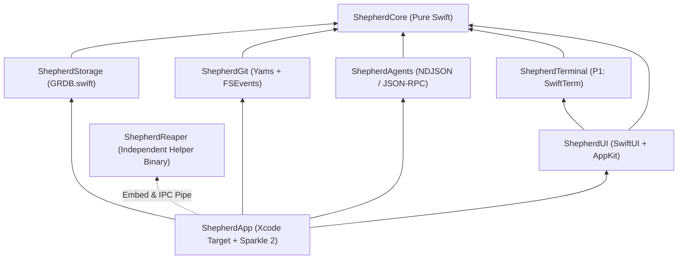
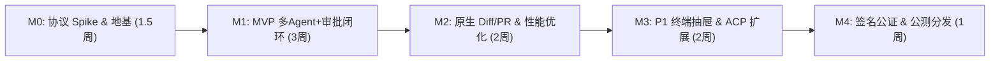

# Shepherd 工程落地路线图与质量保障体系

> **文档角色**：Shepherd 方案计划书 — 工程落地与路线图篇（`docs/04-roadmap-and-engineering.md`）  
> **关联文档**：上游代码审计 [`docs/01-orca-audit.md`](./01-orca-audit.md) · 系统架构 [`docs/02-architecture.md`](./02-architecture.md) · 产品与 UX 规范 [`docs/03-product-and-ux.md`](./03-product-and-ux.md)  
> **已锁定基线**：**MIT License** · **macOS 15.0+ / 仅 Apple Silicon (`arm64`，不支持 Intel Mac)** · **100% 纯 Swift 6 原生内核 + Protocol-First 抽象 + 可选开放 ACP 逃生舱**（零 Electron、零 Node 24 Sidecar、零闭源商业 SDK）。  
> **范围说明**：本路线图覆盖 **M0–M4** 完整工程交付（`⌘J` `SwiftTerm` 终端抽屉锁定在 **M3**）；多模型本地路由与额度容灾网关（如 Magpie 类能力）**显式排除在 M0–M4 规划之外**，仅在文末远期演进中说明扩展边界。

---

## 1. 仓库与模块化目录结构（SwiftPM + Xcode）

Shepherd 采用「**薄 Xcode App Target + 本地多模块 SwiftPM Workspace + 独立 Reaper Helper**」的工程布局。所有核心领域逻辑、Agent 协议层、Git Worktree 引擎与 SQLite 存储层均**不依赖 AppKit / SwiftUI**，确保可在无头 CI 节点上以纯 `swift test` 秒级执行全套单元与契约测试。

### 1.1 完整仓库目录树

```text
Shepherd/
├── README.md
├── LICENSE                                  # MIT License
├── THIRD_PARTY_NOTICES.md                   # 上游合规与三方依赖声明（含 Lovecast Inc. MIT 及依赖库）
├── Package.swift                            # 根 SwiftPM Workspace（聚合全部无头核心库与测试，支持纯 CLI swift test）
├── Shepherd.xcodeproj/                      # macOS App Target（签名、Entitlements、Assets、Sparkle 嵌入、Reaper 拷贝）
│   └── project.pbxproj
│
├── App/                                     # 【App】极薄 macOS 应用入口与系统集成层
│   ├── ShepherdApp.swift                    # @main 入口、WindowGroup、MenuBarExtra、Settings Scene
│   ├── AppDelegate.swift                    # NSApplicationDelegate、优雅退出进程组回收、Notification 点击路由
│   ├── AppEnvironment.swift                 # 生产级依赖装配容器（连接 Storage / Git / Agents / Core）
│   ├── DeepLinkRouter.swift                 # 通知/URL Scheme/命令面板深链接路由（worktree_id + approval_id）
│   ├── Entitlements/
│   │   ├── Shepherd.entitlements            # Hardened Runtime 最小权限（app-sandbox=false, network.client=true）
│   │   └── ShepherdReaper.entitlements      # Helper 极简权限
│   └── Resources/
│       ├── Assets.xcassets                  # 原生 App Icon、单色模板 MenuBar 图标（严禁复用 Orca 资产）
│       └── Info.plist                       # CFBundleIdentifier (M0-M1 占位 io.github.julytang.shepherd，公测前定稿)、Sparkle 2、LSMinimumSystemVersion=15.0
│
├── Helpers/
│   └── ShepherdReaper/                      # 【Reaper】独立编译的极简孤儿进程回收助手（打入 Contents/Helpers/）
│       ├── Package.swift                    # 纯 Darwin/C-Swift 可执行目标（零三方依赖，产物体积 < 200 KB）
│       └── Sources/
│           └── main.swift                   # kqueue(EVFILT_PROC+NOTE_EXIT) 监听主 App PID + 匿名 Pipe 登记 PGID 清场
│
├── Packages/
│   ├── ShepherdCore/                        # 【Core】领域模型、状态机编排、审批门控与环境管道（纯 Swift 6）
│   │   ├── Sources/ShepherdCore/
│   │   │   ├── Models/                      # Repository, Worktree, AgentSession, Turn, TranscriptItem, ApprovalPayload
│   │   │   ├── Coordinator/                 # SessionCoordinator (Actor), DeltaCoalescer (33ms 节流), WorkspaceCoordinator
│   │   │   ├── Security/                    # ApprovalGatekeeper (三档策略 + 硬护栏), ScriptTrustGate (SHA-256)
│   │   │   ├── Process/                     # ProcessSupervisor (POSIX_SPAWN_SETPGROUP), ReaperClient, LoginShellEnvProbe
│   │   │   ├── Environment/                 # ProcessEnvironmentProvider（分层合成 + 敏感值脱敏日志）
│   │   │   └── Diagnostics/                 # ProtocolRingBuffer (最近 500 帧抓包), OSLog 分类 Logger
│   │   └── Tests/ShepherdCoreTests/         # 状态机转换、审批策略、33ms 节流合并、环境合成单测
│   │
│   ├── ShepherdAgents/                      # 【Agents】统一 AgentAdapter 协议与多厂商传输驱动（纯 Swift 6）
│   │   ├── Sources/ShepherdAgents/
│   │   │   ├── Protocol/                    # AgentAdapter, AgentEvent, AgentLaunchConfig, AgentCapabilities
│   │   │   ├── Transport/                   # StdioNDJSONTransport (增量分帧/单行上限/背压/尾帧排空), JsonRpc2Peer
│   │   │   ├── Codex/                       # CodexAppServerAdapter (initialize/initialized, 4类审批 + 未支持请求拒绝, -32001 退避)
│   │   │   ├── Claude/                      # ClaudeCodeAdapter (直连 stream-json + --permission-prompt-tool stdio, 零闭源 SDK)
│   │   │   └── ACP/                         # ACPClientAdapter (JSON-RPC 2.0, $/cancel_request) + DialectsRegistry (opencode/gemini/claude-agent-acp...)
│   │   └── Tests/ShepherdAgentsTests/
│   │       ├── Fixtures/                    # Golden-file 脱敏真实 NDJSON 流量样本（Codex / Claude / ACP）
│   │       └── ...                          # 协议解码、分片行、异常断连、审批回写回归测试
│   │
│   ├── ShepherdGit/                         # 【Git】Git Worktree 管理器、配置兼容解析与增量 Diff 引擎（纯 Swift 6）
│   │   ├── Sources/ShepherdGit/
│   │   │   ├── Worktree/                    # WorktreeManager, RepoLockActor (Per-Repo 串行写锁), OrphanReconciler
│   │   │   ├── Config/                      # WorkspaceConfigLoader (shepherd.yaml 优先 + orca.yaml 嵌套 Schema 兼容, Yams)
│   │   │   ├── Safety/                      # PathTraversalGuard, GitCheckIgnoreValidator, DiskSpaceGuard
│   │   │   ├── Diff/                        # GitDiffEngine (porcelain=v2 -z, Unified/Split Hunk 解析, Stage/Discard Hunk)
│   │   │   ├── Watcher/                     # FSEventsWatcher (过滤 .git/node_modules/.build + 300ms 滑动防抖)
│   │   │   └── PullRequest/                 # GitHubPRClient (调用本机 gh pr create / gh pr view)
│   │   └── Tests/ShepherdGitTests/          # 真实临时 Git 仓并发 worktree add、check-ignore、路径穿越、崩溃续跑集成测试
│   │
│   ├── ShepherdStorage/                     # 【Storage】本地 SQLite 持久化层（GRDB.swift v7 WAL 模式）
│   │   ├── Sources/ShepherdStorage/
│   │   │   ├── DatabaseManager.swift        # DatabasePool (WAL) 初始化与连接管理
│   │   │   ├── Migrations/                  # DatabaseMigrator (v1 Schema + transcript_fts FTS5 + trusted_hook_hashes)
│   │   │   ├── Records/                     # RepositoryRecord, WorktreeRecord, SessionRecord, TurnRecord, ApprovalLogRecord
│   │   │   ├── Stores/                      # 强类型 DAO / Repository 接口实现
│   │   │   └── Blobs/                       # BlobStorageManager (>128KB 大日志外置压缩 + 7天/500MB LRU 清理)
│   │   └── Tests/ShepherdStorageTests/      # 内存库迁移测试、并发读写竞态、FTS5 检索、Blob LRU 回收测试
│   │
│   ├── ShepherdTerminal/                    # 【Terminal · P1】可选极简终端抽屉抽象与实现
│   │   ├── Sources/ShepherdTerminal/
│   │   │   ├── TerminalSurfaceHosting.swift # 渲染后端无关协议 + 持久化 NSView 容器池 (TerminalViewPool)
│   │   │   ├── SwiftTermAdapter.swift       # P1 首发纯 Swift 实现（基于 SwiftTerm）
│   │   │   ├── Osc7501Parser.swift          # PTY 流内 OSC 7501 Program Status 零侵入状态解析
│   │   │   └── LocalHookServer.swift        # P1 可选 Unix Socket / Loopback HTTP 极简 POSIX curl Hook 接收端
│   │   └── Tests/ShepherdTerminalTests/     # OSC 7501 序列解析、Session 互斥锁测试
│   │
│   └── ShepherdUI/                          # 【UI】SwiftUI 视图层 + AppKit 性能热区桥接
│       ├── Sources/ShepherdUI/
│       │   ├── State/                       # WorkspaceStore (@Observable @MainActor), SessionViewModel, CommandPaletteState
│       │   ├── Layout/                      # MainSplitViewController (NSSplitViewController 桥接与宽度记忆)
│       │   ├── Sidebar/                     # RepoWorktreeSidebar (NeedMe 置顶筛选、五态指示点、右键菜单)
│       │   ├── Chat/                        # NativeChatView (增量尾块、折叠 Thinking、ToolCard 归并、内联审批条、Follow-up Queue)
│       │   ├── Diff/                        # DiffInspectorView (虚拟化 AppKit NSTableView / TextKit 2、Hunk 操作、PR 面板)
│       │   ├── Modals/                      # NewWorktreeSheet (⌘N), ScriptTrustSheet (SHA-256 审查), CommandPalette (⌘K)
│       │   ├── MenuBar/                     # MenuBarPopoverView (状态徽章 + 快捷导航，禁止盲批高危命令)
│       │   └── Settings/                    # PreferencesView (General / Agents & PATH 诊断 / External IDEs / Shortcuts)
│       └── Tests/ShepherdUITests/           # ViewModel 投影与快捷键路由单测
│
├── CLI/                                     # 【P1 可选】面向人类开发者的极简 shepherd CLI（shepherd open / new）
│   └── ShepherdCLI/
│
├── Tests/                                   # 【Tests】跨模块端到端集成测试、Fake CLI Harness 与性能基准
│   ├── FakeAgentHarness/                    # 模拟 codex / claude / acp 的双向 stdio 测试替身可执行工具
│   ├── EndToEndTests/                       # 多 Worktree 并发 + 审批 + Diff + 零污染审计集成测试
│   ├── ReaperTests/                         # SIGKILL 主进程后验证 3 层孙进程零残留的专项测试
│   └── PerformanceBenchmarks/               # 冷启动、5 并发内存曲线、50 文件 2000 行 Diff 首帧基准套件
│
├── Scripts/                                 # 构建、签名、公证、合规检查自动化脚本
│   ├── check-compliance.sh                  # CI 红线检查：禁止出现闭源 SDK / electron / ORCA_ 品牌残留
│   ├── build-release.sh                     # Archive + 由内向外 codesign + create-dmg + notarytool + stapler
│   └── generate-appcast.sh                  # Sparkle 2 EdDSA 签名与 appcast.xml 生成
│
└── .github/workflows/
    ├── ci.yml                               # PR 门禁：Swift 6 严格并发构建 + 全量 swift test + 合规检查
    ├── nightly.yml                          # 夜间回归：FakeAgentHarness 5 路并发压测 + PerformanceBenchmarks
    └── release.yml                          # Tag 触发：签名、公证、Sparkle appcast、GitHub Release & Homebrew Cask
```

### 1.2 模块依赖有向无环图（DAG）



### 1.3 第三方依赖克制清单（Minimal Dependency Policy）

| 依赖包 | 所属模块 | 许可协议 | 引入阶段 | 选型理由 |
| :--- | :--- | :---: | :---: | :--- |
| **`GRDB.swift` (v7.x)** | `ShepherdStorage` | MIT | M1 | 原生 Swift 6 Strict Concurrency、`DatabasePool` WAL 并发读、FTS5 支持、零宏黑盒 |
| **`Yams` (v5.x)** | `ShepherdGit` | MIT | M0 | 成熟轻量的 Swift YAML 解析器，用于解析 `shepherd.yaml` 与兼容 `orca.yaml` |
| **`Sparkle` (v2.x)** | `ShepherdApp` | MIT | M4 | macOS Direct Distribution 工业标准自动更新框架（EdDSA 签名） |
| **`SwiftTerm`** | `ShepherdTerminal` | MIT | M3 (P1) | 纯 Swift 终端引擎、零 Zig 工具链、包体增量 < 1 MB；通过抽象协议保留 P2 升 `libghostty` 路径 |
| **轻量语法高亮（如 `swift-tree-sitter` 或增量 Lexer）** | `ShepherdUI` | MIT | M2 | 仅对 Diff 可见窗口异步高亮，严格控制包体增量 ≤ 3 MB |

> **零引入红线**：全仓严禁引入 Electron、Node.js 运行时、`@anthropic-ai/claude-agent-sdk`（商业条款非开源）、Geist SIL OFL 字体（全程使用系统原生 SF Pro / SF Mono）及任何遥测/云端追踪 SDK。

---

## 2. 构建、签名、公证、更新与 CI/CD 方案

### 2.1 编译基线、目标架构与立项锁定策略

- **最低支持系统**：**macOS 15.0 (Sequoia)**。
  - **决策依据**：完整原生支持稳定的 `@Observable`、`MenuBarExtra` 窗口增强、成熟版 TextKit 2（`NSTextLayoutManager` 规避 macOS 13/14 早期布局崩溃 Bug）、以及 Xcode 16+ / Swift 6 工具链；全面覆盖主力 Apple Silicon 开发者机型。
- **目标架构（已锁定）**：**仅 Apple Silicon (`arm64`)**，明确不支持 Intel Mac，不构建 Universal Binary。
  - **工程收益**：单一 `arm64` 构建、签名与分发产线可将签名 `.dmg` 体积稳定控制在 **12–18 MB**（远低于 ≤ 25 MB 红线），省去交叉编译校验矩阵，并大幅简化 `ShepherdReaper`、依赖库及 Sparkle 2 `appcast.xml` 维护。
- **开源协议（已锁定）**：**MIT License**（根目录 `LICENSE` + `THIRD_PARTY_NOTICES.md` + `About -> Licenses` 同步维护）。
- **Bundle ID 与签名节奏（已锁定）**：
  - **开发期（M0–M1）**：采用临时占位 Bundle ID（如 `io.github.julytang.shepherd`）+ 本地 ad-hoc 签名进行高速迭代，不阻塞早期核心功能开发；
  - **公证演练与公测前（M4 前定稿）**：在首次对外公测（M4）或正式公证演练前最终定稿正式 Bundle ID 与 Developer ID Application 签名主体，再切入正式 `notarytool` / Sparkle 2 发版链路。
- **并发与语言模式**：全部 `Packages/*` 强制开启 **`Swift 6` language mode（`-strict-concurrency=complete`）** 与 `-warnings-as-errors`（Release CI），在编译期彻底根除跨 Actor 数据竞争，防止 5 路高吞吐 Agent 并发时出现偶发崩溃。

### 2.2 Direct Distribution 签名、公证与 Sparkle 2 自动更新流水线

> **为何严禁使用 `codesign --deep`**：Apple 官方已弃用 `--deep`，对包含 `Contents/Helpers/shepherd-reaper` 与 `Sparkle.framework`（内含 `Updater.app` / `Autoupdate` / XPC Services）的 App 使用 `--deep` 会破坏内部独立 Entitlements 导致公证失败。必须严格执行**由内向外逐层签名**。

#### 发布构建 7 步标准流水线（`Scripts/build-release.sh`，单一 `arm64` · 遵循 Apple TN3127）
1. **编译辅助与主程序（仅 `arm64`）**：以 `-arch arm64` 分别构建 `ShepherdReaper` Release 二进制并拷贝至 `Shepherd.app/Contents/Helpers/shepherd-reaper`，执行 `xcodebuild archive -arch arm64` 导出未签名 `Shepherd.app`（使用已定稿正式 Bundle ID）。
2. **由内向外 Hardened Runtime 签名与逐组件校验**：
   - 先签 `Contents/Frameworks/Sparkle.framework` 内部全部 XPC/Autoupdate/Updater 组件；
   - 再签 `Contents/Helpers/shepherd-reaper`（`--options runtime --timestamp --entitlements ShepherdReaper.entitlements`）；
   - 最后签主程序 `Shepherd.app`（`--options runtime --timestamp --entitlements Shepherd.entitlements`）；
   - 遵循 Apple TN3127，**不使用 `--verify --deep`**，改为对 Sparkle 组件、`shepherd-reaper` 与 `Shepherd.app` 逐一执行 `codesign --verify --strict --verbose=2` 校验证书链与权限。
3. **公证并装订 `Shepherd.app`（保障 Sparkle 2 自动更新过 Gatekeeper）**：
   - 使用 `ditto -c -k --keepParent Shepherd.app Shepherd-notarize.zip` 生成临时公证归档；
   - 执行 `xcrun notarytool submit Shepherd-notarize.zip --keychain-profile "shepherd-notary" --wait`；
   - 执行 `xcrun stapler staple Shepherd.app` 将公证票据直接装订进 `.app`；
   - 重新执行 `ditto -c -k --keepParent Shepherd.app Shepherd-<ver>-arm64.zip` 生成**包含已装订票据的最终 Sparkle 更新包**。
4. **打包、签名、公证并装订 `.dmg`（首次安装载体）**：
   - 基于已完成装订的 `Shepherd.app` 生成 `Shepherd-<ver>-arm64.dmg`（含 `/Applications` 软链）；
   - 使用 Developer ID Application 证书对 `.dmg` 本身执行 `codesign --force --timestamp --sign "Developer ID Application: ..." Shepherd-<ver>-arm64.dmg`；
   - 执行 `xcrun notarytool submit Shepherd-<ver>-arm64.dmg --keychain-profile "shepherd-notary" --wait` 与 `xcrun stapler staple Shepherd-<ver>-arm64.dmg`。
5. **Gatekeeper 双介质终验**：
   - 验证应用可执行签名：`spctl --assess --type execute -vv Shepherd.app`；
   - 验证镜像打开签名：`spctl --assess --type open --context context:primary-signature -vv Shepherd-<ver>-arm64.dmg`。
6. **Sparkle 2 更新签名**：使用存放在 GitHub Actions Encrypted Secrets 的 EdDSA 私钥对最终 `.zip` 执行 `generate_appcast`，生成并更新托管在 Releases/Pages 的静态 `appcast.xml`（区分 `stable` 与 `beta` 双频道）。
7. **Homebrew Cask 同步**：Release 成功后自动提 PR 更新 `homebrew-shepherd` tap 的 Cask formula（含最新版本号与 `.dmg` SHA-256 校验和），方便开发者通过 `brew install --cask shepherd` 一键安装。

### 2.3 GitHub Actions CI/CD 门禁设计

| 工作流 | 触发条件 | 运行环境 | 关键检查项 |
| :--- | :--- | :--- | :--- |
| **`ci.yml`（PR 门禁）** | Pull Request / Push `main` | `macos-15` (Apple Silicon) | 1. `Scripts/check-compliance.sh`（合规红线：禁闭源 SDK、禁 `ORCA_` 标识、校验 `Entitlements` 白名单）；<br>2. `swift test --parallel`（覆盖 Core / Agents Golden-file / Git 临时仓 / Storage WAL）；<br>3. `ShepherdReaper` 独立构建 + 进程组回收测试；<br>4. `xcodebuild build` 验证主 App 编译零警告。 |
| **`nightly.yml`（夜间回归）** | 每日定时 | `macos-15` | 1. 运行 `EndToEndTests`（FakeAgentHarness 5 路并发 5 分钟压测）；<br>2. 运行 `PerformanceBenchmarks` 追踪冷启动、内存与大 Diff 回归趋势。 |
| **`release.yml`（版本发布）** | 推送 `v*.*.*` Tag | `macos-15` | 执行完整签名 → Notarization → Stapling → Sparkle `appcast.xml` 更新 → 创建 GitHub Release 并附校验和。 |

---

## 3. 分阶段里程碑计划（M0 → M4）

按 **2 名资深 Swift / macOS 工程师** 并行节奏估算，完整周期约 **9.5 周**；其中 **M0 + M1 + M2（6.5 周）即可交付可日常主力使用的 MVP 内测版本**。



### M0：高风险协议验证 Spike 与工程地基（1.5 周）
- **核心目标**：在投入大规模 UI 开发前，用最小命令行 Harness 实机验证全部 4 条最高风险底层链路，彻底消除技术不确定性。
- **关键任务拆解**：
  1. 搭建多模块 SwiftPM 仓库骨架、`ci.yml` 与合规检查脚本；
  2. **Codex Spike**：实机跑通 `codex app-server --listen stdio://` 的 `initialize` → `initialized` → `thread/start` → `turn/start` → 4 类审批回复与未知 Server Request 显式拒绝；
  3. **Claude Spike**：实机验证 `claude --print --input-format stream-json --output-format stream-json --permission-prompt-tool stdio` 双向对话、审批拦截、`--resume` 续聊，并录制真实 Golden-file 样本；同步验证开放 `@agentclientprotocol/claude-agent-acp` 降级通道；
  4. **Git & Reaper Spike**：实现 `WorktreeManager` + `RepoLockActor` + `shepherd.yaml`/`orca.yaml` 解析（含 `git check-ignore` & SHA-256 哈希计算）+ `ShepherdReaper`（`kqueue` 孤儿进程清理）。
- **退出验收门禁（Go/No-Go）**：
  - [ ] Codex 与 Claude 双向审批实机连续跑通 20 轮无挂起，Golden-file 样本入库；
  - [ ] 并发 5 路 `git worktree add` 零 `index.lock` 失败；
  - [ ] 对宿主测试进程发 `kill -9` 后 2 秒内 3 层孙进程 100% 清空；
  - [ ] **若 Claude `stream-json` 实测发现不可控协议缺陷，即刻在 M0 结束前决定切换默认驱动至开放 ACP 适配层**。

### M1：MVP 核心闭环 — 多 Worktree + Native Chat + 审批通知（3 周）
- **核心目标**：打通「创建 Worktree → 并发运行 Claude & Codex → 监控与审批 → 外部 IDE 打开 → 归档清理」完整端到端可用链路。
- **关键任务拆解**：
  1. **Storage & Core**：落地 `ShepherdStorage`（GRDB WAL + 全部核心表 + `trusted_hook_hashes`）、`SessionCoordinator`（Per-Session Actor + 33ms 节流合并）、`ApprovalGatekeeper`（三档安全策略 + 硬护栏）、`LoginShellEnvProbe`；
  2. **Agents 正式化**：补齐 `CodexAppServerAdapter`（含 `-32001` 退避）、`ClaudeCodeAdapter`（含 `rate_limit_event` 限流提示）与 `ACPClientAdapter` 最小闭环；
  3. **原生双栏 UI**：`MainSplitViewController`、左侧 Repo/Worktree 状态树（五态指示点 + `NeedMe` 置顶筛选）、中间 Native Chat（增量尾块、可折叠 Thinking、只读 Tool 归并卡、内联审批条、Follow-up 消息队列）、`⌘N` 新建面板、SHA-256 脚本信任审查弹窗；
  4. **macOS 原生联动**：`MenuBarExtra` 状态徽章与 Popover、`UNUserNotificationCenter` 降噪深链接、一键 `⌘O` 外部 IDE 跳转与 `⌘⇧T` 系统终端跳转、归档脏检查与中断删除续跑。
- **退出验收门禁（对齐 `03-product-and-ux.md` §5）**：
  - [ ] 同仓并发跑通 1 个 Claude + 1 个 Codex Worktree，零文件冲突、零审批串台；
  - [ ] 零污染审计通过（`~/.claude`、`~/.codex` 与目标仓库无未声明写入）；
  - [ ] 实机冷启动 TTI **≤ 400 ms**，空闲物理内存 **≤ 80 MB**，审批通知延迟 **≤ 300 ms**；
  - [ ] 兼容真实 `orca.yaml`（`worktree.sharedDirectories` + `scripts.setup`）并触发 SHA-256 首次信任弹窗。

### M2：原生 Diff Inspector、PR 闭环与性能打磨（2 周）
- **核心目标**：补齐「审查代码 → 局部修正 → Commit & Create PR」闭环，将高并发渲染与大 Diff 体验打磨至原生标杆级。
- **关键任务拆解**：
  1. **高性能 Diff Inspector（`⌘⇧D`）**：基于 AppKit 虚拟化 `NSTableView`（或 TextKit 2）实现文件树、Unified / Split 视图、双基线切换（`Uncommitted` vs `Branch vs Base`）、逐文件/逐 Hunk `Reviewed` / `Stage` / `Discard`、点击行号精准跳外部 IDE 对应行；
  2. **实时同步与 PR 闭环**：集成 `FSEventsWatcher`（300ms 防抖自动刷新外部 IDE 手改）；实现 Commit Message / PR 摘要辅助生成 + 调用 `gh pr create` / `gh pr view` 闭环；
  3. **键盘流与诊断工具**：落地 `⌘K` 全局命令面板、`⌘1-9`、`⌘⇧A` 连续清零审批、`⌘⇧P`、设置面板（Agent 二进制与 `PATH` 诊断向导）、内存态 `Protocol Inspector`（最近 500 帧脱敏抓包导出）；
  4. **性能专项调优**：Instruments Time Profiler / Allocations 排查主线程长耗时与内存泄漏。
- **退出验收门禁**：
  - [ ] 50 文件 / 2,000 行标准 Diff 首帧渲染 **≤ 150 ms**；外部 IDE 保存后自动刷新 **≤ 500 ms**；
  - [ ] 5 路高吞吐模拟流式输出持续 15 分钟：主线程稳定 **60fps（ProMotion 120fps）**，物理内存 **≤ 220 MB** 且关闭会话后正常回落；
  - [ ] 全键盘端到端验收通过（不碰鼠标走完 `⌘N → ⌘⇧A → ⌘↩ → ⌘⇧D → ⌘O → ⌘⇧P`）。

### M3：P1 可选极简终端抽屉（已锁定 M3）、ACP 扩展与体验进阶（2 周）
- **核心目标**：落地锁定于本阶段的 `⌘J` 极简终端抽屉（`SwiftTerm`，M0–M2 保持专注 Native Chat + 原生 Diff/PR 闭环）与高频进阶能力，拓宽长尾 Agent 支持面。
- **关键任务拆解**：
  1. **`ShepherdTerminal` 抽屉（`⌘J` · 锁定 M3）**：基于 `SwiftTerm` + 持久化 `NSView` 容器池（规避 SwiftUI 条件渲染销毁 PTY）；顶部支持「Resume in Terminal」（一键以同 Session ID 拉起原版交互 CLI，带 Native Chat ↔ TUI 会话互斥锁）；
  2. **轻量终端状态回传**：默认开启零侵入 `OSC 7501` 解析同步侧栏状态；提供可选 Opt-in 开关启用 macOS POSIX Shell + `curl` 本地 Hook；
  3. **ACP 方言扩展与效率功能**：扩充 `DialectsRegistry` 验证 5–8 个主流 ACP CLI（如 `opencode`、`gemini`、`goose`、`cursor`、`claude-agent-acp`）；开放 GRDB FTS5 跨会话全文搜索；发布面向人类开发者的极简 `shepherd` CLI（`shepherd open` / `shepherd new`）；按需评估并合入可选 `CodexSharedServerPool`。
- **退出验收门禁**：
  - [ ] 连续折叠/展开终端抽屉 50 次无 PTY 断连或字体重绘异常；
  - [ ] 终端内执行 `/usage` / `/btw` 后退出可无缝回到 Native Chat，无会话文件损坏；
  - [ ] 合入 `SwiftTerm` 后单一 `arm64` 签名 `.dmg` 体积仍 **≤ 25 MB**。

### M4：正式标识定稿、签名公证与 Public Beta 发布（1 周）
- **核心目标**：定稿正式 Bundle ID 与签名主体，打通单一 `arm64` 全自动 Direct Distribution 生产发版链路，完成 MIT 合规审查与首批开发者灰度验证。
- **关键任务拆解**：
  1. **正式身份与签名定稿**：将 M0–M1 临时占位 Bundle ID（如 `io.github.julytang.shepherd`）与本地 ad-hoc 签名替换为最终定稿的正式 Bundle ID 与 Developer ID Application 签名主体；
  2. 跑通单一 `arm64` `release.yml`（由内向外 Developer ID 签名 + `.app`/`.dmg` 双载体 `notarytool` 公证装订 + Sparkle 2 EdDSA `appcast.xml` + Homebrew Cask）；
  3. 合规终检：审阅 MIT `LICENSE`、`THIRD_PARTY_NOTICES.md`、`About -> Licenses` 界面、零 `ORCA_*` / 零遥测网络抓包确认；
  4. 灰度发布：面向 20–50 名高频双持 Claude Code + Codex 的 Apple Silicon macOS 开发者启动 Public Beta，建立脱敏诊断包一键上报通道。
- **退出验收门禁**：
  - [ ] 全新无 Xcode 的 macOS 15 干净环境双击 `.dmg` 安装，通过 Gatekeeper 零警告启动；
  - [ ] 实测 Sparkle 2 从 `v0.9.0-beta.1` 平滑原地升级至 `v0.9.0-beta.2`；
  - [ ] Beta 连续 7 天高强度 Dogfooding 零孤儿进程残留、零 SQLite 损坏、零数据误删。

---

## 4. 测试与验证体系

鉴于多 Agent 协议依赖外部付费 CLI 与真实文件系统副作用，Shepherd 建立 **五层自动化测试金字塔**，使 90% 的质量保障在**无真实 API Key、无外网的 GitHub Actions `macos-15` 上可确定性运行**：

| 测试层级 | 所属 Target | 核心机制 | 覆盖的典型故障场景 |
| :--- | :--- | :--- | :--- |
| **L1：协议 Golden-File 回放测试** | `ShepherdAgentsTests` | 将 M0 实机录制的脱敏 NDJSON 流量（Codex / Claude / ACP）作为只读 Fixture，按随机字节切片（模拟 TCP/Pipe 半包、粘包）喂入 `StdioNDJSONTransport` 与解码器 | 跨行截断、非 JSON 噪声日志混入、`codex` `-32001` 过载退避、未知 Server Request 显式拒绝、Claude `rate_limit_event` 识别、字段新增宽容解码 |
| **L2：Fake CLI Harness 契约测试** | `FakeAgentHarness` + `EndToEndTests` | 独立编译的 Swift 命令行测试替身，通过启动参数扮演 Codex / Claude / ACP，可脚本化控制吐字速率（如 500 tokens/s）、触发审批请求、拒绝后改写行为、模拟 `SIGSEGV` 崩溃 | 5 路并发背压节流（验证 MainActor 更新率 ≤ 30Hz）、审批 Allow/Deny 闭环、Follow-up 消息排队、Turn 中断（`⌘.`）与 `--resume` 重连 |
| **L3：真实 `git worktree` 集成测试** | `ShepherdGitTests` | 在 `NSTemporaryDirectory()` 初始化真实裸仓 + 本地克隆仓执行真实 `git` 命令 | 并发 5 路 `worktree add` 无 `index.lock` 冲突；`shepherd.yaml` 覆盖 `orca.yaml` 优先级；`worktree.sharedDirectories` 拒绝未忽略路径（`git check-ignore`）与 `../` 路径穿越；SHA-256 哈希变更拦截；中断删除后重启续跑 |
| **L4：孤儿进程 Reaper 破坏性测试** | `ReaperTests` | 拉起受测宿主子进程，由其通过 `ProcessSupervisor` 启动含 3 层进程树（含捕获并忽略 `SIGTERM` 的顽固孙进程），随后直接向宿主发 **`kill -9` (`SIGKILL`)** | 断言 2 秒内所有登记的 PGID 及全部 3 层孙进程均返回 `ESRCH`（彻底清空），验证 `shepherd-reaper` `kqueue` 兜底可靠性 |
| **L5：性能基准与零污染审计** | `PerformanceBenchmarks` | 自动化 `XCTMetric` 采集 + 沙盒临时 `HOME` 文件系统快照 Diff | 验证冷启动 ≤ 400ms、空闲内存 ≤ 80 MB、5 并发 15 分钟内存 ≤ 220 MB 且无持续增长、50 文件/2000 行 Diff 首帧 ≤ 150ms；断言运行全流程后 `~/.claude`、`~/.codex` 与目标仓库零未声明写入 |

---

## 5. 风险登记册与缓解预案

| 编号 | 风险项 | 概率 | 影响 | 早期监测信号 | 预防措施与缓解预案 |
| :---: | :--- | :---: | :---: | :--- | :--- |
| **R1** | **Claude Code `stream-json` 底层控制协议漂移** | 高 | 高 | M0/每周定时跑实机 Smoke Test 失败或解码出现未知控制帧 | 1) 解码器强制宽容解析（忽略未知字段并保留原始帧）；2) 维护 Golden-file 版本样本库；3) **应急预案**：设置页内置开关可 1 天内切至 `ACPClientAdapter` 驱动开放 `@agentclientprotocol/claude-agent-acp`。 |
| **R2** | **Anthropic Commercial Terms of Service / SDK 合规边界** | 中 | 高 | 依赖审计发现引入闭源 SDK 或改写官方入口点导致条款争议 | 1) 坚决不捆绑 `@anthropic-ai/claude-agent-sdk`；2) CI 脚本 `check-compliance.sh` 锁死零闭源依赖与零 `ORCA_*`/`CLAUDE_CODE_ENTRYPOINT=orca` 注入；3) 严格定位为纯本地 BYOA 编排器。 |
| **R3** | **Claude 订阅窗口额度消耗差异与短时限流（429）** | 高 | 中 | 用户反馈 Native Chat 5 小时窗口消耗快于终端 TUI 或频繁触发限流 | 1) 精确解析 `rate_limit_event` 并在 UI 清晰提示冷却时间与消耗估算；2) M1 起提供 `⌘⇧T` 系统终端逃生舱、M3 提供 `⌘J` 抽屉内一键 `claude --resume` 零阻力切回原版交互 TUI。 |
| **R4** | **Codex `app-server` 未支持 Server Request 导致会话永久挂起** | 中 | 高 | 实测某版本 Codex 发出新类型反向请求后 Turn 卡死无超时 | 1) 借鉴 Orca 实证经验，在 `CodexAppServerAdapter` 实现统一分发默认分支——任何未识别 Server Request 立即返回标准 JSON-RPC Error/拒绝响应；2) 为所有挂起请求加超时告警。 |
| **R5** | **多 Worktree 并发操作触发 `.git/index.lock` 冲突或误删脏代码** | 中 | 高 | 并发新建/清理任务报错 `Unable to create index.lock` | 1) `RepoLockActor` 按 `repoCommonDir` 串行化所有 Git 拓扑写操作 + 有限抖动重试；2) 归档前强制脏检查（未提交 + 未跟踪 + 未 Push Commit），`scripts.archive` 失败默认阻断删除。 |
| **R6** | **恶意仓库 `shepherd.yaml` / `orca.yaml` 脚本执行与软链越界** | 低 | 极高 | 打开不信任第三方开源仓库时自动执行任意 Shell 命令或篡改源码 | 1) **SHA-256 脚本内容哈希信任门控**（未授权绝不执行，内容一改即重新弹窗审查）；2) 软链强制双重校验：`git check-ignore` + 规范路径穿越防护。 |
| **R7** | **macOS GUI `PATH` 缺失导致找不到 `claude` / `codex` / `git` / `gh`** | 高 | 中 | Finder 双击启动后报错 `executable not found`（尤其 nvm/mise/volta 用户） | 1) 启动后台执行 `$SHELL -ilc 'env -0'`（3s 超时保护 + 交互抑制）并叠加常见路径回退表；2) 设置页内置「工具链诊断向导」，展示当前探测路径并支持手动指定二进制绝对路径。 |
| **R8** | **macOS Notarization / Hardened Runtime 与嵌套二进制签名失败** | 中 | 中 | `notarytool` 拒签或用户打开提示“文件已损坏” | 1) M0–M1 开发期先用占位 ID + 本地 ad-hoc 签名快速推进，**定稿正式 Bundle ID 与 Developer ID 证书后（最晚在 M4 公证演练窗口前）即提前在 CI 试跑单一 `arm64` 空壳签名公证**，绝不拖到发版当日才暴露；2) 严格禁用 `codesign --deep`，由内向外逐一签名 `Sparkle`、`ShepherdReaper` 与主 App。 |
| **R9** | **5 并发吐字 + 8,000 行大 Diff 引发主线程掉帧或内存飙升** | 中 | 中 | Instruments 出现 > 16ms 掉帧或内存超过 220 MB 门禁 | 1) Actor 33ms 合并推送 + Chat 不可变历史块拆分；2) Diff Inspector 从 Day 1 采用 AppKit 虚拟化 `NSTableView`，单文件超 1,500 行默认折叠按需展开；3) >128 KB 日志外置 Blob 文件。 |

---

## 6. 远期演进边界（Post-M4 · 明确排除在本期外）

以下能力**均不在 M0–M4 开发与测试计划内**，仅由当前架构的自然抽象边界保证未来零重构接入：
1. **模型路由与额度容灾网关（如 Magpie 类能力）**：依托 `ShepherdCore` 中干净分层的 `ProcessEnvironmentProvider` 注入点，未来可低成本对接外部本地模型代理或协议转换网关，本期不做任何代理路由实现。
2. **P2 进阶可选能力**：包括 Opt-in 的「Agent 自驱派活」（通过会话级动态挂载的本地轻量 MCP Server 实现，保持零磁盘残留）、终端抽屉底层由 `SwiftTerm` 平滑升级至 `libghostty`（`GhosttyKit` Metal 渲染）、以及跨设备只读状态同步。
