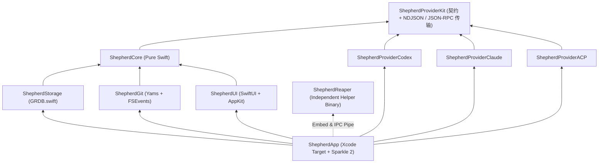

# Shepherd 工程落地路线图与质量保障体系

> **文档角色**：Shepherd 方案计划书 — 工程落地与路线图篇（`docs/04-roadmap-and-engineering.md`）  
> **关联文档**：上游代码审计 [`docs/01-orca-audit.md`](./01-orca-audit.md) · 系统架构 [`docs/02-architecture.md`](./02-architecture.md) · 产品与 UX 规范 [`docs/03-product-and-ux.md`](./03-product-and-ux.md)  
> **已锁定基线**：**MIT License** · **macOS 27.0+ / 仅 Apple Silicon (`arm64`，不支持 Intel Mac)** · **100% 纯 Swift 6 原生内核 + Protocol-First 抽象 + 可选 ACP 逃生舱**（零 Electron、零 Node 24 Sidecar、零闭源商业 SDK）。  
> **范围说明**：本路线图覆盖 **M0–M4** 完整工程交付；多模型本地路由与额度容灾网关（如 Magpie 类能力）**显式排除在 M0–M4 规划之外**，仅在文末远期演进中说明扩展边界。  
> **修订状态**：修订版 v3（2026-11-26）。v2：M0 增加验证项，风险登记册新增 R10–R14。v3：Claude Code 接入已对齐（[`docs/02-architecture.md`](./02-architecture.md) §3.1.4），Agent 接入改为 provider 分层（§3.1.5），终端抽屉移出规划，全部排期内容移除，风险登记册新增 R15–R16。v4（2026-11-27）：`ShepherdReaper` 改为每个 Agent 一层的启动器与看守进程，加进程树标记（`02` §3.3.3），相应更新目录注释、M0 任务与验收、L4 测试。本轮只修订文档，仓库中尚无代码，下面的目录结构是规划。v5（2026-11-27）：仓库已初始化为 monorepo，顶层结构改为 workspace 加 `Apps/` 两个项目，新增 `Server/`；最低系统升到 27；Bundle ID 定稿；新增 R17–R19。各包内部的子目录仍是规划，现有代码只是可构建的空壳。

---

## 1. 仓库与模块化目录结构（SwiftPM + Xcode）

Shepherd 采用「**薄 Xcode App Target + 本地多模块 SwiftPM Workspace + 独立 Reaper Helper**」的工程布局。所有核心领域逻辑、Agent 协议层、Git Worktree 引擎与 SQLite 存储层均**不依赖 AppKit / SwiftUI**，确保可在无头 CI 节点上以纯 `swift test` 秒级执行全套单元与契约测试。

### 1.1 完整仓库目录树

```text
Shepherd/
├── README.md
├── LICENSE                                  # MIT License
├── THIRD_PARTY_NOTICES.md                   # 上游合规与三方依赖声明（含 Lovecast Inc. MIT 及依赖库）
├── Shepherd.xcworkspace/                     # 唯一入口：两个 App 项目 + 全部本地包
├── Config/
│   ├── Shared.xcconfig                      # Bundle ID 规则、版本号、最低系统、Swift 版本，两个项目共用
│   └── Local.xcconfig.example               # 本机签名团队等设置的模板（Local.xcconfig 不进仓库）
│
├── Apps/
│   ├── macOS/
│   │   ├── macOS.xcodeproj/                 # target：macOS、Reaper、macOSTests、macOSUITests（产品名 Shepherd）
│   │   ├── Shepherd/                        # App 源码：@main 入口、WindowGroup、MenuBarExtra、依赖装配
│   │   ├── Reaper/                          # shepherd-reaper 源码，构建后嵌入 Shepherd.app/Contents/Helpers/
│   │   ├── macOSTests/
│   │   └── macOSUITests/
│   └── iOS/
│       ├── iOS.xcodeproj/                   # target：iOS、iOSTests、iOSUITests（产品名 Shepherd；iPhone、iPad、iPhone Duo 共用）
│       ├── Shepherd/                        # Companion 源码
│       ├── iOSTests/
│       └── iOSUITests/
│
├── Server/                                  # 【Server】Node：中继（relay）与推送网关（push），外层协议见 PROTOCOL.md
│
├── Packages/                                # 10 个独立 Swift 包。下列 8 个之外，v5 新增两端通用的 ShepherdModels 与 ShepherdRemote
│   ├── ShepherdCore/                        # 【Core】领域模型、状态机编排、审批门控与环境管道（纯 Swift 6）
│   │   ├── Sources/ShepherdCore/
│   │   │   ├── Models/                      # Repository, Worktree, AgentSession, Turn, TranscriptItem, ApprovalPayload
│   │   │   ├── Coordinator/                 # SessionCoordinator (Actor), DeltaCoalescer (33ms 节流), WorkspaceCoordinator
│   │   │   ├── Security/                    # ApprovalGatekeeper (档位映射 Agent 原生权限模式), ScriptTrustGate (入口信任, SHA-256)
│   │   │   ├── Process/                     # ProcessSupervisor (POSIX_SPAWN_SETPGROUP), DescendantTracker (后代快照，仅用于展示与诊断), ReaperClient (经 shepherd-reaper 启动并下发停止指令), LoginShellEnvProbe
│   │   │   ├── Environment/                 # ProcessEnvironmentProvider（分层合成 + 敏感值脱敏日志）
│   │   │   ├── Providers/                   # ProviderRegistry（按清单注册 provider，校验契约版本范围；不引用具体 provider）
│   │   │   └── Diagnostics/                 # ProtocolRingBuffer (最近 500 帧抓包), OSLog 分类 Logger
│   │   └── Tests/ShepherdCoreTests/         # 状态机转换、审批策略、33ms 节流合并、环境合成单测
│   │
│   ├── ShepherdProviderKit/                 # 【ProviderKit】provider 契约包（独立版本号；核心与 provider 之间唯一的共享面）
│   │   ├── Sources/ShepherdProviderKit/
│   │   │   ├── Contract/                    # AgentAdapter, AgentEvent, 三类交互, AgentLaunchConfig, AgentCapabilities
│   │   │   ├── Manifest/                    # ProviderManifest（ID / 名称 / 契约版本范围 / 能力声明 / 启动规格）
│   │   │   └── Transport/                   # StdioNDJSONTransport (增量分帧/单行上限/背压/尾帧排空), JsonRpc2Peer
│   │   └── Tests/ShepherdProviderKitTests/  # 分帧、背压、清单解析与版本范围校验
│   │
│   ├── ShepherdProviderCodex/               # 【内置 provider · codex】只依赖 ProviderKit
│   │   ├── Sources/ShepherdProviderCodex/   # CodexAppServerAdapter (initialize/initialized, 4类交互各自回包 + 未支持请求拒绝, -32001 退避; 类型由 Schema 生成)
│   │   └── Tests/ShepherdProviderCodexTests/ # Codex Golden-file 脱敏 NDJSON 样本与回归测试
│   │
│   ├── ShepherdProviderClaude/              # 【内置 provider · claude-direct】只依赖 ProviderKit
│   │   ├── Sources/ShepherdProviderClaude/  # ClaudeCodeAdapter (直连 stream-json 控制协议, 零闭源 SDK 捆绑; 契约见 02 §3.1.4)
│   │   └── Tests/ShepherdProviderClaudeTests/ # Claude Golden-file 样本、已测试 CLI 版本范围记录
│   │
│   ├── ShepherdProviderACP/                 # 【内置 provider · acp】只依赖 ProviderKit；同时是外部 provider 的宿主
│   │   ├── Sources/ShepherdProviderACP/     # ACPClientAdapter (JSON-RPC 2.0, $/cancel_request) + 外部 provider 清单加载（原 DialectsRegistry）
│   │   └── Tests/ShepherdProviderACPTests/  # ACP Golden-file 样本（含 claude-agent-acp）、异常断连回归测试
│   │
│   ├── ShepherdGit/                         # 【Git】Git Worktree 管理器、配置兼容解析与增量 Diff 引擎（纯 Swift 6）
│   │   ├── Sources/ShepherdGit/
│   │   │   ├── Worktree/                    # WorktreeManager, RepoLockActor (Per-Repo 显式异步串行队列), OrphanReconciler
│   │   │   ├── Config/                      # WorkspaceConfigLoader (shepherd.yaml 优先 + orca.yaml 嵌套 Schema 兼容, Yams)
│   │   │   ├── Safety/                      # PathTraversalGuard, GitCheckIgnoreValidator, SymlinkExcludeWriter (info/exclude), DiskSpaceGuard
│   │   │   ├── Diff/                        # GitDiffEngine (porcelain=v2 -z, Unified/Split Hunk 解析, Stage/Discard Hunk)
│   │   │   ├── Watcher/                     # FSEventsWatcher (过滤 .git/node_modules/.build + 300ms 滑动防抖)
│   │   │   └── PullRequest/                 # GitHubPRClient (调用本机 gh pr create / gh pr view)
│   │   └── Tests/ShepherdGitTests/          # 真实临时 Git 仓并发 worktree add、check-ignore、路径穿越、崩溃续跑集成测试
│   │
│   ├── ShepherdStorage/                     # 【Storage】本地 SQLite 持久化层（GRDB.swift v7 WAL 模式）
│   │   ├── Sources/ShepherdStorage/
│   │   │   ├── DatabaseManager.swift        # DatabasePool (WAL) 初始化与连接管理
│   │   │   ├── Migrations/                  # DatabaseMigrator (v1 Schema + transcript_fts FTS5 + trusted_hook_hashes + repo_trust + external_providers)
│   │   │   ├── Records/                     # RepositoryRecord, WorktreeRecord, SessionRecord, TurnRecord, ApprovalLogRecord
│   │   │   ├── Stores/                      # 强类型 DAO / Repository 接口实现
│   │   │   └── Blobs/                       # BlobStorageManager (>128KB 大日志外置压缩 + 7天/500MB LRU 清理)
│   │   └── Tests/ShepherdStorageTests/      # 内存库迁移测试、并发读写竞态、FTS5 检索、Blob LRU 回收测试
│   │
│   └── ShepherdUI/                          # 【UI】SwiftUI 视图层 + AppKit 性能热区桥接
│       ├── Sources/ShepherdUI/
│       │   ├── State/                       # WorkspaceStore (@Observable @MainActor), SessionViewModel, CommandPaletteState
│       │   ├── Layout/                      # MainSplitViewController (NSSplitViewController 桥接与宽度记忆)
│       │   ├── Sidebar/                     # RepoWorktreeSidebar (NeedMe 置顶筛选、五态指示点、右键菜单)
│       │   ├── Chat/                        # NativeChatView (增量尾块、折叠 Thinking、ToolCard 归并、内联审批条、问答卡/表单卡、Follow-up Queue; 列表方案待 M0 Spike)
│       │   ├── Diff/                        # DiffInspectorView (虚拟化 AppKit NSTableView / TextKit 2、Hunk 操作、PR 面板)
│       │   ├── Modals/                      # NewWorktreeSheet (⌘N), TrustSheet (仓库信任 + 脚本 SHA-256 审查), AddProviderSheet (外部 provider 添加确认), CommandPalette (⌘K)
│       │   ├── MenuBar/                     # MenuBarPopoverView (状态徽章 + 快捷导航，禁止盲批高危命令)
│       │   └── Settings/                    # PreferencesView (General / Providers & PATH 诊断 / External IDEs / Shortcuts)
│       └── Tests/ShepherdUITests/           # ViewModel 投影与快捷键路由单测
│
├── CLI/                                     # 【P1 可选】面向人类开发者的极简 shepherd CLI（shepherd open / new）
│   └── ShepherdCLI/
│
├── Tests/                                   # 【Tests】跨模块端到端集成测试、Fake CLI Harness 与性能基准
│   ├── FakeAgentHarness/                    # 模拟 codex / claude / acp 的双向 stdio 测试替身可执行工具
│   ├── EndToEndTests/                       # 多 Worktree 并发 + 审批 + Diff + 零污染审计集成测试
│   ├── BoundaryTests/                       # 依赖方向边界测试：核心不引用 provider 包，provider 包之间不互相引用
│   ├── ReaperTests/                         # SIGKILL 主进程后的清理测试（同组同会话 / 另建进程组的后代 / 被 launchd 收养的带标记后代 / 外部 provider 下的四层进程树 四个场景）
│   └── PerformanceBenchmarks/               # 冷启动、5 并发内存曲线、50 文件 2000 行 Diff 首帧基准套件
│
├── Scripts/                                 # 构建、签名、公证、合规检查自动化脚本
│   ├── check-compliance.sh                  # CI 红线检查：禁止出现闭源 SDK / electron / ORCA_ 品牌残留
│   ├── build-release.sh                     # Archive + 由内向外 codesign + create-dmg + notarytool + stapler
│   └── generate-appcast.sh                  # Sparkle 2 EdDSA 签名与 appcast.xml 生成
│
└── .github/workflows/
    ├── ci.yml                               # PR 门禁：Swift 6 严格并发构建 + 全量 swift test + 合规检查
    ├── nightly.yml                          # 夜间回归：FakeAgentHarness 5 路并发压测 + PerformanceBenchmarks
    └── release.yml                          # Tag 触发：签名、公证、Sparkle appcast、GitHub Release & Homebrew Cask
```

### 1.2 模块依赖有向无环图（DAG）



> **v3**：三个 provider 包只依赖 `ShepherdProviderKit`，只被 App 入口引用；`ShepherdCore` 与 `ShepherdUI` 不引用任何 provider 包。这条依赖方向由 `Tests/BoundaryTests` 强制。

### 1.3 第三方依赖克制清单（Minimal Dependency Policy）

| 依赖包 | 所属模块 | 许可协议 | 引入阶段 | 选型理由 |
| :--- | :--- | :---: | :---: | :--- |
| **`GRDB.swift` (v7.x)** | `ShepherdStorage` | MIT | M1 | 原生 Swift 6 Strict Concurrency、`DatabasePool` WAL 并发读、FTS5 支持、零宏黑盒 |
| **`Yams` (v5.x)** | `ShepherdGit` | MIT | M0 | 成熟轻量的 Swift YAML 解析器，用于解析 `shepherd.yaml` 与兼容 `orca.yaml` |
| **`Sparkle` (v2.x)** | `ShepherdApp` | MIT | M4 | macOS Direct Distribution 工业标准自动更新框架（EdDSA 签名） |
| **轻量语法高亮（如 `swift-tree-sitter` 或增量 Lexer）** | `ShepherdUI` | MIT | M2 | 仅对 Diff 可见窗口异步高亮，严格控制包体增量 ≤ 3 MB |
| **Markdown 解析与渲染（v2 新增 · 待选型）** | `ShepherdUI` | 随选型确定 | M0 选型，M1 引入 | 原清单漏了这一项。Native Chat 需要流式 CommonMark / GFM 渲染（代码块、表格、增量解析），在 M0 的 Chat 渲染 Spike 中与列表方案一并选型；许可证随选型结果更新到 `THIRD_PARTY_NOTICES.md` |

> **零引入红线**：全仓严禁引入 Electron、Node.js 运行时、`@anthropic-ai/claude-agent-sdk`（商业条款非开源）、Geist SIL OFL 字体（全程使用系统原生 SF Pro / SF Mono）及任何遥测/云端追踪 SDK。

---

## 2. 构建、签名、公证、更新与 CI/CD 方案

### 2.1 编译基线、目标架构与立项锁定策略

- **最低支持系统**：**macOS 27.0**；Companion 为 **iOS / iPadOS 27.0**。
- **项目文件格式**：两个 App 项目使用 Xcode 27.2 默认的 JSON 项目文件（`project.xcproj`），需要 Xcode 27 或更高版本打开。
  - **决策依据**：完整原生支持稳定的 `@Observable`、`MenuBarExtra` 窗口增强、成熟版 TextKit 2（`NSTextLayoutManager` 规避 macOS 13/14 早期布局崩溃 Bug）、以及 Xcode 16+ / Swift 6 工具链；全面覆盖主力 Apple Silicon 开发者机型。
- **目标架构（已锁定）**：**仅 Apple Silicon (`arm64`)**，明确不支持 Intel Mac，不构建 Universal Binary。
  - **工程收益**：单一 `arm64` 构建、签名与分发产线预计可将签名 `.dmg` 体积控制在 **12–18 MB**（估算，未实测；低于 ≤ 25 MB 红线），省去交叉编译校验矩阵，并大幅简化 `ShepherdReaper`、依赖库及 Sparkle 2 `appcast.xml` 维护。
- **开源协议（已锁定）**：**MIT License**（根目录 `LICENSE` + `THIRD_PARTY_NOTICES.md` + `About -> Licenses` 同步维护）。
- **Bundle ID 与签名节奏（已锁定）**：
  - **Bundle ID（v5 已定稿）**：Mac 与 iOS 共用 `top.inorbit.shepherd`。Debug 构建为 `top.inorbit.shepherd.dev`，可与正式版并存。Reaper、测试与扩展在 App 的 ID 后加 `.reaper`、`.tests`、`.uitests`、`.widgets`。规则集中在 `Config/Shared.xcconfig`。
  - **开发期（M0–M1）**：本地 ad-hoc 签名进行高速迭代，不阻塞早期核心功能开发；
  - **公证演练与公测前（M4 前定稿）**：在首次对外公测（M4）或正式公证演练前最终定稿 Developer ID Application 签名主体，再切入正式 `notarytool` / Sparkle 2 发版链路。
- **并发与语言模式**：全部 `Packages/*` 强制开启 **`Swift 6` language mode（`-strict-concurrency=complete`）** 与 `-warnings-as-errors`（Release CI），在编译期彻底根除跨 Actor 数据竞争，防止 5 路高吞吐 Agent 并发时出现偶发崩溃。

### 2.2 Direct Distribution 签名、公证与 Sparkle 2 自动更新流水线

> **为何严禁使用 `codesign --deep`**：Apple 官方已弃用 `--deep`，对包含 `Contents/Helpers/shepherd-reaper` 与 `Sparkle.framework`（内含 `Updater.app` / `Autoupdate` / XPC Services）的 App 使用 `--deep` 会破坏内部独立 Entitlements 导致公证失败。必须严格执行**由内向外逐层签名**。

#### 发布构建 7 步标准流水线（`Scripts/build-release.sh`，单一 `arm64` · 遵循 Apple TN3127）
1. **编译辅助与主程序（仅 `arm64`）**：以 `-arch arm64` 分别构建 `ShepherdReaper` Release 二进制并拷贝至 `Shepherd.app/Contents/Helpers/shepherd-reaper`，执行 `xcodebuild archive -arch arm64` 导出未签名 `Shepherd.app`（使用已定稿正式 Bundle ID）。
2. **由内向外 Hardened Runtime 签名与逐组件校验**：
   - 先签 `Contents/Frameworks/Sparkle.framework` 内部全部 XPC/Autoupdate/Updater 组件；
   - 再签 `Contents/Helpers/shepherd-reaper`（`--options runtime --timestamp --entitlements ShepherdReaper.entitlements`）；
   - 最后签主程序 `Shepherd.app`（`--options runtime --timestamp --entitlements Shepherd.entitlements`）；
   - 遵循 Apple TN3127，**不使用 `--verify --deep`**，改为对 Sparkle 组件、`shepherd-reaper` 与 `Shepherd.app` 逐一执行 `codesign --verify --strict --verbose=2` 校验证书链与权限。
3. **公证并装订 `Shepherd.app`（保障 Sparkle 2 自动更新过 Gatekeeper）**：
   - 使用 `ditto -c -k --keepParent Shepherd.app Shepherd-notarize.zip` 生成临时公证归档；
   - 执行 `xcrun notarytool submit Shepherd-notarize.zip --keychain-profile "shepherd-notary" --wait`；
   - 执行 `xcrun stapler staple Shepherd.app` 将公证票据直接装订进 `.app`；
   - 重新执行 `ditto -c -k --keepParent Shepherd.app Shepherd-<ver>-arm64.zip` 生成**包含已装订票据的最终 Sparkle 更新包**。
4. **打包、签名、公证并装订 `.dmg`（首次安装载体）**：
   - 基于已完成装订的 `Shepherd.app` 生成 `Shepherd-<ver>-arm64.dmg`（含 `/Applications` 软链）；
   - 使用 Developer ID Application 证书对 `.dmg` 本身执行 `codesign --force --timestamp --sign "Developer ID Application: ..." Shepherd-<ver>-arm64.dmg`；
   - 执行 `xcrun notarytool submit Shepherd-<ver>-arm64.dmg --keychain-profile "shepherd-notary" --wait` 与 `xcrun stapler staple Shepherd-<ver>-arm64.dmg`。
5. **Gatekeeper 双介质终验**：
   - 验证应用可执行签名：`spctl --assess --type execute -vv Shepherd.app`；
   - 验证镜像打开签名：`spctl --assess --type open --context context:primary-signature -vv Shepherd-<ver>-arm64.dmg`。
6. **Sparkle 2 更新签名**：使用存放在 GitHub Actions Encrypted Secrets 的 EdDSA 私钥对最终 `.zip` 执行 `generate_appcast`，生成并更新托管在 Releases/Pages 的静态 `appcast.xml`（区分 `stable` 与 `beta` 双频道）。
7. **Homebrew Cask 同步**：Release 成功后自动提 PR 更新 `homebrew-shepherd` tap 的 Cask formula（含最新版本号与 `.dmg` SHA-256 校验和），方便开发者通过 `brew install --cask shepherd` 一键安装。

### 2.3 GitHub Actions CI/CD 门禁设计

| 工作流 | 触发条件 | 运行环境 | 关键检查项 |
| :--- | :--- | :--- | :--- |
| **`ci.yml`（PR 门禁）** | Pull Request / Push `main` | `macos-27` (Apple Silicon) | 1. `Scripts/check-compliance.sh`（合规红线：禁闭源 SDK、禁 `ORCA_` 标识、校验 `Entitlements` 白名单）；<br>2. `swift test --parallel`（覆盖 Core / 各 provider 的 Golden-file / Git 临时仓 / Storage WAL / 依赖方向边界测试）；<br>3. `ShepherdReaper` 独立构建 + 进程组回收测试；<br>4. `xcodebuild build` 验证主 App 编译零警告。 |
| **`nightly.yml`（夜间回归）** | 每日定时 | `macos-27` | 1. 运行 `EndToEndTests`（FakeAgentHarness 5 路并发 5 分钟压测）；<br>2. 运行 `PerformanceBenchmarks` 追踪冷启动、内存与大 Diff 回归趋势；<br>3. 用当前 `codex app-server generate-json-schema` 的输出与仓库内快照比对，发现协议漂移即告警（v2 新增）。 |
| **`release.yml`（版本发布）** | 推送 `v*.*.*` Tag | `macos-27` | 执行完整签名 → Notarization → Stapling → Sparkle `appcast.xml` 更新 → 创建 GitHub Release 并附校验和。 |

---

## 3. 分阶段里程碑计划（M0 → M4）

里程碑按先后顺序推进，其中 **M0 + M1 + M2 交付可日常主力使用的 MVP 内测版本**。

> **预先商定的范围削减顺序**：若 M0 实测表明首版范围需要收缩，依次把以下范围移出首版：① Diff 的 Split 视图；② 逐 Hunk 的 Stage / Discard；③ AI 草拟 Commit / PR 文案。**v3**：ACP 最小闭环原列在第一位，现已移出削减清单，因为它既是 Claude 唯一的备用路径，也是外部 provider 的协议。


### M0：高风险验证 Spike 与工程地基
- **核心目标**：在投入大规模 UI 开发前，用最小 Harness 实机验证最高风险的底层链路，并用一次真实的双 Agent 任务决定是否进入 M1。
- **关键任务拆解**：
  1. 搭建多模块 SwiftPM 仓库骨架（含 `ShepherdProviderKit` 契约草案与依赖方向边界测试）、`ci.yml` 与合规检查脚本；
  2. **Codex Spike**：实机跑通 `codex app-server --listen stdio://` 的 `initialize` → `initialized` → `thread/start` → `turn/start`；4 类需要用户参与的请求分别验证各自的回包（命令与文件审批回 `decision`，用户问答回 `answers`，MCP 表单回 `action` 加 `content`）；未知 Server Request 显式拒绝；用 `codex app-server generate-json-schema` 生成协议类型并存为快照；
  3. **Claude Spike（按 [`docs/02-architecture.md`](./02-architecture.md) §3.1.4 的对齐结论）**：以官方 Python SDK 源码为依据，实机验证启动契约下的双向对话、三类交互、中断、权限模式切换与会话续聊，录制 Golden-file 样本并记录已测试的 CLI 版本；逐条确认 §3.1.4 表中「留给 M0 确认」的事项（`init` 帧字段、`--resume` 后的会话 ID、状态事件环境变量、`hook_callback`、需要清掉的环境变量名单、无头模式可用的斜杠命令清单）；
  4. **Git & Reaper Spike**：实现 `WorktreeManager` + `RepoLockActor`（显式异步串行队列）+ `shepherd.yaml`/`orca.yaml` 解析（含 `git check-ignore` 与命令文本 SHA-256 哈希）+ 软链后写 `info/exclude` + `ShepherdReaper`（每个 Agent 一层：看守进程、管道 EOF 兜底、进程树标记）；并确认 `claude` / `codex` 是否会清洗子进程环境导致标记丢失；
  5. **权限必经性验证（v2 新增）**：逐个驱动验证哪些动作一定会经过 Shepherd、哪些会被 Agent 按自身配置直接放行，据此确定界面能提供的权限档位；
  6. **真实 Agent 进程清理验证（v2 新增）**：让 Claude 与 Codex 各自启动一个长时间运行的命令，再对宿主发 `kill -9`，确认这些自成进程组的后代被清理；
  7. **无头模式信任验证（v2 新增）**：在带有项目级 hooks 与 MCP 配置的测试仓库里，确认 Claude 与 Codex 在各自驱动方式下会加载并执行什么，Claude 一侧已决定设仓库信任门（[`docs/02-architecture.md`](./02-architecture.md) §3.1.4 第 6 项），本项确认它的覆盖范围，并决定 Codex 是否需要同样的门；
  8. **Chat 渲染 Spike（v2 新增）**：用 200+ 条消息的长转录加流式 Markdown，对比 SwiftUI 懒加载列表与 AppKit 虚拟化列表，同时完成 Markdown 引擎选型；
  9. **用量与成本实测（v2 新增）**：同一任务分别用 Native Chat 路径与交互式 TUI 执行，记录订阅额度消耗，替换掉无出处的「1.8×–3×」说法；
  10. **外部 provider 验证（v3 新增）**：用内置 ACP 客户端驱动用户自装的 `claude-agent-acp` 与另一个 ACP Agent，各跑通一次含审批的真实任务，记录内存增量、进程树形态与清理结果；
  11. **provider 契约验证（v3 新增）**：`claude-direct`、`codex` 与一个 ACP Agent 三种实现都通过同一份 `ShepherdProviderKit` 草案接入，记录契约里装不下的差异。
- **退出验收门禁（Go/No-Go）**：
  - [ ] **真实双 Agent 任务跑通（v2 新增 · 首要门禁）**：同一仓库开两个 Worktree，Claude 与 Codex 各跑一个任务；用户在 IDE 里工作，收到通知后能回到正确会话，完成一次审批和一次作答，再审 Diff、提交其中一条分支，并保住另一条分支尚未提交的改动。M0 阶段可以用命令行 Harness 加最简通知完成，不要求正式 UI；
  - [ ] Codex 与 Claude 实机连续跑通 20 轮无挂起，其中权限确认、问题作答、表单填写三类交互分别覆盖，Golden-file 样本入库；
  - [ ] 并发 5 路 `git worktree add` 零锁冲突失败；软链建立后 `git status` 干净；
  - [ ] 对宿主测试进程发 `kill -9` 后 2 秒内，Agent 所在进程组与会话全部清空；真实 Agent 启动的长时间命令、被 launchd 收养的带标记后代同样被清理，未覆盖的情形写入报告；套一层启动器后 Agent 的 `stdin` 关闭、信号与退出码原样传递；
  - [ ] 权限档位清单定稿：每个档位都有逐驱动的验证记录，并写明哪些操作不经过 Shepherd；
  - [ ] Chat 渲染方案与 Markdown 引擎选型定稿；
  - [ ] Claude 接入对齐结论中「留给 M0 确认」的各项都有实测记录，与结论不符的写回 [`docs/02-architecture.md`](./02-architecture.md) §3.1.4；
  - [ ] provider 契约草案经三种实现验证，依赖方向边界测试通过（v3 新增）；
  - [ ] 外部 provider `claude-acp` 跑通一次含审批的真实任务，宿主 `kill -9` 后其下的进程被清理（v3 新增）；
  - [ ] **根据 M0 的实测结果复核首版范围**，必要时按 §3 开头的顺序削减。

### M1：MVP 核心闭环 — 多 Worktree + Native Chat + 审批通知
- **核心目标**：打通「创建 Worktree → 并发运行 Claude & Codex → 监控与审批 → 外部 IDE 打开 → 归档清理」完整端到端可用链路。
- **关键任务拆解**：
  1. **Storage & Core**：落地 `ShepherdStorage`（GRDB WAL + 全部核心表 + `trusted_hook_hashes` + `repo_trust` + `external_providers`）、`SessionCoordinator`（Per-Session Actor + 33ms 节流合并）、`ApprovalGatekeeper`（档位映射 Agent 原生权限模式，只提供 M0 验证过能兑现的档位）、`LoginShellEnvProbe`；
  2. **Provider 正式化**：补齐三个内置 provider，即 `codex`（含 `-32001` 退避）、`claude-direct`（含 `rate_limit_event` 限流提示，会话头部显示登录方式与生效的权限模式）与 `acp` 最小闭环（v3：不可削减）；支持手动添加外部 provider 并确认，`claude-acp` 可用；
  3. **原生双栏 UI**：`MainSplitViewController`、左侧 Repo/Worktree 状态树（五态指示点 + `NeedMe` 置顶筛选）、中间 Native Chat（增量尾块、可折叠 Thinking、只读 Tool 归并卡、内联审批条、问答卡与表单卡、Follow-up 消息队列）、`⌘N` 新建面板、信任弹窗（仓库信任门 + SHA-256 脚本信任审查）；
  4. **macOS 原生联动**：`MenuBarExtra` 状态徽章与 Popover、`UNUserNotificationCenter` 降噪深链接、一键 `⌘O` 外部 IDE 跳转与 `⌘⇧T` 系统终端跳转、归档脏检查与中断删除续跑。
- **退出验收门禁（对齐 `03-product-and-ux.md` §5）**：
  - [ ] 同仓并发跑通 1 个 Claude + 1 个 Codex Worktree，零文件冲突、零审批串台；
  - [ ] 零污染审计通过（`~/.claude`、`~/.codex` 与目标仓库无未声明写入）；
  - [ ] 实机冷启动 TTI **≤ 400 ms**，空闲物理内存 **≤ 80 MB**，审批通知延迟 **≤ 300 ms**；
  - [ ] 兼容真实 `orca.yaml`（`worktree.sharedDirectories` + `scripts.setup`）并触发 SHA-256 首次信任弹窗；
  - [ ] `claude-direct` 不可用时，改用 `claude-acp` 新开会话可以完成同一任务（v3 新增）。

### M2：原生 Diff Inspector、PR 闭环与性能打磨
- **核心目标**：补齐「审查代码 → 局部修正 → Commit & Create PR」闭环，将高并发渲染与大 Diff 体验打磨至原生标杆级。
- **关键任务拆解**：
  1. **高性能 Diff Inspector（`⌘⇧D`）**：基于 AppKit 虚拟化 `NSTableView`（或 TextKit 2）实现文件树、Unified / Split 视图、双基线切换（`Uncommitted` vs `Branch vs Base`）、逐文件/逐 Hunk `Reviewed` / `Stage` / `Discard`、点击行号精准跳外部 IDE 对应行；
  2. **实时同步与 PR 闭环**：集成 `FSEventsWatcher`（300ms 防抖自动刷新外部 IDE 手改）；实现 Commit Message / PR 摘要辅助生成 + 调用 `gh pr create` / `gh pr view` 闭环；
  3. **键盘流与诊断工具**：落地 `⌘K` 全局命令面板、`⌘1-9`、`⌘⇧A` 连续清零审批、`⌘⇧P`、设置面板（Agent 二进制与 `PATH` 诊断向导）、内存态 `Protocol Inspector`（最近 500 帧脱敏抓包导出）；
  4. **性能专项调优**：Instruments Time Profiler / Allocations 排查主线程长耗时与内存泄漏。
- **退出验收门禁**：
  - [ ] 50 文件 / 2,000 行标准 Diff 首帧渲染 **≤ 150 ms**；外部 IDE 保存后自动刷新 **≤ 500 ms**；
  - [ ] 5 路高吞吐模拟流式输出持续 15 分钟：主线程稳定 **60fps（ProMotion 120fps）**，物理内存 **≤ 220 MB** 且关闭会话后正常回落；
  - [ ] 全键盘端到端验收通过（不碰鼠标走完 `⌘N → ⌘⇧A → ⌘↩ → ⌘⇧D → ⌘O → ⌘⇧P`）。

### M3：外部 provider 扩展与体验进阶

> **v3 说明**：原定于本阶段的 `⌘J` 终端抽屉已移出规划（[`docs/02-architecture.md`](./02-architecture.md) §2.4），本阶段改为拓宽 provider 支持面与补齐进阶能力。
- **核心目标**：拓宽长尾 Agent 支持面，补齐首版之后的高频进阶能力。
- **关键任务拆解**：
  1. **外部 provider 清单扩展**：验证 5–8 个主流 ACP CLI（如 `opencode`、`gemini`、`goose`、`cursor`、`claude-agent-acp`），为每个写好清单与方言差异说明；
  2. **`ShepherdProviderKit` 定版**：在三种内置实现与上述外部 provider 的验证基础上把契约定为 1.0，写明版本兼容规则；
  3. **Claude 进阶能力**：会话分叉（`--fork-session`）；视 M0 的 `hook_callback` 验证结果决定是否提供「严格模式」；
  4. **效率功能**：开放 GRDB FTS5 跨会话全文搜索；发布面向人类开发者的极简 `shepherd` CLI（`shepherd open` / `shepherd new`）；按需评估并合入可选 `CodexSharedServerPool`。
- **退出验收门禁**：
  - [ ] 5–8 个外部 provider 各自跑通一次含审批的真实任务，能力声明与实际行为一致；
  - [ ] 外部 provider 会话在宿主 `kill -9` 后，其下的 Agent 与工具进程被清理；
  - [ ] 契约 1.0 发布后，三个内置 provider 与全部已验证的外部 provider 无需修改即可继续工作；
  - [ ] 单一 `arm64` 签名 `.dmg` 体积仍 **≤ 25 MB**。

### M4：正式标识定稿、签名公证与 Public Beta 发布
- **核心目标**：定稿正式 Bundle ID 与签名主体，打通单一 `arm64` 全自动 Direct Distribution 生产发版链路，完成 MIT 合规审查与首批开发者灰度验证。
- **关键任务拆解**：
  1. **正式身份与签名定稿**：将 M0–M1 Bundle ID `top.inorbit.shepherd`（v5 已定稿，Debug 构建加 `.dev`）与本地 ad-hoc 签名替换为最终定稿的 Developer ID Application 签名主体；
  2. 跑通单一 `arm64` `release.yml`（由内向外 Developer ID 签名 + `.app`/`.dmg` 双载体 `notarytool` 公证装订 + Sparkle 2 EdDSA `appcast.xml` + Homebrew Cask）；
  3. 合规终检：审阅 MIT `LICENSE`、`THIRD_PARTY_NOTICES.md`、`About -> Licenses` 界面、零 `ORCA_*` / 零遥测网络抓包确认；对照 Anthropic 合规页确认各条 Claude 路径在订阅登录下的使用边界，并复查 `claude -p` 用量政策是否有变（v2 新增，见 §5 R2、R10）；
  4. 灰度发布：面向 20–50 名高频双持 Claude Code + Codex 的 Apple Silicon macOS 开发者启动 Public Beta，建立脱敏诊断包一键上报通道。
- **退出验收门禁**：
  - [ ] 全新无 Xcode 的 macOS 27 干净环境双击 `.dmg` 安装，通过 Gatekeeper 零警告启动；
  - [ ] 实测 Sparkle 2 从 `v0.9.0-beta.1` 平滑原地升级至 `v0.9.0-beta.2`；
  - [ ] Beta 连续 7 天高强度 Dogfooding 零孤儿进程残留、零 SQLite 损坏、零数据误删。

---

## 4. 测试与验证体系

鉴于多 Agent 协议依赖外部付费 CLI 与真实文件系统副作用，Shepherd 建立 **五层自动化测试金字塔**，使 90% 的质量保障在**无真实 API Key、无外网的 GitHub Actions `macos-27` 上可确定性运行**。

> **v2 补充**：Fake Harness 与 Golden-file 只能证明 Shepherd 与录制时的协议一致，证明不了与当前上游 CLI 一致。R1 所说的每周实机 Smoke Test 需要真实账号与额度，无法在无密钥的 CI 上运行，要单独安排执行人和预算。

五层如下：

| 测试层级 | 所属 Target | 核心机制 | 覆盖的典型故障场景 |
| :--- | :--- | :--- | :--- |
| **L1：协议 Golden-File 回放测试** | 各 provider 包的测试 Target | 将 M0 实机录制的脱敏 NDJSON 流量（Codex / Claude / ACP）作为只读 Fixture，按随机字节切片（模拟 TCP/Pipe 半包、粘包）喂入 `StdioNDJSONTransport` 与解码器 | 跨行截断、非 JSON 噪声日志混入、`codex` `-32001` 过载退避、未知 Server Request 显式拒绝、Claude `rate_limit_event` 识别、字段新增宽容解码 |
| **L2：Fake CLI Harness 契约测试** | `FakeAgentHarness` + `EndToEndTests` | 独立编译的 Swift 命令行测试替身，通过启动参数扮演 Codex / Claude / ACP，可脚本化控制吐字速率（如 500 tokens/s）、触发审批请求、拒绝后改写行为、模拟 `SIGSEGV` 崩溃 | 5 路并发背压节流（验证 MainActor 更新率 ≤ 30Hz）、权限确认 / 问题作答 / 表单填写三类交互闭环、Follow-up 消息排队、Turn 中断（`⌘.`）与 `--resume` 重连 |
| **L3：真实 `git worktree` 集成测试** | `ShepherdGitTests` | 在 `NSTemporaryDirectory()` 初始化真实裸仓 + 本地克隆仓执行真实 `git` 命令 | 并发 5 路 `worktree add` 无 `index.lock` 冲突；`shepherd.yaml` 覆盖 `orca.yaml` 优先级；`worktree.sharedDirectories` 拒绝未忽略路径（`git check-ignore`）与 `../` 路径穿越；命令文本 SHA-256 哈希变更拦截；软链建立后 `git status` 不出现软链本身；中断删除后重启续跑 |
| **L4：孤儿进程 Reaper 破坏性测试** | `ReaperTests` | 拉起受测宿主子进程，由其通过 `ProcessSupervisor` 经 `shepherd-reaper` 启动含 3 层进程树（含捕获并忽略 `SIGTERM` 的顽固孙进程），随后直接向宿主发 **`kill -9` (`SIGKILL`)**。**v2 补充**：进程树中加入主动另建进程组的后代（模拟 Agent 工具命令）。**v3 补充**：经外部 provider 启动的四层进程树（替换原终端作业场景）。**v4 补充**：加入脱离会话后被 launchd 收养的后代，以及一个主动清空环境的后代（预期不被清理，用来确认缺口如文档所述） | 断言 2 秒内 Agent 所在进程组、会话及 3 层孙进程均返回 `ESRCH`；另建进程组的后代、被收养但带进程树标记的后代同样被清理；与本树无关的同名进程不受影响。同组进程清空不能证明真实 Agent 场景被覆盖，所以另设使用真实 CLI 的夜间或手动验证 |
| **L5：性能基准与零污染审计** | `PerformanceBenchmarks` | 自动化 `XCTMetric` 采集 + 沙盒临时 `HOME` 文件系统快照 Diff | 验证冷启动 ≤ 400ms、空闲内存 ≤ 80 MB、5 并发 15 分钟内存 ≤ 220 MB 且无持续增长、50 文件/2000 行 Diff 首帧 ≤ 150ms；断言运行全流程后 `~/.claude`、`~/.codex` 与目标仓库零未声明写入 |

> **v3 补充**：五层之外另有一项静态检查，即依赖方向边界测试（`Tests/BoundaryTests`）：断言 `ShepherdCore` 与 `ShepherdUI` 不引用任何 provider 包，provider 包之间不互相引用。

---

## 5. 风险登记册与缓解预案

| 编号 | 风险项 | 概率 | 影响 | 早期监测信号 | 预防措施与缓解预案 |
| :---: | :--- | :---: | :---: | :--- | :--- |
| **R1** | **Claude Code `stream-json` 底层控制协议漂移** | 高 | 高 | M0/每周定时跑实机 Smoke Test 失败或解码出现未知控制帧 | 1) 解码器强制宽容解析（忽略未知字段并保留原始帧）；2) 维护 Golden-file 版本样本库；3) **备用路径**：外部 provider `claude-acp`（[`docs/02-architecture.md`](./02-architecture.md) §3.1.4）；它依赖 SDK 与 Node ≥ 22，切换后只能新开会话，原「1 天内切换」的说法撤回；4) 实现依据改为官方 Python SDK（MIT）；5) v3：`claude-direct` 独立成包，协议修复不牵动核心，记录已测试的 CLI 版本范围并在超出时提示。 |
| **R2** | **Anthropic Commercial Terms of Service / SDK 合规边界** | 中 | 高 | 依赖审计发现引入闭源 SDK 或改写官方入口点导致条款争议 | 1) 坚决不捆绑 `@anthropic-ai/claude-agent-sdk`；2) CI 脚本 `check-compliance.sh` 锁死零闭源依赖与零 `ORCA_*`/`CLAUDE_CODE_ENTRYPOINT=orca` 注入；3) 严格定位为纯本地 BYOA 编排器；4) **v2 拆分**：「不捆绑 SDK」只解决许可问题，不等于订阅凭据的使用合规。按 Anthropic 合规页的表述，用户用自己的订阅登录未修改的 Claude Code 二进制不受限制，而基于 Agent SDK 的产品应使用 API Key。因此直连本机 CLI 是较稳的路径，依赖 SDK 的 ACP 适配器在订阅登录下的合规性需在公测前确认（[`docs/01-orca-audit.md`](./01-orca-audit.md) §7.5）。 |
| **R3** | **Claude 订阅窗口额度消耗差异与短时限流（429）** | 高 | 中 | 用户反馈 Native Chat 5 小时窗口消耗快于终端 TUI 或频繁触发限流 | 1) 精确解析 `rate_limit_event` 并在 UI 清晰提示冷却时间与消耗估算；2) v3：产品内不再提供切回 TUI 的路径；用户可以用 `⌘⇧T` 打开系统终端自行运行 `claude`，那是独立于 Shepherd 的会话；3) **v2**：消耗倍率在 M0 自行实测，不再引用无出处的社区数字；政策层面的风险单列为 R10。 |
| **R4** | **Codex `app-server` 未支持 Server Request 导致会话永久挂起** | 中 | 高 | 实测某版本 Codex 发出新类型反向请求后 Turn 卡死无超时 | 1) 借鉴 Orca 实证经验，在 `CodexAppServerAdapter` 实现统一分发默认分支——任何未识别 Server Request 立即返回标准 JSON-RPC Error/拒绝响应；2) 为所有挂起请求加超时告警。 |
| **R5** | **多 Worktree 并发操作触发 `.git/index.lock` 冲突或误删脏代码** | 中 | 高 | 并发新建/清理任务报错 `Unable to create index.lock` | 1) `RepoLockActor` 按 `repoCommonDir` 串行化所有 Git 拓扑写操作（须为显式异步队列，actor 可重入）+ 有限抖动重试；2) 归档前强制脏检查（未提交 + 未跟踪 + 未 Push Commit），`scripts.archive` 失败默认阻断删除。 |
| **R6** | **恶意仓库 `shepherd.yaml` / `orca.yaml` 脚本执行与软链越界** | 低 | 极高 | 打开不信任第三方开源仓库时自动执行任意 Shell 命令或篡改源码 | 1) **命令文本 SHA-256 信任门控**（未授权不执行，命令文本一改即重新弹窗）；2) 软链强制双重校验：`git check-ignore` + 规范路径穿越防护；3) **v2 边界**：门控不覆盖被调用脚本文件与包管理器钩子的内容变化，也不覆盖 Agent 自己加载的项目级配置（见 R11），不能当作对恶意分支的完整防护。 |
| **R7** | **macOS GUI `PATH` 缺失导致找不到 `claude` / `codex` / `git` / `gh`** | 高 | 中 | Finder 双击启动后报错 `executable not found`（尤其 nvm/mise/volta 用户） | 1) 启动后台执行 `$SHELL -ilc 'env -0'`（3s 超时保护 + 交互抑制）并叠加常见路径回退表；2) 设置页内置「工具链诊断向导」，展示当前探测路径并支持手动指定二进制绝对路径。 |
| **R8** | **macOS Notarization / Hardened Runtime 与嵌套二进制签名失败** | 中 | 中 | `notarytool` 拒签或用户打开提示“文件已损坏” | 1) M0–M1 开发期先用占位 ID + 本地 ad-hoc 签名快速推进，**定稿正式 Bundle ID 与 Developer ID 证书后（最晚在 M4 公证演练窗口前）即提前在 CI 试跑单一 `arm64` 空壳签名公证**，绝不拖到发版当日才暴露；2) 严格禁用 `codesign --deep`，由内向外逐一签名 `Sparkle`、`ShepherdReaper` 与主 App。 |
| **R9** | **5 并发吐字 + 8,000 行大 Diff 引发主线程掉帧或内存飙升** | 中 | 中 | Instruments 出现 > 16ms 掉帧或内存超过 220 MB 门禁 | 1) Actor 33ms 合并推送 + Chat 不可变历史块拆分；2) Diff Inspector 从 Day 1 采用 AppKit 虚拟化 `NSTableView`，单文件超 1,500 行默认折叠按需展开；3) >128 KB 日志外置 Blob 文件。 |
| **R10** | **`claude -p` 用量政策恢复（v2 新增）** | 中 | 高 | Anthropic 帮助中心文章更新，或官方公告恢复 2026 年 5 月宣布的用量拆分 | 1) 该方案 6 月 15 日暂停、未给恢复时间（[`docs/01-orca-audit.md`](./01-orca-audit.md) §7.5）；2) **v3：接受该风险**。终端通道已取消，产品内没有对冲手段，`claude-direct` 与 `claude-acp` 同样受影响；3) 出路在产品之外：用户改用 API Key，或经外部网关换模型与账号（§6）；4) 会话头部显示登录与计费来源，政策变动时用户能看到自己是否受影响；5) 公测前复查该文章。 |
| **R11** | **无头模式跳过工作区信任（v2 新增）** | 高 | 高 | 在带项目级 hooks 的仓库里新建 Worktree 后，hooks 未经确认即执行 | 1) M0 验证 Claude 与 Codex 各自的加载行为；2) v3 已决定：Shepherd 自设仓库信任门（[`docs/02-architecture.md`](./02-architecture.md) §3.1.4 第 6 项）；是否另外提供受限打开方式视 M0 结果而定；3) 已知缺口：Agent 可以在 Worktree 里修改项目级 hooks，下次会话生效；文档与界面不宣称对陌生仓库安全。 |
| **R12** | **代码体量估算偏乐观（v2 新增）** | 高 | 高 | M0 中 Claude 适配器代码量远超 2 千行 | 1) 现有体量数字一律按未验证估算对待，M0 出口用实测复核；2) 依据：Orca 三个协议目录合计约 10 万行而方案估约 5 千行，「<1 万行」不含 UI，Orca 在 SDK 之上仍有约 1.3 万行结构化对话代码；3) 范围削减顺序已预先商定（§3 开头）。 |
| **R13** | **审批控制范围小于界面承诺（v2 新增）** | 高 | 高 | 界面显示「每次询问」，执行记录里却有未经审批的操作 | 1) 档位映射 Agent 原生模式；2) M0 逐驱动验证必经性；3) 界面与审计日志如实标注覆盖范围（[`docs/02-architecture.md`](./02-architecture.md) §3.3.4）；4) v3：首版不提供「每次询问」档位，Claude 的档位与其原生权限模式一一对应。 |
| **R14** | **Chat 长转录渲染卡顿（v2 新增）** | 中 | 中 | 200+ 条消息的会话切换超过 50 ms，或流式输出时滚动抖动 | M0 的 Chat 渲染 Spike 在 SwiftUI 懒加载列表与 AppKit 虚拟化列表之间选型，并完成 Markdown 引擎选型。 |
| **R15** | **provider 契约过早定版（v3 新增）** | 中 | 中 | 接入第三种实现时需要修改 `ShepherdProviderKit` 的公开类型 | 1) 契约在 M0–M2 保持草案，允许不兼容修改；2) 经三种内置实现与若干外部 provider 验证后在 M3 定为 1.0；3) provider 清单声明兼容的契约版本范围，不兼容的不注册并给出原因。 |
| **R16** | **外部 provider 的安全与资源开销（v3 新增）** | 中 | 中 | 用户添加来源不明的 provider；启用外部 provider 后内存超出门禁 | 1) 只支持手动添加并确认一次，不自动安装、不做市场；2) 外部 provider 为可选项，默认路径保持原生 Swift；3) 性能门禁按默认路径考核，外部 provider 的内存增量单独记录并在界面上提示；4) 清理与后代进程跟踪覆盖四层进程树。 |
| **R17** | **无账号中继被滥用（v5 新增）** | 中 | 中 | 默认中继的连接数、流量或推送量异常；有人把中继当免费通道 | 1) 主机必须先通过密钥证明才能使用中继与推送；2) 按主机密钥与来源地址限制连接数、流量、每小时推送次数与邀请令牌的尝试次数；3) 支持自建中继，分摊默认中继的负载；4) 没有账号，无法按用户封禁，这一点比 Orca 弱，写明在案。 |
| **R18** | **APNs 密钥保管（v5 新增）** | 低 | 中 | 密钥出现在仓库、镜像、日志或备份里；推送网关所在服务器被入侵 | 1) 推送网关与中继分开部署，中继接触不到密钥；2) 密钥限定到 `top.inorbit.shepherd` 一个 App；3) 只从服务器的密钥管理或环境变量读取，CI 加密钥扫描；4) 泄露后的影响限于冒充发通知，读不到内容也批准不了操作，可在开发者后台吊销换新；5) 上线前对配对、加密与质询做一次专门的安全审查。 |
| **R19** | **新项目文件格式的工具链兼容（v5 新增）** | 低 | 低 | CI 或协作者使用低于 27 的 Xcode；第三方工具不认识 `project.xcproj` | 1) 最低系统已是 27，CI 固定使用 Xcode 27.2 或更高；2) 项目文件是可读的 JSON，改动可直接审查；3) 必要时可在 Xcode 里转回 `.pbxproj` 格式。 |

---

## 6. 远期演进边界（Post-M4 · 明确排除在本期外）

以下能力**均不在 M0–M4 开发与测试计划内**，仅由当前架构的自然抽象边界保证未来零重构接入：
1. **模型路由与额度容灾网关（如 Magpie 类能力）**：依托 `ShepherdCore` 中干净分层的 `ProcessEnvironmentProvider` 注入点，未来可低成本对接外部本地模型代理或协议转换网关，本期不做任何代理路由实现。v3：这也是 `claude -p` 用量政策风险（R10）在产品之外的出路之一。
2. **P2 进阶可选能力**：包括 Opt-in 的「Agent 自驱派活」（通过会话级动态挂载的本地轻量 MCP Server 实现，保持零磁盘残留）、外部 provider 的发现与自动安装、以及跨设备只读状态同步。
