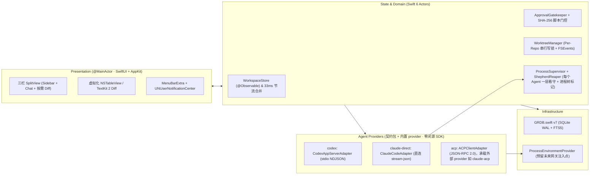
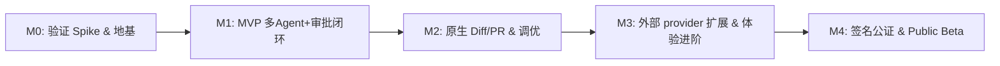

# Shepherd 方案计划书总纲

> **文档状态**：修订版 v5（2026-11-27）· 路线 C1 保留；立项决策第 4 项改定为不内嵌终端，新增第 5 项 provider 分层；性能数字均为未验证目标；**Claude Code 接入已对齐**；全部排期内容已移除；**崩溃兜底改为每个 Agent 一个看守进程**；**工程骨架已初始化，Mobile Companion 改回范围**（修订记录见 §8）  
> **目标平台与协议**：macOS 27.0+ · **仅 Apple Silicon (`arm64`)**（不支持 Intel Mac）· Swift 6.0+ Strict Concurrency · **MIT License**  
> **文档导航**：[01 上游代码审计](./01-orca-audit.md) · [02 系统架构设计](./02-architecture.md) · [03 产品与 UX 规范](./03-product-and-ux.md) · [04 工程路线图与测试](./04-roadmap-and-engineering.md)  
> **范围边界**：本期专注本地单机多 Agent 编排体验，**明确排除模型路由与额度容灾网关（如 Magpie 类能力）**，仅在架构底层预留干净的子进程环境变量注入边界供后续阶段按需对接。

---

## 1. 执行摘要（Executive Summary）

**Shepherd** 是基于开源 [`stablyai/orca`](https://github.com/stablyai/orca) 的理念与协议实证、彻底重构裁剪而成的 **macOS 原生轻量多 AI 编程代理编排应用（ADE）**。它旨在解决开发者同时运行 Claude Code、Codex 与 ACP 代理时的三大痛点：**多代理并发文件冲突、Electron 全家桶的体量与内存臃肿、第一方桌面端的单厂商生态锁定**。

| 决策维度 | 最终结论 | 核心支撑依据 |
| :--- | :--- | :--- |
| **产品定位** | **专属于 macOS 开发者的极简、原生、跨厂商多 Agent 指挥台** | 聚焦「Git Worktree 隔离并发 × Native Chat 主交互 × 原生 Diff/PR 审查 × 外部主力 IDE 接力」80% 核心链路，不做低配 IDE 或全能工作台。 |
| **最终技术路线** | **锁定路线 C1：100% 纯 Swift 6 原生内核 + Protocol-First 抽象 + 可选 ACP 逃生舱** | 上游审计证实 `orcad` 虽已 0 Electron 导入，但锁定 Node v24.22.3（`arm64` 单二进制即 **122.59 MB**）+ 11 MB bundle + 25 子入口 + 31.7 万行深度捆绑 RPC + 闭源商业条款 SDK，违背轻量原生与合规红线；纯 Swift 核心后端估算 **< 1 万行**（不足 Orca `src/main` 的 1%；v2：该估算不含 UI 且偏乐观，路线结论不依赖它）。v3：ACP 不再只是逃生舱，它同时是外部 provider 的协议。 |
| **关键体验取舍** | **只做 Native Chat，不内嵌终端（v3 改定）**；**MVP 默认零 Skill 注入** | 对话只有一种形态，Claude 的备用路径是同一契约下的外部 provider `claude-acp`，不经过终端；需要 shell 时 `⌘⇧T` 跳系统终端。代价是产品内没有切回原版 TUI 的路径（§4.1）。坚持零污染、零 Token 税、不篡改用户 `~/.claude` / `~/.codex`。 |
| **Agent 接入方式（v3 新增）** | **provider 分层：内置 provider 为独立 Swift 包，外部 provider 走 ACP** | 每个 Agent 的接入实现可以独立维护，核心只依赖一个契约包，不随某个 Agent 的协议变动而改动；做法参照 Magpie 的两层插件结构（[`docs/02-architecture.md`](./02-architecture.md) §3.1.5）。 |
| **分发与安全模型** | **Direct Distribution（仅 Apple Silicon `arm64`，非 Mac App Store）** + `shepherd-reaper` 孤儿进程清场 + **SHA-256 脚本信任门控** | App Sandbox 无法调用本机工具链与凭据；开发期先使用Bundle ID `top.inorbit.shepherd`（v5 已定稿，Debug 构建加 `.dev`）+ ad-hoc 签名，首次公测前完成 Developer ID + Notarization + Sparkle 2；仓库脚本入口经 SHA-256 信任确认（只覆盖命令文本，边界见 §4.3），软链强制 `git check-ignore` + 路径穿越拦截。 |
| **核心性能门禁** | 冷启动 **≤ 400 ms** · 空闲内存 **≤ 80 MB**（目标 45–75 MB）· 5 并发 **≤ 220 MB** · `.dmg` **≤ 25 MB** | 均为设计目标，尚未实测；用来对比的 Electron / Node Sidecar 数字（>150 MB 包体、250–500 MB 空闲内存）是估算，不是测量值。 |
| **交付阶段** | **M0–M4 五个阶段按顺序推进，M0–M2 交付 MVP** | `M0 验证 Spike` → `M1 核心闭环` → `M2 原生 Diff/PR` → `M3 外部 provider 扩展` → `M4 公测发版`；各阶段的任务与门禁见 §5。 |
| **开源与合规姿态** | **MIT License 开源 · 零闭源 SDK 捆绑、零遥测、零上游商标残留**（v2：不捆绑 SDK 不等于订阅凭据使用合规，三个独立风险见 §6） | 以 MIT 协议开源发布；彻底不捆绑受 Anthropic Commercial Terms of Service 约束的 `@anthropic-ai/claude-agent-sdk`；清除 `ORCA_*` / `orca_desktop` / `CLAUDE_CODE_ENTRYPOINT=orca`；保留 `Lovecast Inc.` MIT 参考声明（若复用代码）。 |

---

## 2. 项目背景、差异化定位与功能裁剪总览

### 2.1 为什么现在需要 Shepherd

当前多 AI 编程代理工具呈现明显断层，尚无一款同时满足**原生轻快、开源可控、跨厂商 BYOA 与结构化图形审查**的 macOS 标杆：

| 参照系 | 优势亮点 | 核心短板 / 与 Shepherd 的清晰边界 |
| :--- | :--- | :--- |
| **Orca** (`stablyai/orca`) | 开源 MIT、跨厂商 BYOA（Claude/Codex/19 种 ACP）、Worktree 与协议沉淀极深 | Electron 45 + Node 24（**~370 万 LOC**），内嵌浏览器/Monaco/看板/移动端中继/远程节点体量庞大，且依赖闭源 Claude SDK。**Shepherd 将其作为协议活字典，仅提炼 <5% 核心能力纯 Swift 重构。** |
| **Paradev**（原 Superset） | Mac 优先、强团队协作与 Stacked PR 流水线 | Electron/Web 混合偏重，偏向团队商业化协作。**Shepherd 坚持 Local-First 个人极致效率，不做云同步与重型团队看板。** |
| **Conductor**（Meta 收购） | macOS 原生极简体验标杆、Worktree 与审查流畅 | **闭源，2026-11 被 Meta 收购**，Conductor Cloud 已关停，桌面端只更新到 2027 年初。**Shepherd 对标其原生质感，保持开源、零遥测、本地可控；它的停更窗口是最直接的时间机会。** |
| **Emdash / Parallel Code** | 轻量开源多代理并发 | 多基于 Electron / Web 壳，原生质感与结构化审批/大 Diff 渲染弱于原生 AppKit。 |
| **cmux** | Swift/AppKit + `libghostty` 性能天花板、侧栏通知环；v2：已有 Diff 查看器与 Agent chat panes (beta) | **以终端为主的路线**，更新日志中未见应用内创建 PR。「有无图形 Diff / 结构化 Chat」已不是差异点。**Shepherd 的差异在跨厂商待处理列表、带上下文的审批，以及审批与代码变更的关联。** |
| **Claude Code / Codex Desktop** | 官方第一方深度整合 | **单厂商生态锁定**，无法在同一指挥台下按任务特长自由混排 Claude + Codex + ACP Agent。 |

### 2.2 功能裁剪总览（四分法纪律）

完整功能级拆解与优先级表见 [`docs/03-product-and-ux.md`](./03-product-and-ux.md) 第 2 节，核心裁剪边界如下：

| 处置分类 | 优先级 | 包含的核心能力 / 裁剪项 |
| :--- | :---: | :--- |
| **核心保留（Keep）** | `MVP` | ① **Git Worktree 隔离生命周期**（创建、基线同步、脏检查、孤儿对账与崩溃续跑）； ② **`shepherd.yaml` 并向后兼容 `orca.yaml`**（`worktree.sharedDirectories` + 本地 `symlinkPaths` + `git check-ignore` + 脚本 SHA-256 门控）； ③ **Native Chat 主对话流**（Codex & Claude Code 一等公民 + ACP 标准流最小闭环；可折叠 Thinking、只读 Tool 归并卡、内联权限审批条、问题作答卡与表单填写卡、Turn 摘要卡、消息队列）； ④ **原生 Diff Inspector 与一键 Commit / PR**（AppKit 虚拟化渲染、Unified/Split、逐 Hunk 审查/丢弃、`FSEvents` 实时刷新、`gh` PR 闭环）； ⑤ **macOS 原生通知与菜单栏状态徽章**（`MenuBarExtra` + `UNUserNotificationCenter` 降噪深链接）； ⑥ **外部主力 IDE 精准跳转**（`⌘O` 直达 Cursor / Zed / VS Code / Xcode / Finder 及精确 Diff 行号）。 |
| **瘦身保留（Trim）** | `P1` | ① **跨会话全文检索**（GRDB FTS5）； ② **面向人类开发者的极简 `shepherd` CLI**（`shepherd open` / `shepherd new`）； ③ **外部 provider 清单扩展**（5–8 个主流 ACP CLI）； ④ **Claude 进阶能力**（会话分叉；视 M0 验证结果决定是否提供「严格模式」）。 |
| **第一刀砍掉（Cut）** | `Out-of-Scope` | 内嵌 Chromium 浏览器 & Design Mode · 内置 Monaco 代码编辑器 · 远程 SSH / Docker / 云端沙箱节点 · Linear / Jira / GitHub 全套看板 · 复杂 DAG 可视化编排器 · 定时自动化任务（Cron / Schedules）· 语音转写 · 内嵌终端抽屉（v3 移出，原为 P1）。 |
| **暂不纳入（Defer）** | `P2` | **多模型本地路由与额度容灾网关（如 Magpie 类能力）** · Agent 自驱派活模式（Opt-in 会话级本地 MCP Server）· 团队云同步 · 外部 provider 的发现与自动安装。 |

---

## 3. 最终技术路线与系统架构决策

### 3.1 上游审计硬事实 → 为何果断否决 `orcad` Sidecar

在启动架构选型前，我们对 `stablyai/orca` 真实源码（Commit `284bf842` / v1.4.214，详情见 [`docs/01-orca-audit.md`](./01-orca-audit.md)）做了全量静态与依赖审计，得出一条**反直觉但具有决定性意义的实证结论**：

1. **先破除一个常见误判**：Orca 后端**并未耦合 Electron**。上游已内置纯 Node 24 无头守护进程 `orcad`，并由 CI 门禁 `check-runtime-electron-ratchet.mjs` 保证 `runtime`/`codex`/`claude`/`acp`/`git` 均为 **0 处 `electron` 导入**，且已彻底移除 `better-sqlite3` 改用 Node 24 内置 `node:sqlite`。
2. **但复用 `orcad` 做 Sidecar 存在三道不可接受的硬伤**：
   - **包体与内存重税**：锁定 `Node v24.22.3` 单二进制即 **122.59 MB**（`arm64`；双架构 ~248 MB），叠加 ~11 MB `orcad` JS bundle、**25 个平铺子 Worker/进程入口** 与 `node-pty` / `@parcel/watcher` 原生插件，未写一行 UI 即背负 **>150 MB 磁盘**（未压缩口径）与 **250–500 MB 空闲内存**（估算，未实测）；
   - **「能跑」≠「能裁」**：`OrcaRuntimeService`（31.7 万 LOC）与 **1,202 个自定义 NDJSON RPC**（非标准 JSON-RPC 2.0）深度耦合 Bots(143) / Browser(127) / Orchestration(65) / Linear / Jira；黑盒挂接背负 90% 冗余面，强行剥离维护成本高于重写；
   - **闭源 SDK 合规红线**：`orcad` 捆绑了受 **Anthropic Commercial Terms of Service** 约束的闭源 `@anthropic-ai/claude-agent-sdk`（`0.3.330`）。

### 3.2 锁定方案：路线 C1（100% 纯 Swift 6 原生内核 + Protocol-First + ACP 逃生舱）

基于上述实证，[`docs/02-architecture.md`](./02-architecture.md) 正式锁定 **路线 C1**——将 `stablyai/orca` 作为协议与边界坑位活字典（对 Codex 与 ACP 成立；Claude 线协议 Orca 交给了 SDK，参考应改用官方 Python SDK），以估算不足 **1 万行**（不含 UI）的纯 Swift 6 代码干净室实现核心后端：

#### 核心子系统架构要点（详见 [`docs/02-architecture.md`](./02-architecture.md)）
- **三大 Agent 协议精准适配（零闭源 SDK）**：
  - **Codex**：直连 `codex app-server --listen stdio://`（省略 `"jsonrpc":"2.0"` 字段的 NDJSON），完成 `initialize`（`clientInfo: shepherd_mac`）→ `initialized` 握手、4 类需要用户参与的请求分流（回包结构各不相同：`decision`、`answers`、`action` 加 `content`）、**未支持 Server Request 显式拒绝防挂起**、`-32001` 指数退避，且绝不改写 `~/.codex/hooks.json`。
  - **Claude Code（v3 定稿）**：默认用内置 provider `claude-direct`，纯 Swift 直连本机 `claude`（双向 `stream-json` 控制协议，`--permission-prompt-tool stdio`），**零 `@anthropic-ai/claude-agent-sdk` 依赖**，`CLAUDE_CODE_ENTRYPOINT` 既不设置也不继承。备用是外部 provider `claude-acp`（用户自装的 `claude-agent-acp`，依赖 Claude Agent SDK 与 Node ≥ 22，切换后新开会话）。启动契约、会话规则、权限档位、仓库信任门与环境变量规则见 [`docs/02-architecture.md`](./02-architecture.md) §3.1.4。
  - **ACP Client**：标准 JSON-RPC 2.0 over stdio NDJSON，支持增量分帧、单行上限保护与断连尾帧排空。v3：它同时是外部 provider 的宿主。
- **Provider 分层（v3 新增）**：
  - **契约包 `ShepherdProviderKit`**：核心与 provider 之间唯一的共享面，内容是 `AgentAdapter`、事件、三类交互、能力声明与启动规格。
  - **内置 provider**：`codex`、`claude-direct`、`acp` 各是一个独立 Swift 包，只依赖契约包，只被 App 入口引用；依赖方向由边界测试强制。
  - **外部 provider**：一份清单加一个说 ACP 的可执行文件，用户手动添加并确认；Shepherd 不捆绑、不代为安装。
  - **契约定版**：经三种实现验证后再定为 1.0（[`docs/02-architecture.md`](./02-architecture.md) §3.1.5）。
- **高并发防卡顿设计**：每个活跃会话独占 `actor SessionRuntime`，对高频 Token 流施加 **33ms（30Hz）合并窗口**后向 `@MainActor` 推送不可变尾块增量；大 Diff 从 Day 1 采用 AppKit 虚拟化 `NSTableView`（或 TextKit 2），目标保持 60/120fps。Chat 的列表方案与 Markdown 引擎在 M0 选型（v2 新增）。
- **Direct Distribution 与防孤儿进程**：因 Mac App Store 强制 App Sandbox 无法执行用户本机开发工具链与读取 `~/.claude`/`~/.codex`/`~/.ssh`，明确走 **Direct Distribution（Hardened Runtime + Developer ID + `notarytool` 公证 + Sparkle 2 EdDSA 更新 + Homebrew Cask）**；所有子进程强制 `POSIX_SPAWN_SETPGROUP` 独立进程组，并随包内嵌 **< 200 KB 的 `shepherd-reaper`**。v4：每启动一个 Agent 套一层 `shepherd-reaper`，它的看守进程靠管道 EOF 发现主 App 死亡，即使主 App 遭遇 `SIGKILL` 崩溃也能自行完成清理；Agent 为自己启动的命令另建的进程组、被 launchd 收养的后代，靠继承式的进程树标记找回。这套做法借鉴 Orca 的 `orca-provider-exec`，覆盖范围与已知缺口见 [`docs/02-architecture.md`](./02-architecture.md) §3.3.3。
- **本地持久化与远期扩展边界**：选用 `GRDB.swift` v7（SQLite WAL + FTS5 + >128KB 大对象外置 LRU）；通过分层 `ProcessEnvironmentProvider` 保持环境变量注入干净，确保未来可零重构对接外部模型路由网关或 Review CLI。

---

## 4. 关键产品与安全取舍

以下三项核心产品决策直接决定了 Shepherd 的日常可用性与开发者信任度（详见 [`docs/03-product-and-ux.md`](./03-product-and-ux.md) 第 3–4 节）：

### 4.1 专题 A：只做 Native Chat，不内嵌终端（v3 改定）
原方案是「90% Native Chat + 10% `⌘J` 终端抽屉」，并让终端承担 Claude 的备用路径。v3 把终端整体移出规划，对话只有 Native Chat 一种形态。
- **原先保留终端的四个理由，现在的处理**：
  - **额度消耗与用量政策**：接受该风险。会话头部显示登录与计费来源，M0 实测真实消耗；出路在产品之外（API Key，或经外部网关换模型与账号）。
  - **TUI 专属斜杠命令**：只支持无头模式下可用的部分；高频操作做成 Native Chat 的原生按钮。
  - **需要真实终端的交互式命令**：`⌘⇧T` 跳系统终端；登录由用户事先在自己的终端里完成。
  - **启动参数与多账号**：会话环境与用户终端一致，账号管理不在范围内。
- **换来的**：一种交互形态；少一个终端引擎依赖与一整套会话互斥、状态同步、转录回填机制；备用路径留在 Native Chat 内。
- **代价**：不能在 Shepherd 里把会话切到原版 TUI 再切回来；Anthropic 一旦恢复把 `claude -p` 用量移出订阅额度的方案（2026 年 6 月暂停，未给恢复时间），产品内没有对冲手段。完整说明见 [`docs/03-product-and-ux.md`](./03-product-and-ux.md) 3.1。

### 4.2 专题 B：MVP 零 Skill 注入 vs P2 Opt-in 本地轻量 MCP Server
Orca 默认向 `~/.claude/skills` 与 `~/.codex/skills` 写入 `orca-cli` 与 `orchestration` 两个 Skill Stub。
- **Shepherd 决策**：MVP 严格定位为 **“人肉多开指挥台模式”**——**零注入、零污染、零 Token 税**，绝不向用户全局目录或仓库写入任何私有 Skill 或提示词，杜绝行为漂移与 Agent 擅自套娃派生子任务烧光额度。P2 若面向高阶用户开放 Opt-in「Agent 自驱派活」，优先采用**会话级动态挂载的本地轻量 MCP Server**（关闭开关即零磁盘残留、天然跨厂商、可被 Shepherd 审批条一等拦截）。

### 4.3 配置兼容与安全门控体验
- **精准兼容 `orca.yaml`**：优先读取 `shepherd.yaml`，向下兼容 `orca.yaml` 的真实嵌套 Schema（`worktree.sharedDirectories`、`scripts.setup`、`scripts.archive`、`setupAgentStartupPolicy`），并合并仓库级本地 `symlinkPaths`。
- **双层软链安全**：来自仓库 YAML 的 `worktree.sharedDirectories` 必须同时通过**路径穿越校验**与 **`git check-ignore`**（仅放行已存在且被 `.gitignore` 忽略的目录，防止覆盖受版本控制的源码）。v2：实测带斜杠的忽略规则不匹配同名软链，软链建好后还需把路径写入 `.git/info/exclude`，并列入已声明写入清单。
- **脚本入口信任门控（SHA-256）**：执行 `scripts.setup` 或 `scripts.archive` 前计算规范化命令文本的 **SHA-256 哈希**，比对 SQLite `trusted_hook_hashes` 表——首次遇到或命令文本变更时弹出原生 Sheet 展示完整脚本供审批；保留历史已信任哈希避免多分支来回切换时反复弹窗；`scripts.archive` 失败默认阻断清理。**v2 边界**：哈希只覆盖 YAML 里的命令文本，被调用的仓库内脚本或包管理器钩子内容变化时不会重新确认。弹窗文案相应改为「信任此仓库执行此入口」，不把它描述成对陌生 PR 的防护。
- **菜单栏安全原则**：`MenuBarExtra` Popover 仅做全局聚合监控与一键跳转，**不在窄小弹窗内提供高危命令盲批按钮**，确保人类看清完整上下文后再 `⌘↩` 放行。
- **审批控制范围（v2 新增）**：Shepherd 只在 Agent 发来请求时介入，用户在 Agent 自身配置里放行的操作不会经过 Shepherd。权限档位改为映射各 Agent 的原生模式，界面只提供 M0 验证过能兑现的档位；原「不可绕过的硬护栏」说法撤回（[`docs/02-architecture.md`](./02-architecture.md) §3.3.4）。v3：Claude 的档位与其原生权限模式一一对应，默认「沿用我的 Claude 设置」，首版不提供「每次询问」；会话头部显示实际生效的权限模式与登录方式。
- **三类待处理交互（v2 新增）**：权限确认、问题作答、表单填写进入同一个待处理列表，但各自保留语义与回包结构（[`docs/02-architecture.md`](./02-architecture.md) §3.1.1）。
- **无头模式信任缺口（v2 新增）**：`claude -p` 跳过工作区信任对话，仓库自带的项目级 hooks 会直接生效，脚本信任门控不覆盖这部分。v3 定稿：Shepherd 设自己的仓库信任门，仓库第一次加入时确认一次，按仓库记录、对所有 Worktree 生效，不写 `~/.claude.json`（[`docs/02-architecture.md`](./02-architecture.md) §3.1.4 第 6 项）。
- **外部 provider 的添加确认（v3 新增）**：外部 provider 是以用户权限运行的任意代码，只支持手动添加并确认一次，不自动安装。

---

## 5. 分阶段工程路线图与质量保障总览

里程碑按先后顺序推进，**M0 + M1 + M2 交付可日常主力使用的 MVP**；若 M0 实测表明首版范围需要收缩，按预先商定的顺序削减。完整目录结构、CI/CD 流水线与 5 层测试金字塔见 [`docs/04-roadmap-and-engineering.md`](./04-roadmap-and-engineering.md)：

| 里程碑 | 核心交付物 | 关键退出验收门禁（Go/No-Go） |
| :--- | :--- | :--- |
| **M0：验证 Spike 与工程地基** | 10 个工程模块骨架（8 个 SwiftPM 库 + App + Reaper，含 provider 契约草案与依赖方向边界测试）、CI 合规检查脚本；实机打通 Codex / Claude `stream-json` / 外部 provider `claude-acp` / `WorktreeManager` + `RepoLockActor` / `ShepherdReaper` + 后代进程跟踪；v2 新增五项验证：权限必经性、真实 Agent 进程清理、无头模式信任、Chat 渲染选型、用量实测；v3 新增两项：外部 provider 验证、provider 契约验证 | **首要门禁：真实双 Agent 任务跑通**（同仓两个 Worktree，Claude 与 Codex 各一个任务，完成一次审批和一次作答，审 Diff、提交一条分支并保住另一条的未提交改动）；20 轮实机无挂起且三类交互分别覆盖；5 并发 `worktree add` 零锁冲突；`kill -9` 后 Agent 所在进程组、真实 Agent 命令与带标记的后代均被清理；权限档位与 Chat 方案定稿；Claude 接入留给 M0 确认的各项都有实测记录；provider 契约草案经三种实现验证；根据实测结果复核首版范围。 |
| **M1：MVP 核心闭环** | `GRDB` WAL 存储、Per-Session Actor 33ms 节流、权限档位（映射 Agent 原生模式）与三类待处理交互、三个内置 provider 与外部 provider 的手动添加、原生双栏 UI（Sidebar + Native Chat + `⌘N` + 信任弹窗：仓库信任门与 SHA-256 脚本信任）、`MenuBarExtra` & 系统通知、`⌘O`/`⌘⇧T` 跳转 | 同仓并发跑通 Claude + Codex Worktree 零冲突；`claude-direct` 不可用时可改用 `claude-acp` 新开会话完成同一任务；冷启动 **≤ 400 ms**、空闲内存 **≤ 80 MB**、通知延迟 **≤ 300 ms**；通过真实 `orca.yaml` 兼容与零污染审计。 |
| **M2：原生 Diff / PR 与性能打磨** | AppKit 虚拟化 Diff Inspector（`⌘⇧D`、Unified/Split、Hunk Stage/Discard）、`FSEvents` 实时刷新、`gh` Commit/PR 闭环、`⌘K` 命令面板与全键盘流、`Protocol Inspector` | 50 文件 / 2,000 行 Diff 首帧 **≤ 150 ms**；外部保存自动刷新 **≤ 500 ms**；5 并发 15 分钟压测内存 **≤ 220 MB** 且稳定 **60/120fps**；全键盘端到端验收通过。 |
| **M3：外部 provider 扩展与体验进阶** | 5–8 个外部 provider 的清单与方言说明、`ShepherdProviderKit` 定为 1.0、Claude 会话分叉（及视 M0 结果而定的「严格模式」）、GRDB FTS5 全文检索、人类向 `shepherd` CLI | 每个外部 provider 跑通一次含审批的真实任务；外部 provider 会话在宿主 `kill -9` 后被清理；契约 1.0 发布后已有 provider 无需修改；`.dmg` 体积仍 **≤ 25 MB**。 |
| **M4：签名公证与 Public Beta** | 由内向外 Hardened Runtime 签名（禁用 `codesign --deep`）、`notarytool` 公证、Sparkle 2 EdDSA `appcast.xml`、Homebrew Cask、20–50 人种子公测 | 无 Xcode 干净 macOS 27 零警告通过 Gatekeeper；实测 Sparkle 2 原地升级成功；7 天高强度 Dogfooding 零孤儿进程与零数据损坏。 |

**五层无外网自动化测试保障**：① 协议 Golden-File 随机切片回放（各 provider 包的测试）→ ② 独立 `FakeAgentHarness` 500 tok/s 高并发契约测试 → ③ 真实临时仓 `git worktree` / `check-ignore` / SHA-256 集成测试 → ④ `SIGKILL` 宿主验证 `shepherd-reaper` 孤儿清场专项测试（v2：含另建进程组的后代；v3：含外部 provider 下的四层进程树；v4：含被 launchd 收养的带标记后代） → ⑤ `XCTMetric` 性能基准 + 沙盒 `HOME` 零污染快照审计。五层之外另有依赖方向边界测试，断言核心不引用任何 provider 包。

---

## 6. 合规与发布检查清单

综合 [`docs/01-orca-audit.md`](./01-orca-audit.md) 第 1 节与 [`docs/04-roadmap-and-engineering.md`](./04-roadmap-and-engineering.md) 第 2 节，上线前必须经 CI 脚本 `Scripts/check-compliance.sh` 与人工终检 100% 通过：

> **v2 说明**：原清单把合规等同于「不捆绑闭源 SDK」。评审后拆成三个独立风险：SDK 的捆绑与许可、订阅凭据的使用边界、`claude -p` 的用量政策。事实依据见 [`docs/01-orca-audit.md`](./01-orca-audit.md) §7.5。

- [ ] **零闭源商业 SDK 捆绑**：全仓与分发包内 0 处引入 `@anthropic-ai/claude-agent-sdk`（规避 Anthropic Commercial Terms of Service 限制），明确 BYOA 纯本地编排定位。
- [ ] **订阅凭据使用边界（v2 新增）**：对照 Anthropic 合规页逐条确认每条 Claude 路径。直连用户本机未修改的 `claude` 二进制是较稳的一条；依赖 Agent SDK 的 ACP 适配器在订阅登录下是否合规，需在公测前确认。「不捆绑 SDK」不能替代这项检查。v3：外部 provider `claude-acp` 就是这类适配器，它由用户自行安装，Shepherd 不捆绑；添加它时界面要提示这一点。
- [ ] **`claude -p` 用量政策复查（v2 新增）**：Anthropic 把 `claude -p`、Agent SDK 与第三方应用用量移出订阅额度的方案于 2026 年 6 月暂停，没有给出恢复时间。公测前复查帮助中心文章，并在产品内如实提示用量归属。v3：产品内不设对冲，出路是 API Key 或外部网关（§7.1 R10）。
- [ ] **商标与身份彻底隔离**：0 处复用 Orca 图标/品牌资源；0 处残留 `ORCA_*` 环境变量前缀、`clientInfo: "orca_desktop"`、`CLAUDE_CODE_ENTRYPOINT=orca`（仅配置解析层只读兼容 `orca.yaml`）。
- [ ] **开源许可声明完备（MIT License）**：Shepherd 自身以 **MIT License** 开源发布，仓库根目录与 App `About -> Licenses` 完整提供 `LICENSE` 与 `THIRD_PARTY_NOTICES.md`，列出实际依赖（`GRDB.swift`、`Yams`、`Sparkle` 均为 MIT；Markdown 引擎待 M0 选型，许可证随选型补入）；若参考或复用任何 Orca 源码片段，保留 `Copyright (c) 2026 Lovecast Inc.` MIT 声明；全程使用系统原生 SF Pro / SF Mono（不引入 Geist SIL OFL 字体）；如未来随包分发 `ripgrep`，须附带其完整许可证目录。
- [ ] **零遥测与最小权限**：0 处遥测/云端上报代码；`Entitlements` 仅开启 `network.client=true`（用于 Sparkle 与可选 GitHub API），关闭 `allow-jit` / `disable-library-validation`；本地 IPC 严格限定 `0600` Unix Domain Socket（`~/.shepherd/run/shepherd.sock`）+ `LOCAL_PEERCRED` UID 校验 + 256-bit Token。
- [ ] **零污染的已声明写入清单（v2 新增）**：列明 Shepherd 会写的位置（自身数据目录、`~/.shepherd`、目标仓库的 `$GIT_COMMON_DIR/info/exclude`），以及 Agent CLI 自己会写的位置（如其会话文件）。除此之外，对 `~/.claude`、`~/.codex` 与目标仓库工作区零写入。
- [ ] **由内向外签名与双载体公证（仅 `arm64`）**：开发期（M0–M1）先以Bundle ID `top.inorbit.shepherd`（v5 已定稿，Debug 构建加 `.dev`）+ 本地 ad-hoc 签名迭代，首次对外公测前最终定稿正式 Bundle ID 与签名主体；发版禁用 `codesign --deep`，按 `Sparkle.framework` → `shepherd-reaper` → `Shepherd.app` 顺序签 Hardened Runtime 并逐组件校验，对 `.app`（供 Sparkle 2 `.zip` 增量更新）与已签名 `.dmg` 均完成 `notarytool` 公证、`stapler` 装订与 `spctl` 检验。

---

## 7. 核心风险、已拍板立项决策与 M0 实测裁决项

### 7.1 Top 风险摘要（完整 R1–R16 见 [`docs/04-roadmap-and-engineering.md`](./04-roadmap-and-engineering.md) 第 5 节）

| 风险项 | 等级 | 关键缓解预案 |
| :--- | :---: | :--- |
| **R1：Claude Code `stream-json` 底层控制协议漂移** | 高 | 宽容解码 + Golden-file 回归；实现依据改为官方 Python SDK；备用路径是外部 provider `claude-acp`（依赖 SDK 与 Node，用户自装，切换需新开会话；原「1 天内热切」的说法撤回）；`claude-direct` 独立成包，修复不牵动核心。 |
| **R2 / R3：Anthropic 条款边界与 Claude 订阅窗口消耗倍率差异** | 高 | 零闭源 SDK 捆绑 + 清晰 `rate_limit_event` 限流提示。v3：产品内不再提供切回原版 TUI 的路径。v2：合规拆为三个独立风险（§6）；消耗倍率在 M0 实测。 |
| **R4：Codex `app-server` 未知 Server Request 导致会话挂起** | 中高 | 统一分流默认分支：所有未支持反向请求立即返回显式拒绝/错误码，绝不静默丢弃。 |
| **R5 / R6：并发 `index.lock` 冲突与恶意仓库配置脚本** | 中高 | `RepoLockActor` 按仓库串行写锁 + 软链 `git check-ignore` & 路径穿越双校验 + 脚本入口 SHA-256 信任门控弹窗。v2：锁须为显式异步队列；信任门控只覆盖命令文本，不是对恶意分支的完整防护。 |
| **R7 / R8：macOS GUI 缺失用户 `PATH` 与嵌套签名公证拒签** | 中 | 启动异步探测 Login Shell 环境并置设置页「工具链诊断向导」；M1 末提前在 CI 跑通一次空壳签名公证。 |
| **R10：`claude -p` 用量政策恢复（v2 新增）** | 高 | 该方案 2026 年 6 月暂停、未给恢复时间。v3：接受该风险，产品内不设对冲；出路是 API Key 或外部网关；会话头部显示计费来源；公测前复查。 |
| **R11：无头模式跳过工作区信任（v2 新增）** | 高 | v3 已决定设 Shepherd 自己的仓库信任门；M0 验证 Claude 与 Codex 的项目级配置加载行为，确认它的覆盖范围。 |
| **R12：代码体量估算偏乐观（v2 新增）** | 高 | 现有体量数字按未验证估算对待，M0 出口用实测复核；范围削减顺序已预先商定。 |
| **R13：审批控制范围小于界面承诺（v2 新增）** | 高 | 档位映射 Agent 原生模式；M0 逐驱动验证；界面如实标注覆盖范围。 |
| **R14：Chat 长转录渲染卡顿（v2 新增）** | 中 | M0 的 Chat 渲染 Spike 选定列表方案与 Markdown 引擎。 |
| **R15：provider 契约过早定版（v3 新增）** | 中 | 契约在 M0–M2 保持草案；经三种内置实现与若干外部 provider 验证后在 M3 定为 1.0。 |
| **R16：外部 provider 的安全与资源开销（v3 新增）** | 中 | 只支持手动添加并确认；默认路径保持原生 Swift；外部 provider 的内存增量单独记录。 |

### 7.2 已拍板立项决策与 M0 待裁决项

#### 一、已拍板立项决策（5 项 · LOCKED）

1. **开源协议锁定 MIT License**：Shepherd 正式采用 **MIT License** 开源发布，确保完全透明可控、零商业锁死，利于社区共建 ACP 方言与建立开发者信任。
2. **目标硬件架构锁定仅 Apple Silicon (`arm64`)**：明确仅支持 **macOS 27.0+ Apple Silicon (`arm64`)**，**不支持 Intel Mac**。彻底去除双架构维护与 CI 回归负担，保证单一 `arm64` `.dmg` 体积稳定控制在 **≤ 25 MB** 红线之内。
3. **Bundle ID 与签名主体分阶段定稿**：开发期（M0–M1）先使用Bundle ID `top.inorbit.shepherd`（v5 已定稿，Debug 构建加 `.dev`）配合本地 ad-hoc 签名推进编码；Developer ID 团队证书、Sparkle `appcast.xml` 托管域名及 Homebrew Tap 统一在**首次对外公测（M4）或公证演练前最终定稿**。
4. **对话只保留 Native Chat，不内嵌终端（v3 改定）**：原决策是 `⌘J` 终端抽屉（`SwiftTerm`）锁定在 M3 交付。v3 把它整体移出规划，连同 Resume in Terminal、终端状态同步与转录回填；需要 shell 时用 `⌘⇧T` 跳系统终端。理由与代价见 §4.1。
5. **Agent 接入按 provider 分层（v3 新增）**：内置 provider 为独立 Swift 包，外部 provider 走 ACP；核心只依赖契约包 `ShepherdProviderKit`。Claude 默认用 `claude-direct`，备用是 `claude-acp`。

#### 二、留待 M0 实测的裁决项（6 项）

1. **Claude Code 接入中留给 M0 确认的事实项**：接入方案本身已在 v3 对齐（[`docs/02-architecture.md`](./02-architecture.md) §3.1.4），M0 只确认其中未经实测的前提，例如 `init` 帧能读到的字段、`--resume` 后的会话 ID、`hook_callback` 能否先于允许规则、无头模式下项目级配置的加载行为。与结论不符的写回该节。
2. **能够兑现的权限档位**：M0 逐驱动验证哪些操作必经 Shepherd，据此确定界面提供哪些档位。
3. **Chat 渲染方案与 Markdown 引擎**：M0 Spike 选型。
4. **进程清理的覆盖范围**：M0 用真实 Agent 验证后代进程跟踪，确定验收口径。
5. **首版范围**：M0 出口根据实测结果复核，必要时按预先商定的顺序削减 MVP 范围。v3：ACP 最小闭环不在可削减之列。
6. **provider 契约（v3 新增）**：M0 用 `claude-direct`、`codex` 与一个 ACP Agent 三种实现验证契约草案，记录装不下的差异；定版放在 M3。

---

## 8. 修订记录

### v2（2026-11-26）评审修订

本轮合并了两份独立评审，以及一次对 Orca 接入 Claude Code 方式的源码核对。修订前的版本保留在 git 基线提交 `2c57bac`。

**保留不变**：路线 C1（纯 Swift 内核）、MIT、仅 Apple Silicon、Direct Distribution、功能四分法裁剪、零 Skill 注入。

**主要变更**：

| 主题 | 变更 | 详见 |
| :--- | :--- | :--- |
| 合规 | 拆成 SDK 捆绑、订阅凭据使用边界、`claude -p` 用量政策三个独立风险 | §6；`04` §5 R2、R10 |
| ACP 备用通道 | 更正：适配器依赖 Claude Agent SDK 与 Node ≥ 22；撤回「1 天内无感切换」 | `02` §1.1、§3.1.2 |
| Claude Code 接入 | 整体设计标为待专题对齐，列出 11 项待定事项（v3 已定稿） | `02` §3.1.4 |
| 审批模型 | 控制范围以 Agent 实际请求为界；档位映射原生模式；撤回「不可绕过的硬护栏」 | `02` §3.3.4 |
| 待处理交互 | 拆成权限确认、问题作答、表单填写三类 | `02` §3.1.1；`03` §4.2 |
| 进程清理 | 新增后代进程跟踪；验收拆成三个场景 | `02` §3.3.3；`04` §4 |
| Worktree 安全 | 信任门控改述为入口信任；软链后写 `info/exclude`；修正示例配置；锁须为显式异步队列 | `02` §3.2.2–§3.2.3 |
| Chat 渲染 | 列表方案与 Markdown 引擎改为 M0 选型 | `02` §2.2；`04` §1.3 |
| 数字口径 | 性能、包体与对比数字统一标注为未实测目标或估算 | `02` §1.2；`03` §5 |
| 竞品 | 更新 Conductor 与 cmux 现状，重述差异化 | `03` §1.4 |
| 证据 | 新增评审补充查证与复现方式 | `01` §7 |

**当时未处理、留待后续**：

- Claude Code 接入的 11 项待定事项（已在 v3 处理）。
- 五份文档之间的重复内容。同一组数字在多处出现，后续修改时以本文件为准。

### v3（2026-11-26）接入对齐与结构调整

本轮来自三项决定：移除排期，Claude Code 只走 Native Chat，Agent 接入改为可独立维护的 provider。v2 的版本保留在 git 提交 `af02b9d`。

| 主题 | 变更 | 详见 |
| :--- | :--- | :--- |
| 排期 | 全部移除：不再给出周数、人力假设与各路线的研发周期对比；里程碑只保留先后顺序、任务与门禁 | `04` §3；`02` §1.2 |
| Claude Code 接入 | 11 项待定事项逐项定稿：启动契约、会话规则、权限档位、仓库信任门、环境变量规则、代码体量粗估 | `02` §3.1.4 |
| 终端抽屉 | 整体移出规划，连同 Resume in Terminal、终端状态同步与转录回填；立项决策第 4 项改定 | `02` §2.4；`03` 3.1；§7.2 |
| Provider 分层 | 新增契约包 `ShepherdProviderKit`；内置 provider 为独立 Swift 包，外部 provider 走 ACP；新增立项决策第 5 项 | `02` §3.1.5；`04` §1 |
| ACP | 最小闭环从「第一个被削减」改为首版必备；`claude-agent-acp` 定位为外部 provider `claude-acp`，是 Claude 唯一的备用路径 | `04` §3；`02` §3.1.2 |
| 用量政策 | R10 改为接受风险，产品内不设对冲，出路是 API Key 或外部网关 | `04` §5 R10 |
| 权限与信任 | Claude 档位与原生权限模式一一对应，默认沿用用户设置，首版不提供「每次询问」；新增仓库信任门 | `02` §3.1.4；`03` §4.2 |
| 模块结构 | SwiftPM 库由 6 个变为 8 个：`ShepherdAgents` 拆成契约包加三个 provider 包，`ShepherdTerminal` 取消 | `04` §1；`02` §4 |
| 风险 | 新增 R15（契约过早定版）、R16（外部 provider 的安全与资源开销） | `04` §5 |
| 证据 | 新增 Magpie 插件结构的查证 | `01` §7.6 |

**未处理、留待后续**：

- `02` §3.1.4 表中「留给 M0 确认」的各项，都是未经本机实测的前提。
- `02` §3.1.1 的接口草案代码段仍是最初的写法，只用文字说明了要改的地方。
- 五份文档之间的重复内容。同一组数字在多处出现，后续修改时以本文件为准。

### v4（2026-11-27）崩溃兜底改为每个 Agent 一个看守进程

起因是补查 Orca 源码时发现，v2 审计漏了它的主程序崩溃兜底机制。v3 的版本保留在 git 提交 `c23f866`。

| 主题 | 变更 | 详见 |
| :--- | :--- | :--- |
| 证据 | 新增 Orca `orca-provider-exec` 的查证；更正审计中两处关于进程清理的不完整表述 | `01` §7.7、§5、§7.3 |
| Reaper 形态 | 由「全局一个、主 App 登记进程组」改为「每个 Agent 一层启动器加看守进程」，靠管道 EOF 发现主 App 死亡 | `02` §3.3.3 第 3 点 |
| 后代清理 | 由「主 App 周期性抓快照再登记」改为继承式进程树标记 `SHEPHERD_PROVIDER_TREE`；主 App 内的快照只用于展示与诊断 | `02` §3.3.3 第 4 点 |
| 零注入原则 | 新增一个例外：向 Agent 环境加入一个不透明的标记变量，列为已声明的写入 | `02` §3.1.4；`03` §5.3 |
| 验收与测试 | 进程清理验收由三个场景改为四个；L4 测试加入被 launchd 收养的后代与一个预期漏掉的对照 | `03` §5.3；`04` §3、§4 |

**未处理、留待后续**：

- Orca 的实现只读了注释与关键结构，没有运行验证。
- `claude`、`codex` 是否会清洗子进程环境、启动器是否原样传递信号与退出码，都留给 M0 实测（`02` §3.3.3）。

### v5（2026-11-27）工程骨架初始化与 Companion 改回范围

本轮来自几项决定：仓库初始化为 monorepo；最低系统升到 27；Mobile Companion 改回范围并自建中继。v4 的版本保留在 git 提交 `298bc14`。

| 主题 | 变更 | 详见 |
| :--- | :--- | :--- |
| 最低系统 | macOS 15 改为 macOS 27；Companion 为 iOS / iPadOS 27。不再需要 Liquid Glass 的回退 | 各文档文首；`04` §2.1 |
| Bundle ID | 定为 `top.inorbit.shepherd`，Mac 与 iOS 共用，Debug 构建加 `.dev`；签名主体仍在 M4 前定稿 | `04` §2.1 |
| 仓库结构 | `Shepherd.xcworkspace` 加 `Apps/macOS`、`Apps/iOS` 两个项目；Reaper 成为 macOS 项目里的 target；取消根 `Package.swift` | `04` §1；`02` §4 |
| Swift 包 | 由 8 个变为 10 个：新增两端通用的 `ShepherdModels` 与 `ShepherdRemote` | `04` §1；`02` §4 |
| Mobile Companion | 由 Cut 改为 P1。iPhone、iPad、iPhone Duo 共用一个 iOS App；Agent 仍只在 Mac 执行 | `03` §2；`02` §3.5 |
| 中继与推送 | 自建，Node 实现，放在 `Server/`。不做账号，靠设备绑定；内容端到端加密；推送网关与中继分开部署 | `02` §3.5；`Server/` |
| 证据 | 新增 Orca 中继与推送的查证 | `01` §7.8 |
| 风险 | 新增 R17（无账号中继的滥用）、R18（APNs 密钥保管）、R19（新项目文件格式要求 Xcode 27） | `04` §5 |

**未处理、留待后续**：

- 仓库里的工程都是可构建的空壳，没有业务代码。
- 中继的外层协议只有草案（`Server/PROTOCOL.md`），加密算法、字段与时限都未定。
- Companion 的性能与验收指标尚未制定，`03` §5 的指标仍只针对 Mac。
- `04` §1.1 目录树里各包内部的子目录仍是 v3 的规划，只更新了顶层结构。
- iOS 的通知扩展与实时活动扩展 target 尚未创建。
