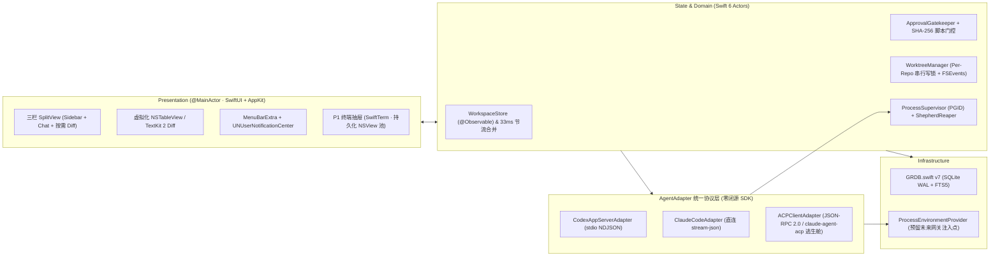

# Shepherd 方案计划书总纲

> **文档状态**：方案规划终版 · **核心立项决策已拍板**（已与上游代码审计、系统架构、产品规范与工程路线图全量交叉校准）  
> **目标平台与协议**：macOS 15.0+ (Sequoia) · **仅 Apple Silicon (`arm64`)**（不支持 Intel Mac）· Swift 6.0+ Strict Concurrency · **MIT License**  
> **文档导航**：[01 上游代码审计](./01-orca-audit.md) · [02 系统架构设计](./02-architecture.md) · [03 产品与 UX 规范](./03-product-and-ux.md) · [04 工程路线图与测试](./04-roadmap-and-engineering.md)  
> **范围边界**：本期专注本地单机多 Agent 编排体验，**明确排除模型路由与额度容灾网关（如 Magpie 类能力）**，仅在架构底层预留干净的子进程环境变量注入边界供后续阶段按需对接。

---

## 1. 执行摘要（Executive Summary）

**Shepherd** 是基于开源 [`stablyai/orca`](https://github.com/stablyai/orca) 的理念与协议实证、彻底重构裁剪而成的 **macOS 原生轻量多 AI 编程代理编排应用（ADE）**。它旨在解决开发者同时运行 Claude Code、Codex 与 ACP 代理时的三大痛点：**多代理并发文件冲突、Electron 全家桶的体量与内存臃肿、第一方桌面端的单厂商生态锁定**。

| 决策维度 | 最终结论 | 核心支撑依据 |
| :--- | :--- | :--- |
| **产品定位** | **专属于 macOS 开发者的极简、原生、跨厂商多 Agent 指挥台** | 聚焦「Git Worktree 隔离并发 × Native Chat 主交互 × 原生 Diff/PR 审查 × 外部主力 IDE 接力」80% 核心链路，不做低配 IDE 或全能工作台。 |
| **最终技术路线** | **锁定路线 C1：100% 纯 Swift 6 原生内核 + Protocol-First 抽象 + 可选开放 ACP 逃生舱** | 上游审计证实 `orcad` 虽已 0 Electron 导入，但锁定 Node v24.22.3（`arm64` 单二进制即 **122.59 MB**）+ 11 MB bundle + 25 子入口 + 31.7 万行深度捆绑 RPC + 闭源商业条款 SDK，违背轻量原生与合规红线；纯 Swift 核心后端仅需 **< 1 万行**（不足 Orca `src/main` 的 1%）。 |
| **关键体验取舍** | **90% 纯 Native Chat + 10% `⌘J` 可折叠极简终端抽屉（P1，锁定 M3）**；**MVP 默认零 Skill 注入** | 兼顾结构化审批/阅读体验与 Claude 额度控制、`/btw` 等原版 TUI 逃生舱需求；坚持零污染、零 Token 税、不篡改用户 `~/.claude` / `~/.codex`。 |
| **分发与安全模型** | **Direct Distribution（仅 Apple Silicon `arm64`，非 Mac App Store）** + `shepherd-reaper` 孤儿进程清场 + **SHA-256 脚本信任门控** | App Sandbox 无法调用本机工具链与凭据；开发期先使用占位 Bundle ID（如 `io.github.julytang.shepherd`）+ ad-hoc 签名，首次公测前定稿正式 ID 并完成 Developer ID + Notarization + Sparkle 2；仓库脚本强制 SHA-256 审查，软链强制 `git check-ignore` + 路径穿越拦截。 |
| **核心性能门禁** | 冷启动 **≤ 400 ms** · 空闲内存 **≤ 80 MB**（目标 45–75 MB）· 5 并发 **≤ 220 MB** · `.dmg` **≤ 25 MB** | 较 Electron / Node Sidecar（>150 MB 包体、250–500 MB 空闲内存）轻量近一个数量级。 |
| **工期与交付节奏** | **2 名资深 Swift 工程师总计 9.5 周（MVP 6.5 周可主力自用）** | `M0 协议 Spike (1.5周)` → `M1 核心闭环 (3周)` → `M2 原生 Diff/PR (2周)` → `M3 P1 终端抽屉 & ACP (2周)` → `M4 公测发版 (1周)`。 |
| **开源与合规姿态** | **MIT License 开源 · 零闭源 SDK、零遥测、零上游商标残留** | 以 MIT 协议开源发布；彻底不捆绑受 Anthropic Commercial Terms of Service 约束的 `@anthropic-ai/claude-agent-sdk`；清除 `ORCA_*` / `orca_desktop` / `CLAUDE_CODE_ENTRYPOINT=orca`；保留 `Lovecast Inc.` MIT 参考声明（若复用代码）。 |

---

## 2. 项目背景、差异化定位与功能裁剪总览

### 2.1 为什么现在需要 Shepherd

当前多 AI 编程代理工具呈现明显断层，尚无一款同时满足**原生轻快、开源可控、跨厂商 BYOA 与结构化图形审查**的 macOS 标杆：

| 参照系 | 优势亮点 | 核心短板 / 与 Shepherd 的清晰边界 |
| :--- | :--- | :--- |
| **Orca** (`stablyai/orca`) | 开源 MIT、跨厂商 BYOA（Claude/Codex/19 种 ACP）、Worktree 与协议沉淀极深 | Electron 45 + Node 24（**~370 万 LOC**），内嵌浏览器/Monaco/看板/移动端中继/远程节点体量庞大，且依赖闭源 Claude SDK。**Shepherd 将其作为协议活字典，仅提炼 <5% 核心能力纯 Swift 重构。** |
| **Paradev**（原 Superset） | Mac 优先、强团队协作与 Stacked PR 流水线 | Electron/Web 混合偏重，偏向团队商业化协作。**Shepherd 坚持 Local-First 个人极致效率，不做云同步与重型团队看板。** |
| **Conductor**（Meta 收购） | macOS 原生极简体验标杆、Worktree 与审查流畅 | **闭源且被 Meta 收购**，开源可控性与长期跨厂商中立性存疑。**Shepherd 对标其原生质感，保持开源、零遥测、彻底本地可控。** |
| **Emdash / Parallel Code** | 轻量开源多代理并发 | 多基于 Electron / Web 壳，原生质感与结构化审批/大 Diff 渲染弱于原生 AppKit。 |
| **cmux** | Swift/AppKit + `libghostty` 性能天花板、侧栏通知环 | **纯极客终端路线**，无结构化 Native Chat、无图形 Diff Inspector 与一键 PR 闭环。**Shepherd 面向更偏好结构化对话与图形审查的开发者。** |
| **Claude Code / Codex Desktop** | 官方第一方深度整合 | **单厂商生态锁定**，无法在同一指挥台下按任务特长自由混排 Claude + Codex + ACP Agent。 |

### 2.2 功能裁剪总览（四分法纪律）

完整功能级拆解与优先级表见 [`docs/03-product-and-ux.md`](./03-product-and-ux.md) 第 2 节，核心裁剪边界如下：

| 处置分类 | 优先级 | 包含的核心能力 / 裁剪项 |
| :--- | :---: | :--- |
| **核心保留（Keep）** | `MVP` | ① **Git Worktree 隔离生命周期**（创建、基线同步、脏检查、孤儿对账与崩溃续跑）； ② **`shepherd.yaml` 并向后兼容 `orca.yaml`**（`worktree.sharedDirectories` + 本地 `symlinkPaths` + `git check-ignore` + 脚本 SHA-256 门控）； ③ **Native Chat 主对话流**（Codex & Claude Code 一等公民 + ACP 标准流最小闭环；可折叠 Thinking、只读 Tool 归并卡、内联权限审批条、Turn 摘要卡、消息队列）； ④ **原生 Diff Inspector 与一键 Commit / PR**（AppKit 虚拟化渲染、Unified/Split、逐 Hunk 审查/丢弃、`FSEvents` 实时刷新、`gh` PR 闭环）； ⑤ **macOS 原生通知与菜单栏状态徽章**（`MenuBarExtra` + `UNUserNotificationCenter` 降噪深链接）； ⑥ **外部主力 IDE 精准跳转**（`⌘O` 直达 Cursor / Zed / VS Code / Xcode / Finder 及精确 Diff 行号）。 |
| **瘦身保留（Trim）** | `P1` | ① **可折叠极简终端抽屉（`⌘J`）**（锁定 **M3** 交付；默认隐藏，单一轻量 PTY + 一键 `Resume in Terminal` + `OSC 7501`；MVP 先由 `⌘⇧T` 系统终端跳转过渡）； ② **跨会话全文检索**（GRDB FTS5）； ③ **面向人类开发者的极简 `shepherd` CLI**（`shepherd open` / `shepherd new`）； ④ **ACP 多方言扩展**（5–8 个主流 CLI）。 |
| **第一刀砍掉（Cut）** | `Out-of-Scope` | 内嵌 Chromium 浏览器 & Design Mode · 内置 Monaco 代码编辑器 · Mobile Companion 与 E2E Relay · 远程 SSH / Docker / 云端沙箱节点 · Linear / Jira / GitHub 全套看板 · 复杂 DAG 可视化编排器 · 定时自动化任务（Cron / Schedules）· 语音转写。 |
| **暂不纳入（Defer）** | `P2` | **多模型本地路由与额度容灾网关（如 Magpie 类能力）** · Agent 自驱派活模式（Opt-in 会话级本地 MCP Server）· 团队云同步 · 终端引擎可选升级 `libghostty`。 |

---

## 3. 最终技术路线与系统架构决策

### 3.1 上游审计硬事实 → 为何果断否决 `orcad` Sidecar

在启动架构选型前，我们对 `stablyai/orca` 真实源码（Commit `284bf842` / v1.4.214，详情见 [`docs/01-orca-audit.md`](./01-orca-audit.md)）做了全量静态与依赖审计，得出一条**反直觉但具有决定性意义的实证结论**：

1. **先破除一个常见误判**：Orca 后端**并未耦合 Electron**。上游已内置纯 Node 24 无头守护进程 `orcad`，并由 CI 门禁 `check-runtime-electron-ratchet.mjs` 保证 `runtime`/`codex`/`claude`/`acp`/`git` 均为 **0 处 `electron` 导入**，且已彻底移除 `better-sqlite3` 改用 Node 24 内置 `node:sqlite`。
2. **但复用 `orcad` 做 Sidecar 存在三道不可接受的硬伤**：
   - **包体与内存重税**：锁定 `Node v24.22.3` 单二进制即 **122.59 MB**（`arm64`；双架构 ~248 MB），叠加 ~11 MB `orcad` JS bundle、**25 个平铺子 Worker/进程入口** 与 `node-pty` / `@parcel/watcher` 原生插件，未写一行 UI 即背负 **>150 MB 磁盘** 与 **250–500 MB 空闲内存**；
   - **「能跑」≠「能裁」**：`OrcaRuntimeService`（31.7 万 LOC）与 **1,202 个自定义 NDJSON RPC**（非标准 JSON-RPC 2.0）深度耦合 Bots(143) / Browser(127) / Orchestration(65) / Linear / Jira；黑盒挂接背负 90% 冗余面，强行剥离维护成本高于重写；
   - **闭源 SDK 合规红线**：`orcad` 捆绑了受 **Anthropic Commercial Terms of Service** 约束的闭源 `@anthropic-ai/claude-agent-sdk`（`0.3.330`）。

### 3.2 锁定方案：路线 C1（100% 纯 Swift 6 原生内核 + Protocol-First + 开放 ACP 逃生舱）

基于上述实证，[`docs/02-architecture.md`](./02-architecture.md) 正式锁定 **路线 C1**——将 `stablyai/orca` 作为协议与边界坑位活字典，以不足 **1 万行纯 Swift 6 代码** 干净室实现核心后端：

#### 核心子系统架构要点（详见 [`docs/02-architecture.md`](./02-architecture.md)）
- **三大 Agent 协议精准适配（零闭源 SDK）**：
  - **Codex**：直连 `codex app-server --listen stdio://`（省略 `"jsonrpc":"2.0"` 字段的 NDJSON），完成 `initialize`（`clientInfo: shepherd_mac`）→ `initialized` 握手、4 类审批分流、**未支持 Server Request 显式拒绝防挂起**、`-32001` 指数退避，且绝不改写 `~/.codex/hooks.json`。
  - **Claude Code**：纯 Swift 直连本机 `claude --print --input-format stream-json --output-format stream-json --permission-prompt-tool stdio`，**零 `@anthropic-ai/claude-agent-sdk` 依赖**、不覆写 `CLAUDE_CODE_ENTRYPOINT`；若上游控制帧发生破坏性漂移，可通过 `ACPClientAdapter` 在 1 天内切至开放 `@agentclientprotocol/claude-agent-acp` 降级通道。
  - **ACP Client**：标准 JSON-RPC 2.0 over stdio NDJSON，支持增量分帧、单行上限保护与断连尾帧排空。
- **高并发防卡顿设计**：每个活跃会话独占 `actor SessionRuntime`，对高频 Token 流施加 **33ms（30Hz）合并窗口**后向 `@MainActor` 推送不可变尾块增量；大 Diff 从 Day 1 采用 AppKit 虚拟化 `NSTableView`（或 TextKit 2），稳定保持 60/120fps。
- **Direct Distribution 与防孤儿进程**：因 Mac App Store 强制 App Sandbox 无法执行用户本机开发工具链与读取 `~/.claude`/`~/.codex`/`~/.ssh`，明确走 **Direct Distribution（Hardened Runtime + Developer ID + `notarytool` 公证 + Sparkle 2 EdDSA 更新 + Homebrew Cask）**；所有子进程强制 `POSIX_SPAWN_SETPGROUP` 独立进程组，并随包内嵌 **< 200 KB 的 `shepherd-reaper`**（`kqueue` 监听主进程 PID），即使主 App 遭遇 `SIGKILL` 崩溃也能在 2 秒内清空全部 3 层孙进程。
- **本地持久化与远期扩展边界**：选用 `GRDB.swift` v7（SQLite WAL + FTS5 + >128KB 大对象外置 LRU）；通过分层 `ProcessEnvironmentProvider` 保持环境变量注入干净，确保未来可零重构对接外部模型路由网关或 Review CLI。

---

## 4. 关键产品与安全取舍

以下三项核心产品决策直接决定了 Shepherd 的日常可用性与开发者信任度（详见 [`docs/03-product-and-ux.md`](./03-product-and-ux.md) 第 3–4 节）：

### 4.1 专题 A：90% 纯 Native Chat + 10% `⌘J` 极简终端抽屉（P1 · 锁定 M3）
纯 Native Chat 虽大幅优于多终端窗格的阅读与审批体验，但无法绕开 **4 个现实工程边界**：① Claude 非交互 `stream-json` 与原版交互式 TUI 在 5 小时订阅窗口消耗节拍（社区实测常快 1.8×–3×+）与短时限流上存在差异；② 原版 TUI 专属斜杠命令（如 `/btw`、`/usage`、`/compact`、`/login`）上游迭代极快，第三方 UI 永远存在滞后；③ 交互式 `git rebase -i`、OAuth 首次鉴权、2FA 部署脚本与持续 Dev Server 离不开真实 PTY；④ 资深用户的自定义环境变量、Shell Alias 与多账号切换（`CLAUDE_CONFIG_DIR`/`CODEX_HOME`）在原生 Shell 中零维护成本。
- **Shepherd 决策**：默认隐藏终端，保持极简双栏；P1（已锁定 **M3** 交付）提供 `⌘J` 底部极简终端抽屉（单 Worktree 单抽屉，不做分屏复用器，M0–M2 MVP 先以 `⌘⇧T` 系统终端跳转过渡），基于 `SwiftTerm` + 持久化 `NSView` 容器池防止折叠杀进程，支持顶部一键「Resume in Terminal」拉起原版 CLI（带会话互斥锁），并以零侵入 **`OSC 7501`** 优先同步状态（macOS 无需 Windows `.exe` Hook，仅 Opt-in 挂载轻量 POSIX Shell + `curl` Hook）。

### 4.2 专题 B：MVP 零 Skill 注入 vs P2 Opt-in 本地轻量 MCP Server
Orca 默认向 `~/.claude/skills` 与 `~/.codex/skills` 写入 `orca-cli` 与 `orchestration` 两个 Skill Stub。
- **Shepherd 决策**：MVP 严格定位为 **“人肉多开指挥台模式”**——**零注入、零污染、零 Token 税**，绝不向用户全局目录或仓库写入任何私有 Skill 或提示词，杜绝行为漂移与 Agent 擅自套娃派生子任务烧光额度。P2 若面向高阶用户开放 Opt-in「Agent 自驱派活」，优先采用**会话级动态挂载的本地轻量 MCP Server**（关闭开关即零磁盘残留、天然跨厂商、可被 Shepherd 审批条一等拦截）。

### 4.3 配置兼容与安全门控体验
- **精准兼容 `orca.yaml`**：优先读取 `shepherd.yaml`，向下兼容 `orca.yaml` 的真实嵌套 Schema（`worktree.sharedDirectories`、`scripts.setup`、`scripts.archive`、`setupAgentStartupPolicy`），并合并仓库级本地 `symlinkPaths`。
- **双层软链安全**：来自仓库 YAML 的 `worktree.sharedDirectories` 必须同时通过**路径穿越校验**与 **`git check-ignore`**（仅放行已存在且被 `.gitignore` 忽略的目录，防止覆盖受版本控制的源码）。
- **SHA-256 脚本内容信任门控**：执行 `scripts.setup` 或 `scripts.archive` 前计算规范化脚本的 **SHA-256 哈希**，比对 SQLite `trusted_hook_hashes` 表——首次遇到或内容变更（如拉取陌生 PR）时弹出原生 Sheet 展示完整脚本供审批；保留历史已信任哈希避免多分支来回切换时反复弹窗；`scripts.archive` 失败默认阻断清理。
- **菜单栏安全原则**：`MenuBarExtra` Popover 仅做全局聚合监控与一键跳转，**不在窄小弹窗内提供高危命令盲批按钮**，确保人类看清完整上下文后再 `⌘↩` 放行。

---

## 5. 分阶段工程路线图与质量保障总览

按 **2 名资深 Swift / macOS 工程师** 节奏推进，总周期 **9.5 周**（**6.5 周交付可日常主力使用的 MVP**），完整目录结构、CI/CD 流水线与 5 层测试金字塔见 [`docs/04-roadmap-and-engineering.md`](./04-roadmap-and-engineering.md)：

| 里程碑 | 工期 | 核心交付物 | 关键退出验收门禁（Go/No-Go） |
| :--- | :---: | :--- | :--- |
| **M0：协议 Spike 与工程地基** | 1.5 周 | 8 个工程模块骨架（6 个 SwiftPM 核心库 + App + Reaper）、CI 合规检查脚本；实机打通 Codex / Claude `stream-json`（+ ACP 逃生舱验证）/ `WorktreeManager` + `RepoLockActor` / `ShepherdReaper` | Codex & Claude 双向审批实机连跑 20 轮无挂起并录制 Golden-file；5 并发 `worktree add` 零 `index.lock` 冲突；宿主 `kill -9` 后 2 秒内 3 层孙进程 100% 清空；决策 Claude 默认驱动是否保持直连。 |
| **M1：MVP 核心闭环** | 3 周 | `GRDB` WAL 存储、Per-Session Actor 33ms 节流、三档审批门控、原生双栏 UI（Sidebar + Native Chat + `⌘N` + SHA-256 信任弹窗）、`MenuBarExtra` & 系统通知、`⌘O`/`⌘⇧T` 跳转 | 同仓并发跑通 Claude + Codex Worktree 零冲突；冷启动 **≤ 400 ms**、空闲内存 **≤ 80 MB**、通知延迟 **≤ 300 ms**；通过真实 `orca.yaml` 兼容与零污染审计。 |
| **M2：原生 Diff / PR 与性能打磨** | 2 周 | AppKit 虚拟化 Diff Inspector（`⌘⇧D`、Unified/Split、Hunk Stage/Discard）、`FSEvents` 实时刷新、`gh` Commit/PR 闭环、`⌘K` 命令面板与全键盘流、`Protocol Inspector` | 50 文件 / 2,000 行 Diff 首帧 **≤ 150 ms**；外部保存自动刷新 **≤ 500 ms**；5 并发 15 分钟压测内存 **≤ 220 MB** 且稳定 **60/120fps**；全键盘端到端验收通过。 |
| **M3：P1 终端抽屉与体验进阶** | 2 周 | `ShepherdTerminal`（`⌘J` `SwiftTerm` + 持久化 `NSView` 池 + `Resume in Terminal` 会话互斥锁 + `OSC 7501`）、ACP 5–8 方言、GRDB FTS5 全文检索、人类向 `shepherd` CLI | 连续折叠展开 50 次无 PTY 断连；终端执行 `/usage` `/btw` 后无损回退 Native Chat；`.dmg` 体积仍 **≤ 25 MB**。 |
| **M4：签名公证与 Public Beta** | 1 周 | 由内向外 Hardened Runtime 签名（禁用 `codesign --deep`）、`notarytool` 公证、Sparkle 2 EdDSA `appcast.xml`、Homebrew Cask、20–50 人种子公测 | 无 Xcode 干净 macOS 15 零警告通过 Gatekeeper；实测 Sparkle 2 原地升级成功；7 天高强度 Dogfooding 零孤儿进程与零数据损坏。 |

**五层无外网自动化测试保障**：① 协议 Golden-File 随机切片回放（`ShepherdAgentsTests`）→ ② 独立 `FakeAgentHarness` 500 tok/s 高并发契约测试 → ③ 真实临时仓 `git worktree` / `check-ignore` / SHA-256 集成测试 → ④ `SIGKILL` 宿主验证 `shepherd-reaper` 孤儿清场专项测试 → ⑤ `XCTMetric` 性能基准 + 沙盒 `HOME` 零污染快照审计。

---

## 6. 合规与发布检查清单

综合 [`docs/01-orca-audit.md`](./01-orca-audit.md) 第 1 节与 [`docs/04-roadmap-and-engineering.md`](./04-roadmap-and-engineering.md) 第 2 节，上线前必须经 CI 脚本 `Scripts/check-compliance.sh` 与人工终检 100% 通过：

- [ ] **零闭源商业 SDK**：全仓与分发包内 0 处引入 `@anthropic-ai/claude-agent-sdk`（规避 Anthropic Commercial Terms of Service 限制），明确 BYOA 纯本地编排定位。
- [ ] **商标与身份彻底隔离**：0 处复用 Orca 图标/品牌资源；0 处残留 `ORCA_*` 环境变量前缀、`clientInfo: "orca_desktop"`、`CLAUDE_CODE_ENTRYPOINT=orca`（仅配置解析层只读兼容 `orca.yaml`）。
- [ ] **开源许可声明完备（MIT License）**：Shepherd 自身以 **MIT License** 开源发布，仓库根目录与 App `About -> Licenses` 完整提供 `LICENSE` 与 `THIRD_PARTY_NOTICES.md`，列出实际依赖（`GRDB.swift`、`Yams`、`Sparkle`、`SwiftTerm` 等全部 MIT）；若参考或复用任何 Orca 源码片段，保留 `Copyright (c) 2026 Lovecast Inc.` MIT 声明；全程使用系统原生 SF Pro / SF Mono（不引入 Geist SIL OFL 字体）；如未来随包分发 `ripgrep`，须附带其完整许可证目录。
- [ ] **零遥测与最小权限**：0 处遥测/云端上报代码；`Entitlements` 仅开启 `network.client=true`（用于 Sparkle 与可选 GitHub API），关闭 `allow-jit` / `disable-library-validation`；本地 IPC 严格限定 `0600` Unix Domain Socket（`~/.shepherd/run/shepherd.sock`）+ `LOCAL_PEERCRED` UID 校验 + 256-bit Token。
- [ ] **由内向外签名与双载体公证（仅 `arm64`）**：开发期（M0–M1）先以占位 Bundle ID（如 `io.github.julytang.shepherd`）+ 本地 ad-hoc 签名迭代，首次对外公测前最终定稿正式 Bundle ID 与签名主体；发版禁用 `codesign --deep`，按 `Sparkle.framework` → `shepherd-reaper` → `Shepherd.app` 顺序签 Hardened Runtime 并逐组件校验，对 `.app`（供 Sparkle 2 `.zip` 增量更新）与已签名 `.dmg` 均完成 `notarytool` 公证、`stapler` 装订与 `spctl` 检验。

---

## 7. 核心风险、已拍板立项决策与 M0 实测裁决项

### 7.1 Top 风险摘要（完整 R1–R9 见 [`docs/04-roadmap-and-engineering.md`](./04-roadmap-and-engineering.md) 第 5 节）

| 风险项 | 等级 | 关键缓解预案 |
| :--- | :---: | :--- |
| **R1：Claude Code `stream-json` 底层控制协议漂移** | 高 | 宽容解码 + Golden-file 回归；M0 同步验证开放 `@agentclientprotocol/claude-agent-acp`，异常时 1 天内热切逃生舱。 |
| **R2 / R3：Anthropic 条款边界与 Claude 订阅窗口消耗倍率差异** | 高 | 零闭源 SDK 捆绑 + 清晰 `rate_limit_event` 限流提示 + `⌘⇧T` / `⌘J` 一键 `claude --resume` 零摩擦切回原版 TUI。 |
| **R4：Codex `app-server` 未知 Server Request 导致会话挂起** | 中高 | 统一分流默认分支：所有未支持反向请求立即返回显式拒绝/错误码，绝不静默丢弃。 |
| **R5 / R6：并发 `index.lock` 冲突与恶意仓库配置脚本** | 中高 | `RepoLockActor` 按仓库串行写锁 + 软链 `git check-ignore` & 路径穿越双校验 + 脚本 SHA-256 信任门控弹窗。 |
| **R7 / R8：macOS GUI 缺失用户 `PATH` 与嵌套签名公证拒签** | 中 | 启动异步探测 Login Shell 环境并置设置页「工具链诊断向导」；M1 末提前在 CI 跑通一次空壳签名公证。 |

### 7.2 已拍板立项决策与唯一待裁决项

#### 一、已拍板立项决策（4 项 · LOCKED）

1. **开源协议锁定 MIT License**：Shepherd 正式采用 **MIT License** 开源发布，确保完全透明可控、零商业锁死，利于社区共建 ACP 方言与建立开发者信任。
2. **目标硬件架构锁定仅 Apple Silicon (`arm64`)**：明确仅支持 **macOS 15.0+ Apple Silicon (`arm64`)**，**不支持 Intel Mac**。彻底去除双架构维护与 CI 回归负担，保证单一 `arm64` `.dmg` 体积稳定控制在 **≤ 25 MB** 红线之内。
3. **Bundle ID 与签名主体分阶段定稿**：开发期（M0–M1）先使用临时占位 Bundle ID（如 `io.github.julytang.shepherd`）配合本地 ad-hoc 签名推进编码；正式 Bundle Identifier、Developer ID 团队证书、Sparkle `appcast.xml` 托管域名及 Homebrew Tap 统一在**首次对外公测（M4）或公证演练前最终定稿**。
4. **可折叠极简终端抽屉（`⌘J` `SwiftTerm`）排期锁定 M3**：M0–M2（6.5 周 MVP）坚决聚焦「多 Worktree 隔离并发 + Native Chat 主交互 + 原生 Diff/PR 审查」核心闭环（期间以 `⌘⇧T` 一键跳转系统终端兜底），`⌘J` 内嵌终端抽屉严格按计划在 **M3** 交付。

#### 二、唯一留待 M0 实测裁决项（1 项 · M0 Go/No-Go）

1. **Claude Code 默认驱动路径（直连 `stream-json` vs 外部开放 `claude-agent-acp`）**：在 **M0（1.5 周）协议验证 Spike** 阶段，对用户本机 `claude --permission-prompt-tool stdio` 双向审批流执行实机连续 20 轮压测并录制 Golden-file；若实测确认存在不可控的稳定性或协议兼容门槛，授权架构师在 M0 结束门禁直接将默认 Claude 驱动切换为按需外部开放适配器 `@agentclientprotocol/claude-agent-acp`（严禁随包捆绑闭源 SDK）。
